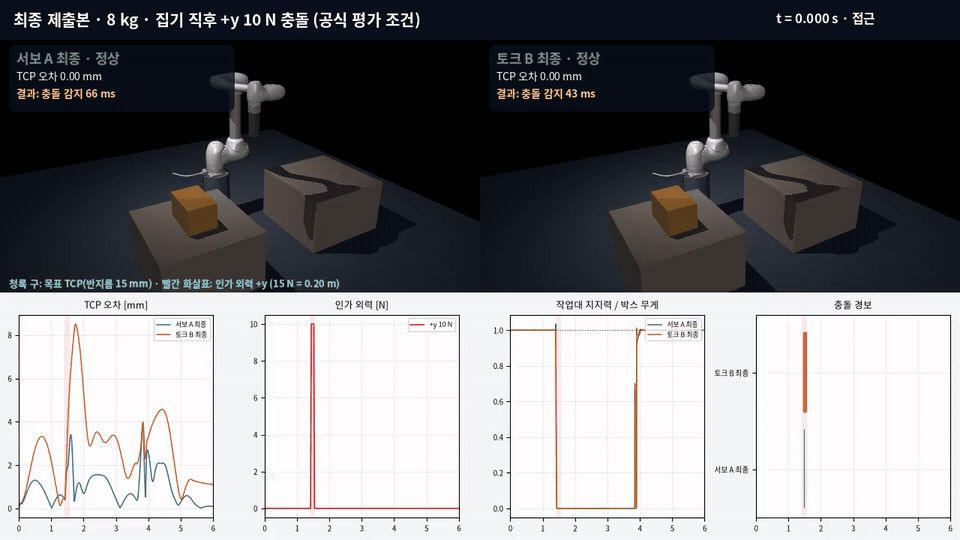

# 팔레타이징 하중 이양: 탄성 관절 제어와 충돌 감지 (Week09 최종)

M1013 팔레타이징 시뮬레이션의 1 ms 제어 주기에서 박스를 작업대에 내려놓는 과제입니다. 감속기 처짐과 수십 ms에 걸친 하중 이양을 제어에 반영하고, 정상적인 하중 변화와 실제 충돌을 구분해 감지해야 합니다. 서보(A)와 토크(B) 두 제어 방식을 모두 다룹니다.

> 이 저장소에는 **직접 작성한 코드와 결과만** 있습니다. 수업 키트의 `sim/`, `model/`, 기준 제어기·감지기, 실행기와 평가기는 포함하지 않습니다.

## 결론부터 보기

**최종 제출본은 [`submission/`](submission/README.md)의 세 파일입니다.** 제어기는 v1에서 새로 작성한 두 제어기를 그대로 씁니다. 충돌 감지기는 제어 방식에 따라 토크에서는 R31, 서보에서는 R32를 쓰도록 한 파일로 조합했습니다.

아래는 변경하지 않은 수업 원본 평가기로 같은 PC에서 측정한 결과입니다. `기준`은 수업 제공 제어기와 제공 감지기, `최종`은 `submission/`의 세 파일입니다.

| 지표 | 기준 서보 A | **최종 서보 A** | 기준 토크 B | **최종 토크 B** |
|---|---:|---:|---:|---:|
| 수평 충돌 검출 (24건) | 12 | **24** | 11 | **24** |
| 놓침 / 충돌 전부터 경보 / 구분 불가 | 4 / 4 / 4 | **0 / 0 / 0** | 5 / 8 / 0 | **0 / 0 / 0** |
| 충돌 없는 동작의 오감지 (0·4·8 kg 합) | 13회 | **0회** | 15회 | **0회** |
| 충돌 실행 중 다른 시각의 오감지 (6조건 합) | 18회 | **0회** | 27회 | **1회** |
| 8 kg TCP 오차 RMS / 최대 | 6.14 / 14.00 mm | **1.17 / 3.91 mm** | 7.04 / 13.18 mm | **3.23 / 8.44 mm** |
| 8 kg 토크 계단 집기 / 놓기 | 57.5 / 73.8 N·m | **9.7 / 14.6 N·m** | 57.2 / 74.8 N·m | **9.0 / 13.1 N·m** |
| 8 kg 놓을 때 작업대 힘 (박스 무게 78.5 N) | 101 N | **79 N** | 295 N | **80 N** |
| 포화 | 0 % | 0 % | 0 % | 0 % |

- **충돌 검출:** 서보는 12건에서 24건, 토크는 11건에서 24건이 됐습니다. 기준은 8 kg에서 판정 자체가 안 되는 칸이 방식마다 8개였습니다. 충돌 전부터 경보가 켜져 있었거나("경보 중"), 충돌이 없어도 같은 시각에 경보가 났기 때문입니다("구분 불가"). 최종은 0개입니다.
- **오감지:** 충돌이 없는 0·4·8 kg 동작에서 서보 13회, 토크 15회이던 오감지가 0회가 됐습니다.
- **추종:** 8 kg TCP 오차 RMS가 서보 6.14→1.17 mm(−81 %), 토크 7.04→3.23 mm(−54 %)로 줄었습니다.
- **내려놓기:** 놓기 토크 계단이 서보 73.8→14.6, 토크 74.8→13.1 N·m로 줄었습니다. 작업대 힘도 박스 무게와 거의 같아졌습니다. 기준은 박스를 부딪히며 내려놓았습니다(서보 101 N, 토크 295 N).
- **더 나빠진 칸:** 일부 칸은 기준보다 늦게 알립니다. 예를 들어 서보 0 kg·3.86 s의 10 N은 기준 50 ms, 최종 131 ms입니다. 빈 집게(0 kg)의 집기 토크 계단도 최종이 더 큽니다(서보 3.7→9.7, 토크 4.7→9.0 N·m). 전체 표는 아래에 있습니다.
- **한계:** 공식 24건은 개발 중에 공개된 조건입니다. 비공개 조건에서의 일반화와 실기 안전은 보장하지 않습니다.

## 단계별로 무엇이 좋아졌나

모든 행은 같은 공식 평가기로 이번에 다시 측정한 값입니다. 원자료는 [`results/final/official/`](results/final/official/servo_stock.txt)에 있습니다.

| 단계 | 바뀐 것 | 충돌 검출 A / B | 무충돌 오감지 A / B | 8 kg RMS A / B |
|---|---|---:|---:|---:|
| 기준 | 수업 제공 제어기·감지기 | 12 / 11 | 13 / 15 | 6.14 / 7.04 mm |
| v1 | 두 제어기를 새로 작성(이후 최종까지 바이트 동일), 첫 감지기 | 16 / 16 | 0 / 0 | 1.17 / 3.23 mm |
| R1 | 정상 동작 데이터로만 맞춘 ridge 잔차·EMA 감지 채널을 v1 경보에 OR | 18 / 18 | 0 / 0 | 동일 |
| R8·R10 | 서보 감지 채널 C1 추가. R10은 같은 검출을 약 2.3배 빠르게 초기화 | 23 / 18 | 0 / 0 | 동일 |
| **최종** | 모드별 감지기 조합: 서보 R32, 토크 R31 | **24 / 24** | **0 / 0** | 동일 |

제어 성능은 v1에서 확보했고, 이후 라운드는 같은 제어기에서 충돌 감지만 개선했습니다. 토크 8 kg·3.00 s 충돌 실행의 오감지 1회는 v1부터 같습니다.

## 공식 평가 전체 표

### 충돌 없는 동작

| 방식 | 박스 | RMS / 최대 mm | 토크 계단 집기 / 놓기 N·m | 작업대 힘 | 오감지 집기 / 놓기 / 기타 |
|---|---|---:|---:|---:|---:|
| A 기준 | 0 kg | 4.69 / 10.49 | 3.7 / 3.3 | 0 N | 0 / 0 / 0 |
| A 기준 | 4 kg | 5.37 / 12.40 | 28.6 / 38.4 | 54 N | 2 / 4 / 0 |
| A 기준 | 8 kg | 6.14 / 14.00 | 57.5 / 73.8 | 101 N | 5 / 2 / 0 |
| **A 최종** | 0 kg | 1.18 / 3.94 | 9.7 / 5.1 | 0 N | 0 / 0 / 0 |
| **A 최종** | 4 kg | 1.15 / 3.79 | 9.7 / 7.6 | 40 N | 0 / 0 / 0 |
| **A 최종** | 8 kg | 1.17 / 3.91 | 9.7 / 14.6 | 79 N | 0 / 0 / 0 |
| B 기준 | 0 kg | 6.27 / 13.10 | 4.7 / 5.3 | 0 N | 0 / 0 / 0 |
| B 기준 | 4 kg | 6.58 / 13.10 | 28.2 / 38.8 | 199 N | 3 / 3 / 0 |
| B 기준 | 8 kg | 7.04 / 13.18 | 57.2 / 74.8 | 295 N | 5 / 4 / 0 |
| **B 최종** | 0 kg | 2.09 / 4.05 | 9.0 / 4.8 | 0 N | 0 / 0 / 0 |
| **B 최종** | 4 kg | 2.32 / 4.42 | 9.0 / 6.8 | 39 N | 0 / 0 / 0 |
| **B 최종** | 8 kg | 3.23 / 8.44 | 9.0 / 13.1 | 80 N | 0 / 0 / 0 |

작업대 힘은 놓을 때 작업대가 박스를 받치는 최대 힘입니다. 박스 무게(4 kg 39.2 N, 8 kg 78.5 N)보다 크면 부딪히며 내려놓았다는 뜻입니다.

### 수평 충돌 감지 지연 (ms)

`놓침`은 미감지입니다. `경보 중`은 충돌 전부터 경보가 켜져 있어 판정할 수 없다는 뜻이고, `구분 불가`는 충돌이 없어도 그 시각(±20 ms)에 경보가 났다는 뜻입니다. 오감지는 그 충돌 실행에서 충돌과 무관한 시각에 울린 횟수입니다.

**서보 A**

| 박스·충돌 시각 | 기준 10 / 15 / 40 / 100 N | 기준 오감지 | **최종** 10 / 15 / 40 / 100 N | 최종 오감지 |
|---|---|---:|---|---:|
| 0 kg·1.42 s (집기 직후) | 놓침 / 놓침 / 28 / 19 | 0회 | **46 / 42 / 36 / 23** | 0회 |
| 0 kg·3.00 s (운반 중) | 놓침 / 97 / 28 / 19 | 0회 | **38 / 32 / 23 / 18** | 0회 |
| 0 kg·3.86 s (놓기 직전) | 50 / 50 / 31 / 20 | 0회 | **131 / 78 / 31 / 19** | 0회 |
| 8 kg·1.42 s | 구분 불가 ×4 | 4회 | **66 / 55 / 36 / 24** | 0회 |
| 8 kg·3.00 s | 놓침 / 68 / 26 / 17 | 8회 | **49 / 37 / 25 / 18** | 0회 |
| 8 kg·3.86 s | 경보 중 ×4 | 6회 | **77 / 67 / 33 / 21** | 0회 |

**토크 B**

| 박스·충돌 시각 | 기준 10 / 15 / 40 / 100 N | 기준 오감지 | **최종** 10 / 15 / 40 / 100 N | 최종 오감지 |
|---|---|---:|---|---:|
| 0 kg·1.42 s (집기 직후) | 놓침 / 놓침 / 27 / 19 | 0회 | **38 / 34 / 26 / 19** | 0회 |
| 0 kg·3.00 s (운반 중) | 놓침 / 놓침 / 27 / 17 | 0회 | **57 / 38 / 25 / 19** | 0회 |
| 0 kg·3.86 s (놓기 직전) | 놓침 / 70 / 29 / 20 | 0회 | **49 / 42 / 30 / 19** | 0회 |
| 8 kg·1.42 s | 경보 중 ×4 | 8회 | **43 / 37 / 27 / 22** | 0회 |
| 8 kg·3.00 s | 97 / 68 / 27 / 17 | 12회 | **56 / 41 / 25 / 18** | 1회 |
| 8 kg·3.86 s | 경보 중 ×4 | 7회 | **86 / 86 / 38 / 22** | 0회 |

이전 제출(R10)과 비교하면 서보는 0 kg·3.86 s의 10 N 한 칸이 놓침에서 131 ms로 바뀌었고, 나머지는 같습니다. 토크는 R10이 놓친 6칸(10·15 N)을 모두 잡았고, 지연은 모든 칸에서 같거나 짧습니다. [R10과의 칸별 비교](docs/FINAL_SUBMISSION.md#후보를-고른-근거)

## 무엇을 바꿨나

### 제어 (v1부터 최종까지 동일)

- **서보 A (`my_servo.py`):** 감속기 처짐과 하중 이양을 반영해 관절 지령을 만듭니다. 시뮬레이터에 명시된 1주기 지령 지연도 보상합니다.
- **토크 B (`my_torque.py`):** 관절 토크 센서 피드백을 제한한 탄성 관절 모터 PD입니다.
- **공유 추정기:** 두 제어기는 감지기와 같은 추정기를 공유합니다. 이 추정기는 엔코더와 관절 토크 센서만으로 외력과 하중 이양을 추정합니다.

### 충돌 감지 (`my_detector.py`)

감지기는 연결된 제어기를 보고 `reset()`에서 방식을 한 번 고릅니다. 1 ms 루프에서는 분기하지 않습니다.

| 제어기 | 감지 방식 | 내용 |
|---|---|---|
| 제공한 토크 제어기 | **R31** | R10에 두 관측을 더했습니다. 기저축 외부 회전 모멘트 추정(R21)과, 집기·놓기 구간의 수평력 관측(R22–R23)입니다. 같은 충격에 경보가 여러 번 울리는 문제는 R24–R31에서 줄였습니다. |
| 제공한 서보 제어기 | **R32** | R10에 지연 수평력 관측을 더했습니다(놓기 직전의 약한 충돌이 목표). 두 관측기의 수평력이 같은 방향일 때만 알리고, 둘 다 안정된 뒤에야 다시 무장합니다. |
| 그 밖의 제어기 | R10 | 공유 추정기의 외력 잔차를 작업대 지지 방향까지 고려해 방향·지속 조건으로 판정합니다. |

연구 단계 코드와 정상 동작 모델 수치를 그대로 한 파일에 연결했고, 새 검출 규칙이나 문턱 조정은 없습니다. 조합 방식과 검증은 [최종 제출본 문서](docs/FINAL_SUBMISSION.md)에 있습니다.

## 영상

최종 제출본(`submission/`)을 그대로 써서 서보 A와 토크 B를 같은 조건에서 나란히 돌린 영상입니다. 공식 평가 조건 중 하나인 8 kg 박스·집기 직후 +y 10 N 충돌이며, 서보 A는 66 ms, 토크 B는 43 ms에 감지하고 오감지는 0회입니다. 공식 평가표와 같은 값입니다. 이미지를 누르면 1280×720 MP4로 볼 수 있습니다.

[](artifacts/media/11_final_servo_torque.mp4)

위쪽은 3D 재생입니다. 청록 구는 목표 TCP, 빨간 화살표는 인가 외력입니다. 아래쪽 그래프는 TCP 오차, 인가 외력, 작업대 지지력/박스 무게, 충돌 경보입니다. 놓을 때 작업대 지지력이 박스 무게(1.0)에 부드럽게 수렴합니다. 이전 버전 비교 영상(기준/v1/R1/R2)은 [R8 README](README_R8.md)에 있습니다.

## 문제별 해결한 부분과 미흡한 부분

| 문제 | 상태 | 해결한 부분 | 미흡한 부분 |
|---|---|---|---|
| TCP 추종·발산 | 해결 (공식) | 8 kg RMS A 6.14→1.17, B 7.04→3.23 mm. 최대 A 14.00→3.91, B 13.18→8.44 mm. 공식 0/4/8 kg에서 발산 없음. | 과거 섭동 34조건에서 토크 최악 TCP는 기준 17.2→45.7 mm로 오히려 나빠졌습니다. |
| 내려놓기 충격 | 해결 (공식) | 놓기 토크 계단 A 73.8→14.6, B 74.8→13.1 N·m. 작업대 힘 A 101→79, B 295→80 N으로 박스 무게(78.5 N) 수준. | 빈 집게의 집기 토크 계단은 기준보다 큽니다. |
| 하중 이양 (G4: 놓기 전 지속 지지) | 미흡 | 별도 착지 제어 연구(R26)는 정상 13조건에서 G4 네 기준을 만족했습니다. | 충돌 보호와 동시에 만족하지 못해 제출 제어는 R1입니다. R1의 놓기 전 마지막 20 ms 평균 지지는 A 0.21, B 11.15 %mg로, 목표 50 %mg에 못 미칩니다. |
| 오감지 | 해결 (공식) | 무충돌 오감지 A 13→0, B 15→0. 충돌 실행 중 오감지 A 18→0, B 27→1. | 토크 8 kg·3.00 s 충돌 실행의 1회가 남았습니다. 공개 385조건 연구 시험에서는 R31 오경보가 9회입니다. |
| 공식 수평 충돌 감지 | 해결 | A 12→24, B 11→24. "경보 중"·"구분 불가"도 A 8→0, B 8→0. | 공식 24건은 개발 중에 공개된 조건입니다. |
| 다방향·약한·연속 충돌 | 부분 | 공개 385조건에서 토크 검출이 R10 111/180에서 R31 154/180이 됐습니다. | 놓은 뒤의 사선 충격, 짧은 간격의 연속 충격, 6 N급 약한 힘, 실제 공구 접촉을 일부 놓칩니다. R33·R34는 더 많이 잡았지만 오경보·중복이 늘어 제외했습니다. |
| 계산 시간 (1 ms) | 부분 | 공식 평가의 평균 계산 시간은 서보 약 32 µs, 토크 약 37 µs입니다. | 최대 지연 1 ms 초과 사례가 남아 있습니다(R24: 48,000주기 중 32주기). 하드 실시간은 보장하지 않습니다. |
| 서보 포화·섭동 오감지 | 미해결 | 공식 0/4/8 kg 포화 0 %. | 공개 정상 189조건 중 2조건에서 서보 포화가 납니다. 섭동 정상 28조건의 오감지는 R8 감지기 기준 A 6회, B 9회였고, 최종 감지기로는 다시 재지 않았습니다. |
| 비공개 조건 일반화 | 미검증 | 후보를 고정한 뒤 독립 시험을 여러 번 열었습니다(R22–R33). | 비공개 질량·무게중심·외력 조건에서의 통과는 보장하지 않습니다. |

### 남은 과제

1. **하중 이양:** 놓기 전 지속 지지(G4)를 충돌 보호와 동시에 만족하는 제어.
2. **다방향·약한 충돌:** 놓은 뒤의 사선 충격, 짧은 간격의 연속 충격, 실제 공구 접촉을 오경보 없이 구분.
3. **최대 1 ms:** 실행 환경 격리와 계산 경량화를 함께 검토한 뒤 대상 환경에서 다시 측정.
4. **서보 포화와 섭동 오감지:** 원인 조건을 식별한 뒤 완화.

## 실행과 재현

수업 키트 폴더(`icpbl_sim`)에 `submission/`의 세 파일을 복사한 뒤 원본 평가기를 실행합니다.

```bash
python evaluate.py --ctrl my_servo --detector my_detector
python evaluate.py --ctrl my_torque --detector my_detector
```

- 최종본 재빌드와 공식 검증: [docs/FINAL_SUBMISSION.md](docs/FINAL_SUBMISSION.md#재현)
- 루트의 `my_servo.py`, `my_torque.py`, `my_detector.py`는 연구 후보들이 상속하는 R10 기준본입니다. R10 검사 방법은 [R10 제출 판정](docs/R10_RELEASE.md)에 있습니다.

## 연구 기록과 문서

- [최종 제출본: 조합 근거·검증·재현](docs/FINAL_SUBMISSION.md)
- [R9–R34 라운드별 요약](docs/RESEARCH_LOG.md) · [R34 연구 최고 기록](docs/FINAL_WEEK09.md)
- [수업 원본 데모 실행과 출처](docs/DEMO_SOURCES.md) · [R8 README](README_R8.md) · [가이드 요구사항 대조](docs/REQUIREMENTS_AUDIT.md)
- [전체 문서 색인](docs/INDEX.md)

원본 평가기는 수정하지 않았습니다. 모든 결과는 시뮬레이션 결과이며, 실물 로봇의 충돌 보호나 정지 기능을 인증하지 않습니다.
