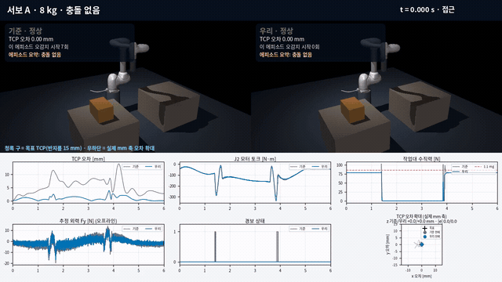
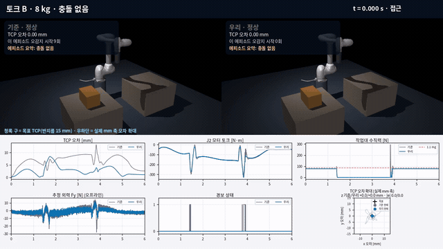
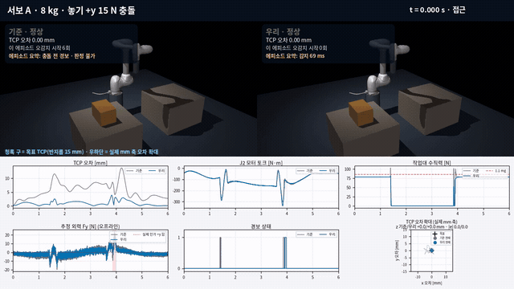
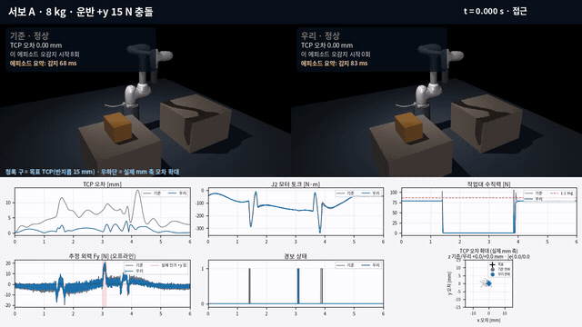

# 팔레타이징 하중 이양: 탄성 관절 제어와 충돌 감지

M1013 팔레타이징 시뮬레이션의 1 ms 고정 제어 주기에서 **감속기 처짐**과 **수십 ms에 걸친 실제 하중 이양**을 제어와 충돌 감지에 함께 반영한 개인 과제입니다. 제어는 기존 서보 구조를 유지하는 A와 모터 토크를 직접 만드는 B를 같은 조건에서 비교했습니다.

> 이 저장소에는 **직접 작성한 코드와 결과만** 있습니다. 별도로 제공되는 실습 키트가 필요하며, 키트의 `sim/`, `model/`, 기준 제어기·감지기, 실행기와 평가기는 포함하지 않습니다. 명목 8 kg 제어 목표는 통과했지만 **전체 수용 기준은 달성하지 못했습니다.**

## 결론부터 보기

같은 PC에서 변경하지 않은 공식 평가기를 실행한 8 kg 결과입니다. `기준` 행은 기준 제어기+기준 감지기, `우리` 행은 최종 제어기+최종 감지기 조합입니다.

| 조합 | TCP RMS / 최대 mm | 토크 계단 집기 / 놓기 N·m | 놓기 작업대 힘 N | 포화 | 오감지 집기 / 놓기 / 기타 |
|---|---:|---:|---:|---:|---:|
| 기준 서보 A | 6.14 / 14.00 | 57.5 / 73.8 | 101 | 0% | 5 / 2 / 0 |
| **우리 서보 A** | **1.17 / 3.91** | **9.7 / 14.6** | **79** | **0%** | **0 / 0 / 0** |
| 기준 토크 B | 7.04 / 13.18 | 57.2 / 74.8 | 295 | 0% | 5 / 4 / 0 |
| **우리 토크 B** | **3.23 / 8.44** | **9.0 / 13.1** | **80** | **0%** | **0 / 0 / 0** |

- A와 B 모두 명목 8 kg의 TCP·토크 계단·작업대 힘·포화 목표를 통과했습니다.
- 최종 A/B의 공식 무충돌 오감지는 0/4/8 kg에서 모두 0입니다.
- 그러나 운반 중 최소 감지력은 **15 N**으로 목표인 `<15 N`에 못 미쳤고, 일부 감지 지연도 기준보다 늘었습니다.
- 770회 층화 강건성 검사에서 방식별 무충돌 189회는 오감지 0이었지만, 충돌은 A 94/180회, B 91/180회만 감지했습니다. 실제 툴 접촉이 생긴 위치 오차 12건은 모두 감지했습니다. 이는 유한 조건 검사이지 실제 충돌 분포의 감지율이 아닙니다.
- A는 강건성 조건 두 개에서 포화했고 가벼운 하중에서 작업대 힘/무게 비가 커졌습니다. 별도 50회 섭동에서는 B가 마찰 변화에 민감했습니다.
- 강건성 검사 중 제어+감지 최악 p99는 A/B 0.309/0.357 ms였지만 관측 최대는 **3.268/3.205 ms**였습니다. 따라서 모든 주기 1 ms 미만이나 hard real-time을 주장하지 않습니다.

세부 공식 8조합, ablation, 실패 판정은 [결과 보고서](report/RESULTS.md)에 있습니다.

## 기준 대비 핵심 차이

기준 제어 계산은 관절을 강체 링크처럼 취급하고 `grip`이 바뀌는 순간 박스 하중 모델을 한 번에 전환합니다. 실제 플랜트에는 감속기 처짐이 있고, 박스 무게는 작업대와 로봇 사이에서 수십 ms에 걸쳐 이동합니다. 우리는 이 두 현상을 제어 FF와 충돌 잔차 해석에 반영했습니다.

### 1. 감속기 처짐을 모터 기준에서 보상한다

탄성 관절 J1–J3에는 링크 목표 대신 다음 모터 목표를 보냅니다.

$$
\theta_d=q_d+K^{-1}\tau_{J,d}
$$

속도 지령은 \(\dot\theta_d\), 토크 FF는 \(B\ddot\theta_d+\tau_{J,d}+\tau_{fric}\)로 만들고 1주기 지령 지연을 앞당겨 보상했습니다. 여기서 \(B\)는 모터 관성, \(\tau_{fric}\)은 명목 점성·쿨롱 마찰 항입니다. 서보 A에서 TCP RMS는 **6.14→1.17 mm**, 놓기 작업대 힘은 **101→79 N**으로 줄었습니다.

다만 처짐 보상 C1만 넣으면 8 kg 집기 토크 계단은 **57.5→107.7 N·m**로 오히려 커집니다. 추종 개선과 하중 전환 개선은 서로 다른 효과이므로 따로 검증했습니다. 이 수치는 모두 **기준 감지기와 결합한 과거 단계 공식 평가**입니다.

### 2. 하중을 grip 순간의 계단이 아니라 연속 비율로 바꾼다

집기 신호 뒤 약 **25 ms** 동안 0→1로 바뀌는 명목 램프 주변으로 JTS 하중 투영값을 제한하고, 저역통과한 실린 하중 비율 \(\hat\lambda\)로 빈손/박스 역동역학을 연속 보간합니다. 필터와 제한 때문에 실제 추정값이 정확히 25 ms에 1에 도달한다는 뜻은 아닙니다. C1의 8 kg 집기 계단은 **107.7→9.7 N·m**로 줄었습니다.

이 개선의 대부분은 궤적 기반 램프 자체에서 나옵니다. 기준 감지기 조합에서 `C1+램프`와 `C1+C2(JTS 추정)`의 공식 집기/놓기 계단은 모두 **9.7/17.7 N·m**입니다. JTS 투영값은 동적으로 흔들리므로 램프 가까운 범위로 제한했습니다. 따라서 이 결과를 자유로운 실하중 식별 성능으로 해석하지 않습니다.

놓기 직전에는 예정 하중을 10% 줄이지만 효과가 작았습니다. 최종 A의 놓기 계단은 14.6 N·m로 남고, 마지막 20 ms의 지속적인 작업대 지지도 확보하지 못했습니다. **놓기 전에 하중을 충분히 넘긴다는 목표는 미달**입니다.

### 3. 잔차를 6축 렌치로 바꾸고 작업대가 설명할 수 있는 힘을 제거한다

기준 감지기는 관절 잔차를 축별 임계값과 직접 비교합니다. 우리는 다음 순서로 판정합니다.

1. 온라인 JTS 영점·느린 드리프트 보정과 운동량 관측기로 관절 외력 잔차를 구합니다.
2. \(\hat w=J_b^{-T}r\)로 잔차를 **박스 바닥 중심의 6축 힘·모멘트**로 변환합니다.
3. 흡착 중이고 박스 질량이 양수이며 바닥이 교시 작업대 높이 근처일 때만 작업대 지지를 허용합니다.
4. 작업대가 낼 수 있는 위쪽 법선력, 작은 마찰력, 박스 바닥 안의 압력 중심(COP), 제한된 비틀림을 투영해 뺍니다.
5. 남은 수평력, 아래로 당기는 힘, COP 이탈, 비틀림, 접촉 불가 높이의 양의 수직력을 충돌 증거로 봅니다.

기준 서보 제어기 조합의 8 kg ablation에서 속도 추정+영점 보정까지 적용한 `+V+B`는 집기/놓기 오감지가 **3/3회** 남았습니다. 렌치 분해를 넣고 즉시 판정한 `+V+B+W`에서 **0/0회**가 됐습니다.

대신 보수적인 수평 대칭 임계값과 지속 조건을 충돌 없는 데이터만으로 정했기 때문에 작은 충돌은 느려지거나 놓칩니다. 8 kg 운반 +y 15 N에서:

- 기준 서보+기준 감지기: **68 ms**, 충돌 조건별 최대 오감지 8회
- 기준 서보+`+V+B+W` 즉시 판정: **53 ms**, 오감지 0회
- 기준 서보+최종 감지기: **77 ms**, 오감지 0회
- 최종 A+최종 감지기: **83 ms**, 오감지 0회

즉, 렌치 분해와 렌치 공간 즉시 판정을 함께 적용한 W 단계는 정상 하중 이양 오감지를 없애면서 빠르게 반응했지만, 최종 무충돌 보정·지속 조건의 대가로 15 N 지연이 늘었습니다. W와 임계값 체계가 함께 바뀌므로 각각의 인과 효과를 이 한 행만으로 분리하지 않습니다. 같은 작업대 법선 위에서 같은 COP로 들어오는 수직 충돌은 정상 작업대 지지와 같은 렌치를 만들 수 있어 **이 신호만으로 원리적으로 구분할 수 없습니다.**

### 4. 토크 방식 B와 공유 추정기

B도 같은 탄성 기준과 FF를 사용하고, 모터 쪽 PD와 작은 JTS 토크 피드백을 추가합니다. 최종 B+최종 감지기에서 TCP RMS는 **7.04→3.23 mm**, 놓기 작업대 힘은 **295→80 N**으로 줄었습니다. 그러나 A보다 정확도가 낮고, 분석 전용 마찰/강성 섭동에서 TCP 최대 17.26 mm와 작업대 힘 138.46 N까지 악화돼 명목 마찰 모델 변화에 더 민감했습니다.

세 최종 파일은 같은 `SharedEstimator`를 자체 내장합니다. 감지기가 먼저 계산하면 제어기가 같은 시각의 캐시를 읽습니다. 공유 on/off의 물리 로그·잔차·판정은 같았고 추정기 갱신은 6초당 **12000→6000회**로 줄었습니다. 이는 전체 제어 계산 시간이 정확히 절반이라는 뜻은 아닙니다. `my_servo.py`, `my_torque.py`, `my_detector.py`는 서로 없어도 각각 동작합니다.

### 사용한 정보 경계

기준과 같은 입력(모터 엔코더 각·속도, JTS, 감지기 인터페이스로 제공되지만 최종 방식에서는 쓰지 않는 모터 토크, `grip`, 기준 궤적, 알려진 박스 질량·COM)에 공개된 명목값(박스 크기·위치, 강성·모터 관성·마찰, 집기·놓기 시각)을 더해 사용합니다. **설정된 JTS 오프셋·드리프트·난수 시드는 읽지 않으며 온라인으로만 편향을 추정합니다.** 마찰 FF는 공개된 명목 마찰값을 사용하므로 실제 마찰이 달라지면 특히 B의 성능이 떨어질 수 있습니다.

## 기준과 우리 방식 비교 영상

왼쪽은 기준, 오른쪽은 우리 방식입니다. 같은 카메라의 MuJoCo 3D 재생과 같은 시각의 그래프를 함께 표시했습니다. 집기·놓기 구간은 느리게 재생합니다. 작은 TCP 차이는 목표 TCP 마커와 실제 mm 눈금을 쓴 우하단 XY 오차 확대 화면으로 확인합니다. z 오차와 전체 크기도 함께 표기하며, 힘 화살표의 시각화 배율은 화면에 밝힙니다. 물리량 자체는 바꾸지 않았습니다. 그림을 누르면 1280×720 MP4가 열립니다.

### 01. 서보 A, 8 kg, 충돌 없음

[](artifacts/media/01_servo_no_collision.mp4)

TCP 오차, 모터 토크, 작업대 힘과 1.1 mg 선, 경보 타임라인을 비교합니다.

### 02. 토크 B, 8 kg, 충돌 없음

[](artifacts/media/02_torque_no_collision.mp4)

B의 기준 놓기 충격과 최종 방식의 TCP·토크·작업대 힘 차이를 비교합니다. 마찰 변화 민감성은 영상 조건이 아니라 아래 한계와 별도 섭동 결과에 기록했습니다.

### 03. 서보 A, 8 kg, 놓기 +y 15 N 충돌(3.86 s)

[](artifacts/media/03_servo_place_collision.mp4)

기준은 충돌 전에 이미 경보 중이라 지연을 잴 수 없고, 최종 A는 충돌 뒤 **69 ms**에 감지합니다. 충돌 힘 화살표와 추정 외력도 표시합니다.

### 04. 서보 A, 8 kg, 운반 +y 15 N 충돌(3.00 s)

[](artifacts/media/04_servo_transport_collision.mp4)

기준은 **68 ms**이지만 충돌 조건별 최대 오감지가 8회이고, 최종 A는 오감지 0회 대신 **83 ms**로 느립니다. 개선되지 않은 지연도 그대로 보여 줍니다.

영상의 외력 그래프는 감지기 관절 잔차를 **분석 전용 실제 링크각**으로 구한 자코비안에 변환한 값입니다. 이 실제 링크각은 제어기·감지기의 입력에 전달하지 않으며, 최종 감지기 내부의 추정 링크각으로 계산한 렌치와는 다를 수 있습니다.

영상 조건·생성 명령·길이·프레임 수·SHA-256은 [`media_manifest.json`](artifacts/media/media_manifest.json)에 기록합니다.

## 못 미친 것과 한계

- **전체 수용 기준 미달:** 운반 최소 감지력은 15 N으로 `<15 N` 목표에 못 미쳤고, 같은 PC 기준보다 느린 조건이 있습니다. 최종 토크 B의 8 kg 운반 충돌 공식 평가에는 추가 오감지 최대 1회가 있습니다.
- **놓기 전 하중 이양 미달:** 10% 예정 감소와 10% 지지 융합은 놓기 계단을 줄였지만, release 전에 하중을 지속적으로 작업대에 넘기지는 못했습니다.
- **유한 강건성 검사:** 방식별 189 무충돌+180 충돌+16 위치 오차, 합계 770회입니다. 전체 Cartesian 조합이나 실제 사건 확률이 아닙니다. A는 두 COM 조건에서 포화했고 가벼운 박스에서 힘/무게 비가 컸습니다.
- **마찰·강성 민감성:** 분석 전용 50회 섭동에서 세 잡음 seed만 바꾼 경우는 오감지 0이었지만 강성/corner 조건은 오감지를 만들었습니다. B는 마찰 변화에 특히 민감했습니다.
- **구분 불가능한 접촉:** 작업대 법선과 같은 수직선 위에서 같은 COP로 들어오는 수직 충돌은 정상 지지와 구분할 수 없습니다. 추가 센서나 접촉 모델, 공정 변경이 필요합니다.
- **실시간·안전 보장 아님:** stress timing의 최대는 3 ms를 넘었습니다. 충돌 뒤 정지·후퇴를 구현하지 않았고, 실기 검증이나 안전 인증을 하지 않았습니다.
- 최종 임계값은 수평 방향 대칭으로 만들고 충돌 없는 학습 24회와 분리 holdout 12회에서 고정한 뒤 충돌을 평가했습니다. 과거의 방향 편향 후보는 폐기했습니다.

## 실행 방법

별도로 받은 키트의 **폐기 가능한 작업 사본** 루트에 `my_servo.py`, `my_torque.py`, `my_detector.py`, `tools/`를 겹쳐 놓습니다. 키트의 `sim/`, `model/`, 기준 모듈, 평가기는 수정하지 말고 키트 README도 이 README로 덮어쓰지 않습니다. 평가 출력용 `results/`는 미리 만들고, 배포 결과와 미디어 자체를 다시 검증할 때는 이 저장소의 `results/`와 `artifacts/media/`도 복사합니다. 의존성은 작업 사본의 가상환경에만 설치합니다. 기록한 환경은 Python 3.12.3, MuJoCo 3.17.0, NumPy 2.5.4입니다.

```bash
env -u PYTHONPATH PYTHONDONTWRITEBYTECODE=1 .venv/bin/python tools/check_integrity.py

mkdir -p results

# 서보 A + 최종 감지기
env -u PYTHONPATH PYTHONDONTWRITEBYTECODE=1 .venv/bin/python \
  tools/evaluate_checked.py --ctrl my_servo --detector my_detector \
  --out results/evaluation_A.txt

# 토크 B + 최종 감지기
env -u PYTHONPATH PYTHONDONTWRITEBYTECODE=1 .venv/bin/python \
  tools/evaluate_checked.py --ctrl my_torque --detector my_detector \
  --out results/evaluation_B.txt
```

무결성 wrapper는 확인 뒤 원래 키트의 다음 명령과 같은 평가를 실행합니다. 세 최종 모듈은 NumPy, MuJoCo와 키트의 공개 `sim.trajectory`/`sim.config` 읽기만 사용합니다.

```bash
evaluate.py --ctrl my_servo --detector my_detector
evaluate.py --ctrl my_torque --detector my_detector
```

기준 평가와 sweep 재현, 가상환경 생성, 강건성 실험 명령은 [재현 문서](report/REPRODUCE.md)에 있습니다. 아래 공개 패키지 검사는 **공개 저장소 루트**에서 실행합니다(키트가 들어 있는 작업 사본 루트는 공개 범위가 아니므로 검사 대상이 아닙니다). 로컬 `ffprobe`가 필요하며, 없거나 미디어 메타데이터를 읽지 못하면 실패로 처리합니다. `ffprobe`를 PATH에 두거나 `--ffprobe`로 지정한 뒤 검사합니다.

```bash
FFPROBE="$(command -v ffprobe)"
test -n "$FFPROBE"
env -u PYTHONPATH PYTHONDONTWRITEBYTECODE=1 python3 tools/audit_public.py . --require-media --ffprobe "$FFPROBE"
env -u PYTHONPATH PYTHONDONTWRITEBYTECODE=1 python3 tools/validate_media.py --root . --ffprobe "$FFPROBE"
sha256sum -c artifacts/SHA256SUMS
```

## 자료와 저장소 구조

- [전체 결과·공식 8조합·ablation·목표 판정](report/RESULTS.md)
- [재현 절차와 환경 경계](report/REPRODUCE.md)
- [방법과 수식](docs/METHOD.md), [한계](docs/LIMITATIONS.md), [일차 문헌](docs/REFERENCES.md)
- [16쪽 발표 자료](results/presentation.pdf), [한국어 발표 노트](docs/PRESENTATION_KO.md)
- [서보 A 그래프](results/figures/control_servo.png), [토크 B 그래프](results/figures/control_torque.png)
- [A 실패 지도](results/figures/failure_map_servo.png), [B 실패 지도](results/figures/failure_map_torque.png)
- [분석 전용 섭동 결과](results/D4_PERTURBATIONS.md)
- [영상 manifest](artifacts/media/media_manifest.json), [전체 체크섬](artifacts/SHA256SUMS)

| 경로 | 내용 |
|---|---|
| `my_servo.py`, `my_torque.py`, `my_detector.py` | 서로 독립 실행 가능한 최종 단일 파일 |
| `experiments/` | 직접 작성한 과거 단계와 ablation wrapper |
| `tools/` | 무결성 확인, 평가 wrapper, sweep, 보정·분석·그림 도구와 테스트 |
| `results/` | 공식 평가 텍스트, JSON/CSV, 그래프와 발표 자료 |
| `artifacts/media/` | 기준 대비 MP4, GIF 미리보기, 생성 manifest |
| `report/`, `docs/` | 결과, 재현, 방법, 한계와 참고 문헌 |

## 라이선스와 외부 코드

직접 작성한 코드는 [BSD 3-Clause](LICENSE)로 공개합니다. 별도 실습 키트, 가이드, 시뮬레이터 코드·모델, MuJoCo 바이너리는 재배포하지 않으며 이 저장소의 라이선스가 이들을 허가하지 않습니다. 외부 모델·런타임과 저작권 고지는 [THIRD_PARTY_NOTICES](THIRD_PARTY_NOTICES)를 확인하세요.

이 결과는 시뮬레이션 연구이며 Doosan Robotics 또는 외부 의존성 저자의 보증·승인을 뜻하지 않습니다.
