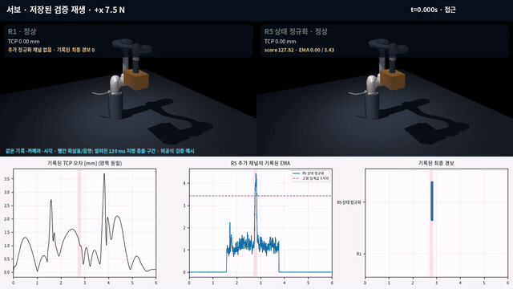
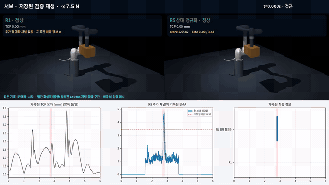

# Week09 R8 — C1 감지 채널 채택과 남은 과제

## R8 추가 검증 — C1 채택(사용자 결정으로 복원)

C1 채택(사용자 결정으로 복원). B5에서 fallback된 이유는 우리가 만든 import 허용 목록(numpy, mujoco, sim)이었다. 가이드에는 import 제한이 없으며, 숨은 내부값 접근과 sim 변경 금지·Part 3 허용 입력 규칙은 그대로다. 허용 목록에 표준 모듈 io, base64, collections만 추가했고 금지 이름 검사는 유지했다. R7 기록 시험은 보관된 R7 파일에 묶어 SHA 결속·변경 거부 검사를 유지했다. 후보 바이트·모델·임계·관문 숫자와 B4 holdout·B5 공식 결과는 그대로이며 다시 실행하지 않았다. 이는 결과를 본 뒤의 사용자 결정에 따른 예외이며 R7에도 채택 복원 선례가 있다. B5 fallback 기록은 R8_ADOPTION.json의 기존 최상위 필드에 보존하고, 현재 판정은 추가한 restoration 항목에 기록했다.

| 세트 | 조건 | 기존 최종 | C1 | 추가 | 손실 | 오감지 증가 조건 |
| --- | --- | --- | --- | --- | --- | --- |
| 서보 D4 개발 | 385 | 119 | 138 | 19 | 0 | 0 |
| 서보 독립 약충돌 | 96 | 60 | 74 | 14 | 0 | 0 |
| 서보 섭동 | 43 | 6 | 6 | 0 | 0 | 0 |
| 토크 D4 개발 | 385 | 111 | 111 | 0 | 0 | 0 |
| 서보 새 holdout | 90 | 66 | 74 | 8 | 0 | 0 |
| 토크 새 holdout | 90 | 61 | 61 | 0 | 0 | 0 |

- 최종 제어는 서보·토크 모두 R1, 감지는 서보 C1(R7 + L2d)·토크 R1이다. 바뀐 제출 파일은 my_detector.py 하나다.
- B4 한 배치 456회에서 서보 66→74/90(+8), 손실·조건별 오감지 증가 0. B5 공식은 서보 18→23/24, 토크 18→18/24다. 아래 수치는 보존 결과이며 재실행하지 않았다.
- 1 ms 최대는 더 나빠졌다. 서보 holdout 1 ms 초과 0→14주기·최대 1.59 ms, 감사 최대 7.99 ms다. p99 675.362 µs는 관문 800 µs 안이다.
- 실제 C1 최종에서 작업 전체 778시험·기본 계약 8건·보고 check 통과. B1의 잘못된 전체 시험 경로와 B5 fallback 기록은 보존했다.
- G4·기존 섭동 오감지·약한 수직 충돌·숨은 조건·토크 감지 이득 없음은 미달 그대로다. 착지는 채택하지 않았다.

[상세 결과](docs/R8_RESULTS.md) · [방법·재현](docs/R8_METHODS.md) · [원래 R7 README](docs/R7_README.md)

아래 R7 전용 표·실행 횟수·판정 복원 경위는 당시 기록이다. 현재 문제 표만 R8 결과에 맞게 갱신했다. 기존 영상은 R7 설명이며 C1의 새 효능 영상이 아니다.

**최종 제출: 제어는 서보·토크 모두 R1, 감지는 서보 C1(R7 + L2d), 토크 R1이다. C1은 사용자 결정으로 복원했다.**

[문제 상황과 해결해야 할 과제](#문제-상황과-해결해야-할-과제) · [문제별 해결한 부분과 미흡한 부분](#2-문제별-해결한-부분과-미흡한-부분)

## 판정 복원 경위

S5 문서 연결 검사 뒤 R1으로 되돌린 기록은 보존했다. 이후 명시적 사용자 결정 ‘서보 후보 채택 복원’에 따라 A 서보 후보를 최종 제출에 복원했다. protocol의 되돌림 조건과 실행 순서에는 문서 연결 검사가 포함되지 않는다. 후보·자료·관문 숫자는 바꾸지 않았고 시뮬레이션·holdout·공식 평가는 다시 실행하지 않았다. 복원한 최종 조립으로 작업 사본 688개와 공개형 사본 569개 전체 테스트, 각 기본 제출 계약 8개를 새로 통과했다. 기존 677개 기록은 S4 후보 계약의 보존값이며 이번 테스트 수와 합치지 않는다.

기준=초기 제공본, v1=첫 개선본, R1=고정 비교 제어·감지기, R7=후보 바이트와 판정 규칙은 그대로 두고 결과 기록 경로만 고친 재검증본이다. A=서보, B=토크, FA=오감지다.

| R1 A 서보 | R1 B 토크 | 기준/v1/R1/R2 A | 기준/v1/R1/R2 B |
|---|---|---|---|
|  |  |  |  |

| R7 양성 비교 | R7 음성 비교 |
|---|---|
|  |  |

09/10은 R5 저장 validation 장면을 비트 동등성 근거로 다시 쓴 설명용 비교다. 새 holdout 효능 영상이 아니다.

## 결론과 근거

A 서보에는 기록 결함을 고친 검증 경로로 확인한 SCALE_STATE 감지 채널을 채택했고, B 토크는 R1을 유지했다. NumPy scalar만 기본 JSON형으로 엄격하게 바꾸고 배열·NaN·무한대·비문자 key는 거부했다. 후보·모델 263개 파라미터·임계값·정규화·R1 제어기·관문 숫자는 바꾸지 않았다. 사전 전체 677개와 최종 전체 677개, 기본 이름 8개 검사가 통과했다. 저장 자료 990개(방식별 495개)의 실제 감지기 출력과 새 조건 8회의 물리 8배열을 dtype·shape·바이트 단위로 비교해 모두 같았다. 상세는 [R7 결과](docs/R7_RESULTS.md), [R7 방법](docs/R7_METHODS.md), [발표 PDF](results/presentation.pdf)에 있다.

## 기준/v1/R1/R7 — T1~T6

| 항목 | 기준 | v1 | R1 | R7 |
|---|---|---|---|---|
| T1: 놓기 전 마지막 20 ms 평균 지지율 [%mg] | A 0.0000; B 0.0557 | A 0.2098; B 11.1507 | A 0.2098; B 11.1507 | A 0.2098; B 11.1507 |
| T2: 놓기 토크 계단 [N·m] | A 73.842; B 74.797 | A 14.626; B 13.126 | A 14.626; B 13.126 | A 14.626; B 13.126 |
| T3: 분석 섭동 최악 TCP/놓기힘/FA | A 22.731 mm / 208.997 N / FA 221; B 17.171 mm / 352.140 N / FA 309 | A 14.777 mm / 212.734 N / FA 4; B 45.652 mm / 362.600 N / FA 8 | A 14.777 mm / 212.734 N / FA 6; B 45.652 mm / 362.600 N / FA 10 | A 14.777 mm / 212.734 N / FA 6; B 45.652 mm / 362.600 N / FA 10 (과거 전체 34조건 R1 보존·새 실행 아님) |
| T4: D4 reference 포화/놓기 peak | A sat 0/189, peak 2.0359 mg; B sat 0/189, peak 9.8822 mg | A sat 2/189, peak 1.6098 mg; B sat 0/189, peak 1.0358 mg | A sat 2/189, peak 1.6098 mg; B sat 0/189, peak 1.0358 mg | A sat 2/189, peak 1.6098 mg; B sat 0/189, peak 1.0358 mg |
| T5: 8 kg TCP RMS/최대 [mm] | A 6.144/14.000; B 7.042/13.183 | A 1.174/3.914; B 3.232/8.444 | A 1.174/3.914; B 3.232/8.444 | A 1.174/3.914; B 3.232/8.444 |
| T6: D4 검출/놓침/선행 경보 | A 88/43/49; B 78/42/60 | A 94/86/0; B 91/89/0 | A 111/69/0; B 111/69/0 | A 119/61/0; B 111/69/0 |

T1/T2/T4/T5 물리값은 감지 채널 변경과 무관해 R1과 같다. T3은 과거 전체 34조건 보존값이다. T6의 저장 평가값은 990개 신호 스트림 동등성으로 승계하며 새 효능 측정으로 세지 않는다.

## 저장 자료로 승계한 단계

| 단계 | A 서보 | B 토크 | 성격 |
|---|---|---|---|
| validation | 13→15/30 | 11→11/30 | 저장 자료 비트 동등성으로 승계 |
| development | 13→18/30 | 12→12/30 | 저장 자료 비트 동등성으로 승계 |
| D4 | 111→119/180; reference FA 0 | 111→111/180; reference FA 0 | 노출 분석 replay·새 독립 holdout 아님 |
| 섭동 | 28 reference FA 6→6; 전체 34 FA 6→6 | 28 reference FA 9→9; 전체 34 FA 10→10 | 노출 분석 replay·새 독립 holdout 아님 |

## 새 holdout 1 batch

| 방식 | 파일 | 충돌 검출 | 오감지 | R1 계산 시간 | 시험 계산 시간 | 판정 |
|---|---|---|---|---|---|---|
| A 서보 | SCALE_STATE | 18→21/30, 추가 +3, 손실 0, 도구 손실 0 | 전체 0→0; reference 0→0; offset 0→0; 증가 조건 0 | p99 374.917 / 최대 1528.257 µs / 1 ms 초과 3주기 | p99 465.240 / 최대 1372.406 µs / 1 ms 초과 1주기 | 통과 |
| B 토크 | R7 파일(토크 R1 분기) | 21→21/30, 추가 +0, 손실 0, 도구 손실 0 | 전체 2→2; reference 0→0; offset 1→1; 증가 조건 0 | p99 397.390 / 최대 1764.614 µs / 1 ms 초과 4주기 | p99 360.983 / 최대 2210.500 µs / 1 ms 초과 3주기 | 통과 |

실행된 값만 적었다. 실행 전 실패 경로에서는 `미실행`으로 표시한다.

## 계산 시간

| 방식 | 비교 파일 | 에피소드 | 감지 p99/최대 [µs] | 합산 p99/최대 [µs] | 1 ms 초과 | 보존 outlier |
|---|---|---|---|---|---|---|
| A 서보 | R5_A | 2 | 397.976 / 752.672 | 454.543 / 809.732 | 0 | 0 |
| A 서보 | R7 | 2 | 392.622 / 658.601 | 447.166 / 693.191 | 0 | 0 |
| B 토크 | R1 | 2 | 283.962 / 696.042 | 348.861 / 737.872 | 0 | 0 |
| B 토크 | R7 | 2 | 287.212 / 668.441 | 347.033 / 707.801 | 0 | 0 |

위 표는 사전 시험과 별개인 실제 full-loop 대조 8회다. 새 holdout의 R1·시험 p99, 최대, 1 ms 초과 주기 수는 holdout 표에 모두 적었다. p99 800 µs는 선택 관문이고 최대 1 ms는 목표다.

## R7 새 공식 1 batch — 0/4/8 kg

| 방식 | 질량 | TCP RMS/최대 | 포화 | 집기/놓기 계단 | 오감지 | 상태 |
|---|---|---|---|---|---|---|
| A 서보 | 0.0 kg | 1.18 / 3.94 mm | 0.0 % | 9.7 / 5.1 N·m | 0 / 0 / 0 | 정상 |
| A 서보 | 4.0 kg | 1.15 / 3.79 mm | 0.0 % | 9.7 / 7.6 N·m | 0 / 0 / 0 | 정상 |
| A 서보 | 8.0 kg | 1.17 / 3.91 mm | 0.0 % | 9.7 / 14.6 N·m | 0 / 0 / 0 | 정상 |
| B 토크 | 0.0 kg | 2.09 / 4.05 mm | 0.0 % | 9.0 / 4.8 N·m | 0 / 0 / 0 | 정상 |
| B 토크 | 4.0 kg | 2.32 / 4.42 mm | 0.0 % | 9.0 / 6.8 N·m | 0 / 0 / 0 | 정상 |
| B 토크 | 8.0 kg | 3.23 / 8.44 mm | 0.0 % | 9.0 / 13.1 N·m | 0 / 0 / 0 | 정상 |

## R7 새 공식 1 batch — 전체 10/15/40/100 N 충돌표

| 방식 | 질량/시각 | 10 N | 15 N | 40 N | 100 N | 충돌 세트 FA | 최소 검출력 |
|---|---|---|---|---|---|---|---|
| A 서보 | 0 kg / 1.42 s | 놓침 | 놓침 | 36 | 23 | 0회 | 40 N |
| A 서보 | 0 kg / 3 s | 38 | 32 | 23 | 18 | 0회 | 10 N |
| A 서보 | 0 kg / 3.86 s | 놓침 | 78 | 31 | 19 | 0회 | 15 N |
| A 서보 | 8 kg / 1.42 s | 놓침 | 놓침 | 36 | 24 | 0회 | 40 N |
| A 서보 | 8 kg / 3 s | 49 | 37 | 25 | 18 | 0회 | 10 N |
| A 서보 | 8 kg / 3.86 s | 놓침 | 69 | 33 | 21 | 0회 | 15 N |
| B 토크 | 0 kg / 1.42 s | 놓침 | 놓침 | 37 | 22 | 0회 | 40 N |
| B 토크 | 0 kg / 3 s | 57 | 42 | 27 | 19 | 0회 | 10 N |
| B 토크 | 0 kg / 3.86 s | 놓침 | 78 | 30 | 19 | 0회 | 15 N |
| B 토크 | 8 kg / 1.42 s | 놓침 | 놓침 | 36 | 24 | 0회 | 40 N |
| B 토크 | 8 kg / 3 s | 56 | 43 | 26 | 18 | 1회 | 10 N |
| B 토크 | 8 kg / 3.86 s | 놓침 | 91 | 42 | 22 | 0회 | 15 N |

B 토크 8 kg, 3.0 s의 충돌 세트 FA 1회를 포함했다. `R5_OFFICIAL_REGRESSION.json`의 `R3_delay_ms`와 `R3_false_alarms`는 이름과 달리 R5 후보 값을 담는다. 과거 JSON은 바꾸지 않았고 R7은 `tested_delay_ms`와 `tested_false_alarms`를 쓴다.

## 공식 R1과 R7 실측 비교

| 방식 | 질량 | R1 TCP RMS/최대 | R7 TCP RMS/최대 | R1 집기/놓기 | R7 집기/놓기 |
|---|---|---|---|---|---|
| A 서보 | 0.0 kg | 1.18 / 3.94 mm | 1.18 / 3.94 mm | 9.7 / 5.1 N·m | 9.7 / 5.1 N·m |
| A 서보 | 4.0 kg | 1.15 / 3.79 mm | 1.15 / 3.79 mm | 9.7 / 7.6 N·m | 9.7 / 7.6 N·m |
| A 서보 | 8.0 kg | 1.17 / 3.91 mm | 1.17 / 3.91 mm | 9.7 / 14.6 N·m | 9.7 / 14.6 N·m |
| B 토크 | 0.0 kg | 2.09 / 4.05 mm | 2.09 / 4.05 mm | 9.0 / 4.8 N·m | 9.0 / 4.8 N·m |
| B 토크 | 4.0 kg | 2.32 / 4.42 mm | 2.32 / 4.42 mm | 9.0 / 6.8 N·m | 9.0 / 6.8 N·m |
| B 토크 | 8.0 kg | 3.23 / 8.44 mm | 3.23 / 8.44 mm | 9.0 / 13.1 N·m | 9.0 / 13.1 N·m |

8 kg, 3.0 s 운반 충돌의 R1/R7 비교다.

| 방식 | R1 10/15/40/100 N | R7 10/15/40/100 N | R1/R7 충돌 세트 FA |
|---|---|---|---|
| A 서보 | 62 / 45 / 27 / 18 | 49 / 37 / 25 / 18 | 0회 / 0회 |
| B 토크 | 56 / 43 / 26 / 18 | 56 / 43 / 26 / 18 | 1회 / 1회 |

## 요구사항 점검

가이드 33개 항목은 24개 충족, 4개 부분 충족, 5개 판정 불가다. 런타임 입력·제출 형식·무결성 8개 검사는 모두 통과했다. 최종 감지 파일이 바뀌어도 허용 입력과 제어기를 바꾸지 않아 이 판정은 유지된다. 상세는 [요구사항 점검](docs/REQUIREMENTS_AUDIT.md)에 있다.

## 평가기 점검과 R1 놓침

원본 평가기는 조건·집계·출력에서 판정을 뒤집는 결함이 확인되지 않았다. R1의 공식 8 kg 놓침 6건은 두 방식에서 집기 1.42 s의 10·15 N, 놓기 3.86 s의 10 N이며, 연속성·그립·정상 분기·임계 조건의 결과다. [평가기 점검과 미검출 원인](docs/R4_README.md#평가기-점검과-미검출-원인)을 함께 본다.

## 문제 상황과 해결해야 할 과제

기존 측정과 문서에서 확인한 남은 문제다. 새 실험 결과가 아니며, 확인된 관찰과 미확정 원인을 구분한다.

### 1. 문제 상황

| 문제 | 현재 값 | 원인(확인/미확정) | 근거 문서 |
|---|---|---|---|
| 하중 이양(G4) 미달 | G4 기준은 마지막 20 ms 평균 ≥50 %mg, 최소 ≥25 %mg, v1 대비 +25 %p, 놓기 힘 ≤1.1 mg다. 현재 A는 평균 0.2098, 최소 0.0000, 증가 0, peak 1.0045; B는 평균 11.1507, 최소 0.3802, 증가 0, peak 1.0140이다. | 확인: P0에서 놓기 50–57 ms 전 접촉 뒤 반발·접촉 손실이 관측됐다. 40회 변위 탐색 모두 미달. 지속 지지에 필요한 실현 가능한 변위·속도는 미식별이다. | [P0 물리 측정](docs/R2_README.md#무엇을-시도했고-왜-유지했나), [요구사항](docs/REQUIREMENTS_AUDIT.md) |
| 약한 집기·놓기 충돌 놓침 | 서보는 기존 최종 대비 holdout 66→74/90(+8), 공식 18→23/24로 개선됐다. 사건·툴 손실과 조건별 오감지 증가 0이다. 토크 공식 18/24는 그대로다. | 기존 R1 신호 분석은 게이트·연속 표본 조건·정상 점수 겹침을 확인했다. L2d의 부분 개선이지 모든 수직 약충돌 분리 보장은 아니다. | [R8 결과](docs/R8_RESULTS.md), [과거 신호 측정](docs/R4_README.md#평가기-점검과-미검출-원인) |
| 최대 1 ms 초과 | R8 서보 holdout 합산 p99 406.149→675.362 µs, 최대 701.350→1587.216 µs, 1 ms 초과 0→14주기로 더 나빠졌다. 감사 최대는 7991.764 µs다. | p99 800 µs 관문은 통과하나 최대 1 ms는 미달이다. 최대치의 단일 원인은 미확정이며 서로 다른 감사/holdout 사건을 합치지 않는다. | [R8 시간](docs/R8_RESULTS.md#3-계산-시간--이상치를-모두-포함) |
| 섭동 오감지 | 무충돌 섭동 28 reference FA는 A 6→6, B 9→9다. 전체 34조건은 A 6, B 10회다. | 원인은 미확정이다. 다른 후보의 FA 증가가 강성 ±20 % 변경 조건에 모인 기록은 있지만, 강성이 유일한 원인이라는 증명은 아니다. | [섭동 집계](docs/R7_RESULTS.md), [다른 후보의 강성별 분포](docs/R4_RESULTS.md#w40-오감지가-늘어난-조건) |
| 서보 포화 | D4 R1 A 서보 포화는 2/189 조건이다. 후보 채택 여부와 별개로 이 한계를 공개한다. | 원인은 미확정이다. 해당 조건과 포화 시점의 원인 확인이 남았다. | [D4 결과](docs/R7_RESULTS.md) |
| 토크 감지 개선 없음 | R5 토크 SCALE_STATE는 D4 추가 검출 +5 (기준 6), reference FA 9→10 (전체 34조건 10→11)로 탈락. B는 R1이다. | 확인: 추가 검출과 오감지 관문에 미달했다. 개선을 막은 특징·물리 원인은 미확정이다. | [R5 후보별 판정](docs/R5_RESULTS.md) |
| 숨은 조건 일반화 미검증 | 15주차 비공개 질량·COM·외력 조건에는 접근할 수 없다. | 검증 범위의 한계다. 유한 holdout은 대리 시험일 뿐 비공개 조건 통과의 증명이 아니다. | [일반화 요구사항](docs/REQUIREMENTS_AUDIT.md) |
| 계산 비용 증가 | R8 서보 holdout 합산 p99는 기존 최종 R7 406.149→C1 675.362 µs다. | 새 L2d 계산이 추가됐다. OS·측정 영향도 섞여 증가분 전체를 순수 알고리즘 비용으로 단정할 수 없다. | [R8 시간](docs/R8_RESULTS.md#3-계산-시간--이상치를-모두-포함) |

### 2. 문제별 해결한 부분과 미흡한 부분

상태는 문제 전체를 기준으로 쓴다. ‘부분’은 개선과 미달이 함께 있다는 뜻이다. 기준은 초기 제공본이며, 별도 표기가 없으면 기준→최종이다. 공통 8 kg 정밀 분석값은 반올림한 공식 출력과 구분한다. D4는 집기·운반·놓기 전체 180개 충돌 조건이고, 저장된 분석값은 보존 자료 승계이지 새 독립 효능 시험이 아니다. [분석 수치](results/v2_protocol/R5_REFERENCE_METRICS.json), [R7 결과](docs/R7_RESULTS.md), [요구사항](docs/REQUIREMENTS_AUDIT.md).

| 문제 | 상태 | 해결한 부분 | 미흡한 부분 |
|---|---|---|---|
| TCP 추종·발산 | 부분 | 공통 8 kg RMS A 6.144→1.174, B 7.042→3.232 mm; 최대 A 14.000→3.914, B 13.183→8.444 mm. 공식 0/4/8 kg 발산 없음. | 보존 토크 섭동 최악 TCP(기준→R1)는 17.171→45.652 mm로 악화. 진동 부재 증명은 없다. |
| 놓기 충격·하중 이양(G4) | 부분 | 놓기 토크 계단 A 73.842→14.626, B 74.797→13.126 N·m. 놓기 힘 peak 1.0045/1.0140 mg는 ≤1.1 mg 충족. 토크 평균 지지율 0.0557→11.1507 %mg. | 평균 A 0.2098, B 11.1507 %mg(목표 ≥50); 최소 0.0000/0.3802 %mg(≥25). v1 대비 증가 A 0, B 0 %p(목표 +25). [R2](docs/R2_README.md)·[R3](docs/R3_RESULTS.md) 제어 후보는 최종 미채택. |
| 포화 | 부분 | 공식 0/4/8 kg 포화 A 0.0 %, B 0.0 %. D4 토크 0/189. | D4 서보 2/189(기준 0/189, v1 2/189부터 발생). 원인 미확정. |
| 충돌 감지(전체 D4·운반) | 부분 | D4 서보 R7 119→C1 138/180, 토크 111/180 그대로. 새 holdout 서보 66→74/90, 공식 18→23/24. 손실·오감지 증가 0이다. | D4 서보 놓침 42, 토크 69. 토크 감지 이득은 없고 모든 약충돌을 해결한 것은 아니다. [R8 원자료](docs/R8_RESULTS.md) |
| 약한 집기·놓기 충돌 | 부분 | 서보 holdout 추가 8/90(집기 1·놓기 7), 공식 18→23/24. 사건·툴 손실·조건별 오감지 증가 0. | 토크는 개선 없음. 약한 수직 충돌의 모호성과 숨은 조건은 여전히 미달이다. [R8](docs/R8_RESULTS.md) |
| 오감지 | 부분 | 공식 무충돌 FA A 0/0/0, B 0/0/0. D4 기존 경보·구분불가로 가려진 조건 A 49→0, B 60→0. 보존 34조건 FA 합계(기준→R1) A 221→6, B 309→10. | 현재 승계 28 reference FA A 6, B 9. 보존 34조건 v1→R1 FA A 4→6, B 8→10 증가가 관측됐지만 학습 분기만의 원인으로 확정하지 않는다. 토크 8 kg 3.0 s 충돌 세트 FA 1회. |
| 계산 시간(1 ms) | 부분 | 서보 holdout p99 675.362 µs로 800 µs 관문 통과. | 기존 최종 대비 1 ms 초과 0→14주기, 최대 1.59 ms로 악화. 감사 최대 7.99 ms. 엄격한 1 ms 보장은 없다. [시간](docs/R8_RESULTS.md#3-계산-시간--이상치를-모두-포함) |
| 토크 감지 추가 개선 | 미해결 | 이전 v1→R1에서 D4 B 검출 91→111/180, 기존 경보·구분불가 0. | R5 토크 후보는 추가 검출·오감지 관문 실패로 탈락했다. R7에서도 토크는 R1이며 추가 개선은 없다. |
| 숨은 조건 일반화 | 미검증 | R8 봉인 holdout 1배치 456회와 공식 회귀를 통과했다. 새 독립 실행을 추가한 것이 아니라 기존 B4·B5 결과로 복원했다. | 비공개 조건 통과의 보장은 없다. 과거 R7의 152회 결과와 별개이며 R6 holdout은 미실행이다. |
| 제출 요건 | 부분 | 입력·형식·무결성 필수 규칙 8항목 통과. 가이드 33항목 중 24 충족. | 부분 4항목(포화·진동, 무충돌 FA, 약한 충돌, 1 ms), 판정 불가 5항목(미선택·조건부 4, 비공개 평가 1). 선택 항목의 미검증을 필수 규칙 위반으로 세지 않는다. |

### 3. 해결해야 할 과제

아래는 우선순위별 시도할 방향이며, 효과를 확인하거나 개선을 약속한 결과가 아니다.

1. **하중 이양(G4)**: 놓기 전 지속 지지를 높이는 제어가 필요하다. 먼저 필요한 변위·속도를 식별한다. [토크 추적 feedforward](docs/R4_README.md#이번에-시도하지-않은-것)는 아직 구현하지 않은 시도할 방향이며 효과는 모른다.
2. **약한 집기·놓기 충돌**: 그립·해제 과도와 충돌을 구분하는 구간별 감지가 시도할 방향이다. 현재 진단은 잡음 시드 1개와 고정된 일곱 점수에 한정되며 분리 가능성은 미확정이다. 같은 공식 조건을 다시 독립 검증이라고 부를 수 없다.
3. **최대 1 ms와 계산 비용**: 실행 우선순위·CPU 격리 같은 실시간 실행 환경과 계산 경량화를 함께 검토하고 대상 환경에서 다시 측정해야 한다. 엄격한 시간 상한은 아직 보장하지 못한다.
4. **섭동 오감지**: 관절 강성 변화와 오감지의 관계를 분석하고 정상 자료 범위를 넓히는 것이 시도할 방향이다. 충돌 결과에 맞춘 임계 조정으로 해결을 주장하지 않는다.
5. **토크 감지 개선**: 토크 방식에 맞는 새 특징을 검토한다. 기존 SCALE_STATE의 실패 관문은 그대로 두고 효능·오감지를 다시 검증해야 한다.
6. **서보 포화 2/189**: 해당 조건과 포화 시점을 식별하고 원인을 확인한 뒤 완화 방향을 정한다.
7. **숨은 조건 대비**: 질량·COM·외력 방향을 넓힌 별도 holdout을 사전에 정할 필요가 있다. 비공개 조건 일반화나 안전성을 약속하지 않는다.
8. **선택 항목**: 가이드의 충돌 뒤 정지·후퇴 반응은 구현하지 않았다. [선택 항목과 요구사항](docs/REQUIREMENTS_AUDIT.md)을 구분한다.

유한 시뮬레이션 결과이며 하드웨어 안전 보장이나 충돌 정지 인증이 아니다.

### 4. 검증 과정에서 생긴 문제와 처리

| 라운드 | 문제 | 처리 |
|---|---|---|
| R5 | 한 원소 모드 모음이 문자열로 조립돼 제어기 정보 없는 reset()에서 예외 | 후보 철회. R6에서 한 줄 수정. [R5](docs/R5_RESULTS.md), [R6](docs/R6_RESULTS.md) |
| R6 | numpy.bool_를 JSON으로 쓰지 못해 대조 결과 저장 실패 | 검증 규칙대로 R1 유지. R7에서 엄격한 기록기와 전 구간 사전 시험 도입. [R6](docs/R6_RESULTS.md), [R7](docs/R7_RESULTS.md) |
| R7 | 기존 문서 10개가 연결되지 않아 문서 검사 실패, R1으로 되돌림 | 문서 연결을 고치고, 문서 검사가 사전 등록 protocol의 되돌림 조건이 아님을 확인한 뒤 사용자 결정으로 채택 복원. [경위 보존](docs/R7_PUBLICATION_VETO.md) |

교훈: 동결 전 전체 검사와 모든 기록 경로의 사전 시험을 마치고, 되돌림 범위는 사전 등록된 과학·검증 관문으로 명확히 정한다. 문서 검사는 별도 통과 요건으로 유지한다.

## 이전 라운드와 문서

- README: [R1](docs/R1_README.md), [R2](docs/R2_README.md), [R3](docs/R3_README.md), [R4](docs/R4_README.md), [R5](docs/R5_README.md), [R6](docs/R6_README.md)
- 결과: [R1](docs/V2_RESULTS.md), [R2](docs/R2_RESULTS.md), [R3](docs/R3_RESULTS.md), [R4](docs/R4_RESULTS.md), [R5](docs/R5_RESULTS.md), [R6](docs/R6_RESULTS.md), [R7](docs/R7_RESULTS.md)
- 발표: [R5 PDF](results/presentation_R5.pdf), [R6 PDF](results/presentation_R6.pdf), [현재 PDF](results/presentation.pdf)
- 전체 문서 목록: [문서 색인](docs/INDEX.md)
