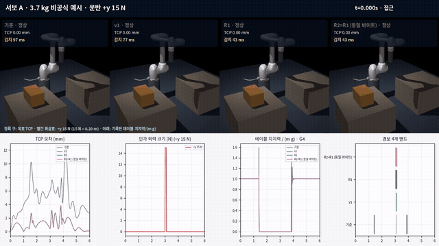
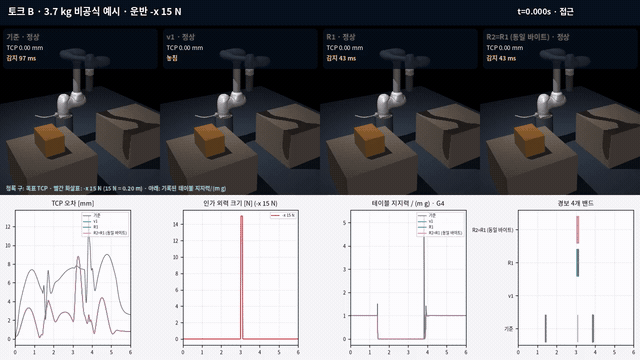
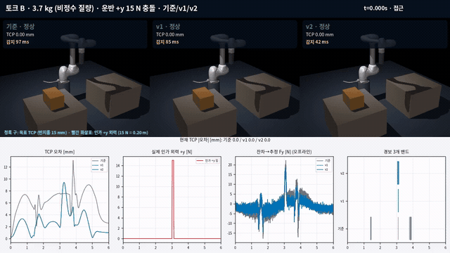

# 팔레타이징 하중 이양 · 순차 충돌 감지 R4

A=서보, B=토크, FA=오감지다. 기준=배포 키트, v1=탄성·하중 이양 제어와 기하 감지,
R1=v1 제어와 정상-only ridge/EMA 감지, R4=고정 정상 보정 순차 감지의 최종 판정이다.

**새 채택 0개, 최종 3파일은 R1과 바이트가 같다. 수정 W40은 D4에서 A +13, B +10 검출했지만 무충돌 섭동 FA가 A 6→9, B 9→17로 늘어 탈락했다. 모든 후보는 동결 전에 탈락했고 새 holdout은 R1 보존만 확인했다.**

[상세 결과](docs/R4_RESULTS.md) · [방법과 가정](docs/R4_METHODS.md) · [문헌 조사](docs/R4_LITERATURE.md) · [요구사항 점검](docs/REQUIREMENTS_AUDIT.md) · [재현 절차](docs/R4_REPRODUCE.md) · [발표 PDF](results/presentation.pdf) · [R3 보존본](docs/R3_README.md)

## 용어

- W40은 현재까지의 40 ms 후행 평균으로 짧은 오차를 모아 보는 감지 방법이다.
- CUSUM은 정상 수준보다 큰 오차를 시간에 따라 누적하는 변화 감지 방법이다.
- D4는 질량·무게중심·외력을 넓힌 기존 개발 평가로, 방식당 385조건 중 충돌은 180조건이다.
- holdout은 후보 선정에 쓰지 않고 마지막에 한 번 확인하는 별도 평가 자료다.
- 동결은 별도 평가 전에 코드·보정값·최종 선택을 고정하는 절차다.

## 영상으로 먼저 보기

R4는 새 방법을 채택하지 않아 비교 영상을 다시 만들지 않았다. 아래 07/08은 R2 당시 기준/v1/R1/R2 네 열이고, 05/06은 기준/v1/R1 세 열이다.

## T1–T6: 기준/v1/R1/R4

기준/v1/R1은 보존된 비공식 분석 집계다(공식 evaluator가 아님). T3의 네 열은 R2와 같은 34조건 보존값이며,
R4의 새 섭동을 네 버전 모두 다시 실행한 독립 효능 표가 아니다.
추가 소수 자릿수는 원래 분석 원자료의 정밀도이며 공식 출력의 자릿수를 늘린 것이 아니다.

| 항목 | 조건·단위 | 기준 | v1 | R1 | R4 |
|---|---|---|---|---|---|
| T1: 놓기 전 마지막 20 ms 평균 지지율 | 8 kg, 같은 COM, 놓기 직전 20 ms; 보존값이며 R4는 최종 소스·물리 비간섭 동일성 / %mg (A/B) | A 0.0000 / B 0.0557 | A 0.2098 / B 11.1507 | A 0.2098 / B 11.1507 | A 0.2098 / B 11.1507 |
| T2: 놓기 토크 계단 | 8 kg, 같은 COM, 놓기 토크 계단; 보존값이며 R4는 최종 소스·물리 비간섭 동일성 / N·m (A/B) | A 73.842 / B 74.797 | A 14.626 / B 13.126 | A 14.626 / B 13.126 | A 14.626 / B 13.126 |
| T3: 분석 섭동 최악 TCP/놓기힘/오감지 | R2와 같은 전체 34조건 보존값(충돌 외 FA 포함); R4 새 섭동은 별도 표 / mm / N / 상승 횟수 | A 22.731 mm / 208.997 N / FA 221; B 17.171 mm / 352.140 N / FA 309 | A 14.777 mm / 212.734 N / FA 4; B 45.652 mm / 362.600 N / FA 8 | A 14.777 mm / 212.734 N / FA 6; B 45.652 mm / 362.600 N / FA 10 | A 14.777 mm / 212.734 N / FA 6; B 45.652 mm / 362.600 N / FA 10 |
| T4: 질량·COM 격자 포화/놓기 peak | 방식별 무충돌 질량·COM 189조건; 보존값이며 R4는 최종 소스·물리 비간섭 동일성 / 포화 조건 수 / mg | A sat 0/189, peak 2.0359 mg; B sat 0/189, peak 9.8822 mg | A sat 2/189, peak 1.6098 mg; B sat 0/189, peak 1.0358 mg | A sat 2/189, peak 1.6098 mg; B sat 0/189, peak 1.0358 mg | A sat 2/189, peak 1.6098 mg; B sat 0/189, peak 1.0358 mg |
| T5: TCP 추적 RMS/최대 | 8 kg, 같은 COM, 무충돌; 보존값이며 R4는 최종 소스·물리 비간섭 동일성 / mm (A/B) | A 6.144/14.000; B 7.042/13.183 | A 1.174/3.914; B 3.232/8.444 | A 1.174/3.914; B 3.232/8.444 | A 1.174/3.914; B 3.232/8.444 |
| T6: D4 감지/놓침/masked | 방식별 충돌 180조건; 선행 경보를 별도 집계 / 검출/놓침/선행 경보 조건 수 | A 88/43/49; B 78/42/60 | A 94/86/0; B 91/89/0 | A 111/69/0; B 111/69/0 | A 111/69/0; B 111/69/0 |

## 후보 판정

| 방식 | 후보 | 정상 추가 FA | 사전 검증 | 개발 | D4 | 섭동 무충돌 FA [28조건] | p99/최대 [µs] | 판정 | 실패 관문 |
|---|---|---|---|---|---|---|---|---|---|
| A 서보 | W40_ACTIVE | 표본 0, 상승 0 | +4, 손실 0 | +2, 손실 0 | +13, 손실 0 | 6→9 | 342.133/5141.191 | 탈락 | 분석 섭동: 오감지 증가 |
| A 서보 | CUSUM_ACTIVE_K05 | 표본 0, 상승 0 | +4, 손실 0 | +2, 손실 0 | +14, 손실 0 | 6→24 | 324.003/6416.361 | 탈락 | 공유 상태 저장 금지 위반; D4: 오감지 증가 |
| A 서보 | CUSUM_ACTIVE_K10 | 표본 0, 상승 0 | +2, 손실 0 | +2, 손실 0 | +13, 손실 0 | 6→17 | 335.068/6283.941 | 탈락 | 공유 상태 저장 금지 위반; D4: 오감지 증가 |
| A 서보 | CUSUM_PHASE_K05 | 표본 0, 상승 0 | +5, 손실 0 | +5, 손실 0 | +27, 손실 0 | 6→38 | 355.242/613.296 | 탈락 | 공유 상태 저장 금지 위반; 사전 검증: 오감지 증가 |
| B 토크 | W40_ACTIVE | 표본 0, 상승 0 | +4, 손실 0 | +2, 손실 0 | +10, 손실 0 | 9→17 | 275.261/465.879 | 탈락 | 분석 섭동: 오감지 증가 |
| B 토크 | CUSUM_ACTIVE_K05 | 표본 0, 상승 0 | +1, 손실 0 | +2, 손실 0 | +10, 손실 0 | 9→24 | 301.992/6329.750 | 탈락 | 공유 상태 저장 금지 위반; 사전 검증: 오감지 증가, 추가 검출 기준 미달 |
| B 토크 | CUSUM_ACTIVE_K10 | 표본 0, 상승 0 | +3, 손실 0 | +4, 손실 0 | +11, 손실 0 | 9→25 | 329.256/5475.875 | 탈락 | 공유 상태 저장 금지 위반; 개발 검증: 오감지 증가 |
| B 토크 | CUSUM_PHASE_K05 | 표본 0, 상승 0 | +6, 손실 0 | +6, 손실 0 | +20, 손실 1 | 9→62 | 312.905/6592.088 | 탈락 | 공유 상태 저장 금지 위반; 사전 검증: 오감지 증가 |

전체 34조건의 충돌 외 FA는 아래처럼 별도로 보존한다. W40의 전체값은 A 6→9,
B 10→18이며, 후보 판정의 주 관문인 무충돌 28조건 값과 합치지 않았다.

| 방식 | 후보 | 전체 34조건 충돌 외 FA |
|---|---|---|
| A 서보 | W40_ACTIVE | 6→9 |
| A 서보 | CUSUM_ACTIVE_K05 | 6→42 |
| A 서보 | CUSUM_ACTIVE_K10 | 6→17 |
| A 서보 | CUSUM_PHASE_K05 | 6→44 |
| B 토크 | W40_ACTIVE | 10→18 |
| B 토크 | CUSUM_ACTIVE_K05 | 10→26 |
| B 토크 | CUSUM_ACTIVE_K10 | 10→32 |
| B 토크 | CUSUM_PHASE_K05 | 10→94 |

## 새 holdout: R1 보존 전용

모든 후보가 동결 전에 탈락했으므로 W40 holdout은 실행하지 않았다.

| 방식 | 충돌 검출 | 정상 4조건 FA | 전체 충돌 외 FA | 용도 |
|---|---|---|---|---|
| A 서보 | 20/30 | 0 | 0 | R1 보존 확인; W40 미실행 |
| B 토크 | 22/30 | 0 | 1 | R1 보존 확인; W40 미실행 |

## 구현에서 발견한 문제와 수정

처음 만든 감지기는 기존 모델의 임시값을 같은 값으로 다시 저장했다. 물리 결과는 같았지만 공유 상태에 쓰지 말라는 규칙을 어겼다. 당시 W40은 추가 검출 A 4/B 3건과 정상 오감지 보존을 보여, 이 방법만 재설계 1회를 써 중복 저장을 없앴다. 가중치·통계량·임계값은 그대로다. 새 조건의 재검증에서 추가 검출은 A 4/B 4건이었다. CUSUM 3설정은 고치지 않았고 계속 탈락이다.

[공유 임시값과 재설계의 세부 설명](docs/R4_METHODS.md#비간섭과-안정성의-범위)을 따로 적었다.

## 별도 평가 조건을 미리 만든 사고와 조치

검사 코드의 실수로 원래 별도 평가 시드 371501의 조건을 동결 전에 메모리에서 두 번 만들었다. 조건을 출력·저장하거나 시뮬레이션을 실행하지는 않았지만 사전 생성 금지 위반으로 기록했다. 후보 충돌 결과를 보기 전에 그 시드를 폐기하고 새 시드 371599로 바꿨다. 관문과 조건 범위는 그대로다. 실제 새 holdout은 코드와 선택을 동결하고 실행 시작을 한 번만 기록한 뒤 1회 진행했다. 재검증에서 쓴 질량 1.5173, 3.8051, 6.0473, 7.2303 kg은 동결 전에 새 별도 평가의 제외 목록에 추가했다.

## 마지막 공식 회귀: 최종 R1

공식 결과는 R1 보존을 확인한 마지막 1회 회귀 검사다. 후보 선정이나 임계값 보정에 쓰지 않았다.

### 공식 0/4/8 kg 무충돌

| 방식 | 질량 [kg] | TCP RMS/최대 [mm] | 놓기 계단 [N·m] | 포화 [%] | FA 집기/놓기/기타 | 상태 |
|---|---|---|---|---|---|---|
| A 서보 | 0.0 | 1.18/3.94 | 5.1 | 0.0 | 0/0/0 | 정상 |
| A 서보 | 4.0 | 1.15/3.79 | 7.6 | 0.0 | 0/0/0 | 정상 |
| A 서보 | 8.0 | 1.17/3.91 | 14.6 | 0.0 | 0/0/0 | 정상 |
| B 토크 | 0.0 | 2.09/4.05 | 4.8 | 0.0 | 0/0/0 | 정상 |
| B 토크 | 4.0 | 2.32/4.42 | 6.8 | 0.0 | 0/0/0 | 정상 |
| B 토크 | 8.0 | 3.23/8.44 | 13.1 | 0.0 | 0/0/0 | 정상 |

### 공식 8 kg 충돌

| 방식 | 시각 [s] | 10/15/40/100 N·FA·최소 |
|---|---|---|
| A 서보 | 1.42 | 놓침 / 놓침 / 36 / 24 / 0회 / 40 N |
| A 서보 | 3.0 | 62 / 45 / 27 / 18 / 0회 / 10 N |
| A 서보 | 3.86 | 놓침 / 69 / 33 / 21 / 0회 / 15 N |
| B 토크 | 1.42 | 놓침 / 놓침 / 36 / 24 / 0회 / 40 N |
| B 토크 | 3.0 | 56 / 43 / 26 / 18 / 1회 / 10 N |
| B 토크 | 3.86 | 놓침 / 91 / 42 / 22 / 0회 / 15 N |

앞 네 값은 각 힘의 검출 지연 [ms], 뒤는 충돌 외 FA [회]와 최소 검출력 [N]이다.
공식 문자열은 evaluator의 원래 자릿수를 그대로 쓴다. **B 8 kg 3.0 s 충돌 세트의 추가 오감지 1회는 R1부터 동일하게 남아 있다.**
[공식 원자료](results/v2_protocol/R4_OFFICIAL_REGRESSION.json)를 함께 확인한다.

## 계산 시간과 미달

| 방식·소스 | 최악 행 p99 [µs] | 관측 최대 [ms] | 1 ms 초과 주기 |
|---|---|---|---|
| A 서보/R1 | 260.611 | 0.501 | 0 |
| A 서보/W40 | 342.133 | 5.141 | 1 |
| B 토크/R1 | 307.692 | 5.257 | 3 |
| B 토크/W40 | 275.261 | 0.466 | 0 |

같은 새 사전 재검증 38조건/방식의 제어기+감지기 합산 벽시계 시간이다. 각 소스는 228,000주기이며, p99는 주기 시간의 99백분위값 중 가장 나쁜 조건의 값이다. p99 800 µs 관문은 통과했지만 A W40·B R1의 관측 최대 1 ms 목표는 미달이다. 직렬 실행 순서와 OS 부하의 영향이 있어 순수 알고리즘 속도 비나 시간 상한 보장으로 쓰지 않는다.

**보존된 R3 표:** 서보 R1은 p99 327.670 µs, 최대 11.703 ms, 1 ms 초과 8주기다. 토크 R1은 p99 350.440 µs, 최대 14.163 ms, 1 ms 초과 4주기다. **R1은 최대 1 ms 목표 미달이다.** R3 표의 원래 표시값을 그대로 인용했으며 재계측하지 않았다. 위 38조건 표와 평가 범위가 다르고 이 유한 표로 과거 미달이 해소됐다고 주장하지 않는다. [보존된 R3 시간 표](docs/R3_README.md#계산-시간과-미달)를 함께 본다.

- G4 지속 지지(평균 ≥50 %mg, 최소 ≥25 %mg, v1 대비 +25 %p, 놓기 힘 ≤1.1 mg)는 완화하지 않았고 미달이다.
- 공식 8 kg 집기 10·15 N과 놓기 10 N 미검출, 보존 무충돌 격자의 서보 포화 2/189조건, R1 섭동 FA A 6/B 9가 남는다.
- 수정 W40도 섭동 FA 증가로 탈락했다. 새 방법의 전체 우위·실기 안전·엄격 최대 1 ms를 주장하지 않는다.

## 요구사항 점검

기존 가이드 33항목의 24충족/4부분/5판정 불가와 입력·형식·무결성 8통과 판정은 최종 3파일이 R1과 같아 유지한다. 이는 모든 성능 목표의 충족이나 새 후보의 성공을 뜻하지 않는다. 판정 불가에는 선택하지 않은 권고 항목과 비공개 평가도 포함된다. [가이드 요구와 자체 목표의 구분](docs/REQUIREMENTS_AUDIT.md)을 보존했다.

## 이번에 시도하지 않은 것

- 토크 추적 feedforward는 구현하지 않았고 효과는 모른다. 감지기의 추가 검출 여지를 먼저 시험해 2순위로 남겼다.
- 공식 8 kg 미검출 3조건에 W40을 실행하지 않았다. 집기 10·15 N과 놓기 10 N은 최종 R1의 미검출이며 W40의 개선 여부는 모른다.

문헌 10편을 직접 확인해 순차 누적과 고정 정상 보정을 골랐다. 온라인 ACI/AgACI,
RL, 리그룹 재시도는 이번 후보에서 제외했다. 자세한 확인 범위와
논문에서 바꾼 점은 방법·문헌 문서에 구분했다.
