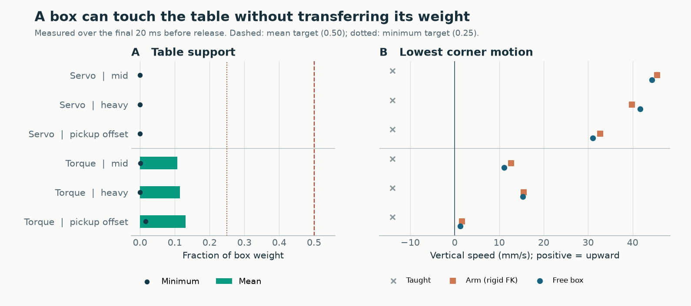

# R11 — 박스가 닿은 시각과 하중을 지탱한 시각은 다르다

**제출은 [R10](R10_RELEASE.md) 그대로다.** R11은 놓기 직전 힘이 사라지는 원인을 좁혔고, 반동을 줄이는 제어기를 만들었다. 그러나 그 제어기는 필요한 지지력을 끝까지 유지하지 못했고 기존 충돌 한 건도 놓쳤다. 잘된 숫자만 골라 제출하지 않았다.

## 실제 힘과 운동을 같은 구간에서 보면

동일한 키트에 R1+FAST2와 현 제출을 따로 조립했다. 서보/토크 각각 4.42 kg, 7.58 kg, 픽업 위치가 어긋난 5.69 kg를 비교했다. 두 조합은 이 6조건에서 같은 물리 결과를 냈다. 아래는 해제 직전 20 ms의 값이다. 힘은 박스 무게를 100%로 표시했다. 모서리 속도는 20개 시점 중 첫·끝 위치 차를 **19 ms**로 나눈 값이며, 양수는 위쪽이다.

| 모드·하중 | 작업대가 받은 평균 하중 | 교시 모서리 속도 | 실제 팔에서 계산한 모서리 속도 | 자유 박스 모서리 속도 |
|---|---:|---:|---:|---:|
| 서보 4.42 kg | 0.000% | −13.95 mm/s | +45.50 mm/s | +44.38 mm/s |
| 서보 7.58 kg | 0.011% | −13.95 mm/s | +39.81 mm/s | +41.72 mm/s |
| 토크 4.42 kg | 10.77% | −13.95 mm/s | +12.67 mm/s | +11.08 mm/s |
| 토크 7.58 kg | 11.48% | −13.95 mm/s | +15.52 mm/s | +15.35 mm/s |



두 서보 조건 모두 20개 표본 **전부에서 네 모서리가 연성 작업대의 기하학적 윗면 아래**였다. 최저 모서리는 평균 2.07–2.24 mm 아래였지만, 팔과 박스는 이미 함께 위로 움직이고 있었다. 이는 늦은 첫 접촉이나 흡착부의 상대운동만으로 설명하기 어렵다. 반대로 변형 깊이만으로 실제 반력을 알아낼 수도 없다. 위 속도와 힘은 시뮬레이션 결과이며, 실물의 접촉 강성이나 인과 계수를 측정한 것은 아니다. [여섯 조건의 출처·힘·틸트·경계값](../results/r11/r10_placement.json).

## 접근과 반동을 실제로 바꾼 결과

1. **접근 속도 개입:** 세 질량·섭동, 두 모드에서 같은 경로 위상에 느린/빠른 수직 개입과 원래 제어를 대조했다(18회). 빠르게 하강한 여섯 조합 모두 마지막 지지가 늘었지만 접촉 시각은 대체로 1 ms 이내로만 바뀌었다. 예를 들어 토크 7.85 kg은 접촉 전 하강 속도 0.188→0.242 m/s, 최종 평균/최소 지지 15.4/2.3%→45.3/23.2%였다. **속도만 바뀐 실험은 아니다.** 실제 수직 위치도 최대 약 5 mm 달라졌다. 양방향 12번 모두 오경보가 추가됐고 7번은 포화가 발생했다. 첫 분석이 픽업 접촉을 읽는 오류를 바로잡은 뒤, 같은 개입과 조건에서 적재 접근의 접촉만 측정했다. [대조 수치와 분석 범위](../results/r11/approach_velocity.json).
2. **정상 동작에서 속도 보정 학습:** 엔코더와 관절 토크센서로 추정한 높이, 교시 궤적만으로 매끄러운 수직 보정 네 개의 계수를 구했다. 학습에 실제 박스 위치·작업대 힘·충돌 라벨·경보를 쓰지 않았다. 새 4조건에서 서보의 위쪽 반동은 **36.1–47.0→1.5–5.6 mm/s**, 최종 평균 지지는 **0.0–0.2%→8.9–19.6%**가 됐다. 토크 한 조건도 평균 **10.5%→43.3%**로 올랐다. 하지만 여덟 정상 조건 중 G4 전항목을 통과한 것은 **0개**다. 서보 6.31 kg 충격은 검출→미검출, 토크 7.89 kg 정상에서는 경보가 1회 늘었다. [동결 계수와 조건별 결과](../results/r11/velocity_learning.json).
3. **속도를 막거나 힘을 더하는 것만으로는 부족:** 위로 움직일 때만 제동한 후보는 실제로 0.47–1.50 J를 소산했어도 8조건 모두 최소 지지가 0이었고 피크는 최대 243%였다. 정지 시 55% 무게를 받치도록 별도 평형점을 둔 후보는 마지막 20 ms에 제어 쪽에서 평균 9.93–49.61 N의 추가 힘에 해당하는 지령을 전달했지만, 작업대의 평균 지지는 최대 32.1%, 피크는 최대 342.5%였다. **로봇이 보낸 힘과 작업대가 받은 힘은 별개다.** [제동 대조](../results/r11/rebound.json) · [평형점 대조](../results/r11/equilibrium.json).
4. **집을 때 얻은 높이·기울기 보정:** 픽업 직전 엔코더/JTS와 교시 자세의 차이를 적재 자세로 옮겨 보았다. 여덟 정상 조건 모두 G4를 통과하지 못했고, 토크 충격 하나에서 지연이 59→80 ms였다. [계획](../experiments/r11_datum/plan.json) · [32회 물리·경보 대조](../results/r11/grasp_datum.json).

두 개의 수직 궤적 변수로 속도와 JTS 기반 지지 추정값을 함께 맞추는 방식도 검사했다. 고정한 범위의 서보 선형 근사에서, 속도 조건을 빼고 계산한 추정 지지의 상한도 두 보정 조건에서 28.4%, 25.2%였다. 이는 **그 변수·국소 모델·공개 관측량에 대한 한계**이지 실제 작업대 힘의 물리적 상한이 아니다. 실제 힘과 충돌을 열어 보기 전에 기각했다. [공개 신호 가용성 검사](../results/r11/load_proxy.json). 정상 모터 토크에 직접 작용하는 독립 변수까지 더해도 두 보정 조건에서 예측 지지는 40.0%, 40.7%에 그쳤다. 또한 힘을 거두는 구간이 올리는 구간보다 짧아 실제 최대 지령 변화율이 사전 계산 0.238 대신 0.334 N·m/ms였다. 한계를 고쳐 재시도하지 않았고 실제 충돌을 열지 않았다. [추가 변수·변화율 감사](../results/r11/wrench_proxy.json).

## 실행 방법

공개 배포본에는 수업 키트가 없다. 키트 의존성이 설치된 Python으로 저장소 루트에서 다음을 실행한다. 원본 키트나 기본 제출 파일에 쓰지 않는다.

```bash
KIT=/path/to/icpbl_sim
# 내 키트에서 현재 제출과 보관 R1 제어를 같은 조건으로 비교
python tools/r11_placement.py --kit "$KIT" --out /path/to/new-placement.json
# 그림을 측정 결과에서 생성 (새 PNG 경로)
python tools/r11_placement_plot.py --input /path/to/new-placement.json --out /path/to/new-plot.png
# 반동은 줄였지만 G4·감지에서 탈락한 연구용 제어를 별도 새 디렉터리에 조립
python tools/r11_velocity_demo.py --out /path/to/new-simulation-demo
python tools/r11_placement.py --kit "$KIT" --candidate-dir /path/to/new-simulation-demo \
  --out /path/to/new-demo-result.json
```

다른 자체완결 `my_servo.py`, `my_torque.py`, `my_detector.py`를 담은 디렉터리도 `--candidate-dir`로 줄 수 있다. 각 비교에서 시간 3.900 s 자체를 뺀 마지막 20개 표본을 빠짐없이 쓰며, 하중은 질량×9.81 N으로 나눈다. G4는 **평균 ≥50%, 최소 ≥25%, 기준 대비 평균 +25%p 이상, 놓기 전후 최대 ≤110%**를 함께 요구하는 연구 자체 기준이다. 기준과 같은 제어의 개선량이 0인 것은 정상이다. 발산은 실패, 적재 작업대 지지를 확인할 수 없는 위치는 판정 불가로 기록한다. 이 도구의 3가지 무충격 조건만으로 충돌 검출이나 제출 적격을 판단하지 않는다. [판정 코드](../tools/r11_placement.py) · [동결 진단 조건](../results/r11/placement_plan.json) · [연구용 조립본 실측](../results/r11/velocity_demo.json) · [연구 소스와 조립본의 물리·경보 해시 대조](../results/r11/demo_parity.json).

## 다른 미해결 항목

- **정지 복귀**: 마찰 바이어스를 적분한 후보는 정상 위치 오차를 줄였지만 외력으로 적분 이력이 달라져 정지 펄스 6개 모두 복귀 기준을 넘었다. 측정 속도에 따라 마찰 일부를 상쇄한 후보 역시 첫 펄스의 위치 차이가 0.203→0.343°로 나빠졌다. [적분 후보](../results/r11/bias_hold.json) · [마찰 보상 후보](../results/r11/friction_hold.json).
- **약충돌**: 정상에서 식별한 강성·마찰 잔차 투영은 새 토크 충돌 16개에서 검출 8→8, 사건 밖 오경보 2조건 증가였다. 정지 중 충격량을 누적한 별도 감지는 충돌을 열기 전부터 독립 정상 감사에서 임계값을 넘어서 둘 다 제외했다. [토크 분리 검사](../results/r11/identified_detection.json) · [정지 누적 검사](../results/r11/hold_impulse.json).

정지 마찰 적분 후보는 원본 안내서와 겹치는 문자열이 배포 검사에서 발견되어, 해당 소스 대신 측정 결과와 실험 당시 해시만 배포한다.

실기·비공개 평가·하드 실시간은 검증하지 않았다. 원래 평가기와 제출 조합은 변경하지 않았다.
