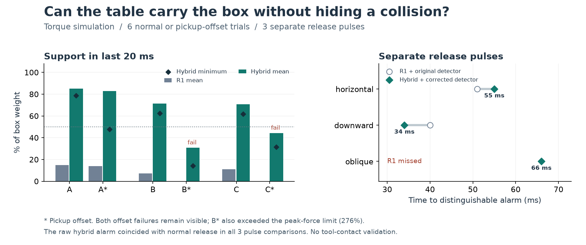

# R12 — 작업대에 무게를 넘기면서 실제 충돌을 구별할 수 있는가?

**토크 모드에서 두 문제를 함께 개선한 시뮬레이션 후보가 나왔다.** 픽업 위치 오차가 없는 새 3조건 모두에서, 놓기 직전 20 ms 동안 작업대가 상자 무게의 평균 71–85%를 받았다. 같은 제어로 생기던 해제 오경보도 없앴고, 별도로 가한 충돌 3건을 모두 구별했다. 그러나 픽업 위치가 어긋난 3조건은 1개만 하중 인계 기준을 통과했다. **따라서 기본 제출은 [R10](R10_RELEASE.md) 그대로이고, R12는 직접 실행해 볼 수 있는 연구용 선택지**다.



## 제어 변경과 감지 변경의 기여를 나눠 보면

1. **제어:** 팔의 위치 보정이 작업대와 계속 힘겨루기를 하지 않도록 했다. 공개 센서에서 지지가 관측되면 위치 복원 토크 중 작업대 법선에 해당하는 성분만 원래의 20%까지 낮추고, 팔이 맡는 모델 하중 비율을 45%로 매끄럽게 바꿨다. 나머지 방향의 위치 복원과 감쇠는 남겼다. 접촉을 재빨리 명령하거나 시뮬레이터의 실제 작업대 힘을 읽는 방식이 아니다. 독립된 두 개발 조건에서 참값 기준 평균/최소 지지가 각각 **80.9/75.2%, 71.1/60.3%**였다. 그러나 원래 감지기는 둘 다 해제 3 ms 뒤에 정상 동작을 충돌로 판정했다. [개발 대조](../results/r12/hybrid_torque.json)
2. **감지:** 충격을 가하지 않은 별도 4조건에서, 같은 질량일 때 새 제어가 기존 제어보다 만들어 내는 **부호 있는** 6축 잔차·빠른 변화 신호의 차이를 한 사이클 전체에 걸쳐 학습했다. 실행 때는 공개된 시각과 질량만으로 그 정상 차이를 예측해 측정 신호에서 뺀다. 감지 임계값·지속 시간은 그대로이고, 해제 부근의 신호나 특정 방향을 끄지 않는다. 동일한 센서 교란이 보정 입력에 가해지면 그 차이는 그대로 남는다. 이는 임의 충돌을 언제나 구별한다는 뜻이 아니다. API로 반환하는 기존 잔차도 그대로 두고 경보 판정에서만 보정한다. 공유 제어 상태도 바꾸지 않아 원래 하이브리드와 보정 감지 조합의 물리 궤적은 같았다. [실험 계획](../experiments/r12_counterfactual/plan.json) · [측정 판정](../results/r12/counterfactual.json)

| 새 토크 조건 | 기존 제어 평균 지지 | R12 평균 / 최소 지지 | 하중 기준(G4) |
|---|---:|---:|---|
| 4.85 kg | 15.0% | 85.1 / 78.7% | 통과 |
| 6.35 kg | 7.2% | 71.5 / 62.6% | 통과 |
| 7.75 kg | 11.0% | 70.9 / 61.7% | 통과 |
| 같은 세 질량, 픽업 위치 오차 추가 | 0–14.0% | 평균 82.8%, 30.9%, 44.4% | 첫 조건만 통과 |

G4는 평균 ≥50%, 최소 ≥25%, 짝지은 기존 제어 대비 평균 ≥25%p 증가, 놓기 전후 최대 ≤110%를 **모두** 요구하는 연구 기준이다. 특히 6.35 kg의 픽업 위치 오차 조건은 순간 최대가 무게의 **276.4%**였다. 평균값 개선만으로 안전하게 놓았다고 판단할 수 없다. 위 여섯 조건에서 **무충돌 오경보는 기존 제어 0건, 하이브리드 제어 단독 4건, 보정 감지 결합 0건**이었다. [조건별 평균·최소·최대와 실패 포함 원자료 요약](../results/r12/paired_outcomes.json)

| 해제와 겹친 별도 충돌 | 기존 R1/R10 | R12 결합 | 해석 |
|---|---:|---:|---|
| 수평 17 N | 51 ms | 55 ms | 4 ms 늦음 |
| 수직 하향 35 N | 40 ms | 34 ms | 6 ms 빠름 |
| 사선 (13, −11, 16) N | 놓침 | 66 ms | 이 조건에서 새 검출 |

하이브리드 **제어만** 바꾼 경우 세 충돌 모두 정상 해제 경보와 구별되지 않았다. 여기서 검출은 충돌 직전부터 울리고 있거나 짝지은 무충격 동작에서도 같은 시점에 울린 경우를 제외한다. 이 세 비교에서는 실제 공구 접촉이 일어나지 않았다. 공구 충돌 검출 보존, 숨은 평가, 실기 안전 또는 하드 실시간을 입증한 것이 아니다.

## 본인이 받은 키트로 실행

키트 의존성이 설치된 Python과 신뢰하는 소스만 사용한다. 출력은 원본 키트와 기본 제출 디렉터리 **밖의 새 경로**를 선택한다. 하중·충돌을 함께 평가하는 아래 검사는 동일한 기본 키트에서 이전 제어와 후보를 각각 실행한다.

```bash
KIT=/path/to/icpbl_sim
# 실제 비교에서 사용한 하이브리드+정상 보정 감지: 모델을 내장한 독립적인 세 파일 생성
python tools/r12_coupled_demo.py --out-dir /path/to/new-coupled-demo
python tools/r12_handoff_check.py --kit "$KIT" --mode torque \
  --candidate-dir /path/to/new-coupled-demo --out /path/to/new-handoff-check.json
```

검사는 먼저 4개 무충격 조건에서 원래 경로 TCP 오차, 집기/놓기 토크 변화, 작업대 힘, 포화, G4 및 오경보를 짝지어 비교한다. **하나라도 실패하면 추가 충돌은 실행하지 않고 `impact: null`과 실패 이유를 반환한다.** 정상 조건을 모두 통과할 때만 각 제어기의 자체 무충격 기록과 실제 해제 충격을 비교한다. 이 공개 네 조건은 위 사전 분리 실험과 다르다. `--mode servo` 또는 같은 형식의 다른 `--candidate-dir`도 검사할 수 있다. [공개 검사 조건](../results/r12/check_plan.json) · [결합 시연과 연구 버전 대조](../results/r12/coupled_parity.json)

**공개 검사에서 추가로 드러난 약점:** 기본 키트의 네 무충격 조건에서는 결합 후보가 G4와 비용·경보 기준을 모두 통과해 네 충돌을 실제 실행했다. 중량 4.42 kg과 위치 오차 5.69 kg에서는 각각 기존과 같은 50, 68 ms에 구별했다. 하지만 **7.58 kg의 3.905 s 사선 충격 (8, −5, −15) N은 기존 143 ms 검출 → 후보 미검출**이었고, 가벼운 2.95 kg의 반대 수평 충격은 둘 다 놓쳤다. 이 검사에서 후보는 2/4, 기준은 3/4였다. 앞 표의 3/3과 조건·목적이 달라 합산하지 않는다. 이것도 기본 제출을 유지하는 직접적인 이유다. [별도 배포본이 실제로 낸 네 정상·네 충돌 전체 결과](../results/r12/coupled_original_kit.json).

위 두 미검출 조건만 대상으로 제어·감지를 서로 바꿔 원인을 검사했다. 7.58 kg에서 기존 제어+기존 감지만 구별했고, 한쪽만 바꾼 두 조합은 충돌 전에 이미 경보 중이었다. 2.95 kg에서는 네 조합 모두 놓쳤다. 양 제어의 강제–정상 신호 차이가 비슷해도 경보 이력은 달랐다. 이 결과로 원인을 제어나 감지 한쪽에만 돌릴 수 없으며, 이미 본 이 충격으로 임계값을 다시 맞추지도 않았다. [교차 대조 8쌍](../results/r12/crossover.json).

**작동 조건을 보수적으로 바꾼 별도 제어**도 제공한다. `python tools/r12_handoff_demo.py --out /path/to/new-guarded-demo` 후 같은 검사기에 넣는다. 이 버전은 20 ms 안에 전환을 끝낼 수 없는 늦은 지지 신호에는 개입하지 않으며, 미작동 시 해제 뒤에도 R1 출력을 그대로 낸다. 0 kg 6,000주기의 물리·제어·경보가 기존과 똑같았다. 별도 섭동 조건에서 가벼운 2.86 kg은 피크 149.3%, 6.57 kg 픽업 오차는 최소 지지 10.7%로 실패했다. 이 버전은 위 결합 감지의 검증 수치를 물려받지 않는다. [별도 제어 검증](../results/r12/guarded_handoff.json) · [기본 키트에서의 실행 결과](../results/r12/guarded_original_kit.json)

**주기 비용:** 같은 CPU에서 3.037 kg 무충격 토크 에피소드를 R10→결합→결합→R10 순서로 실행했다. 실행당 6,000주기에서 제어+감지 wall p99는 R10 208.6–212.0 µs, 결합 248.0–249.7 µs였다. 관측 최대는 각각 381.5 µs와 908.5 µs였다. 결합안이 더 무겁고 이 네 측정에서 1 ms를 넘지 않았다는 사실은 시간 보장이 아니다. 모듈 import·최초 reset은 주기 안에 넣지 않았다. [실행별 비용·원본 핀](../results/r12/coupled_timing.json).

## 센서로 알 수 있는 하중과 알 수 없는 하중

`python tools/r12_force_audit.py --kit "$KIT" --out /path/to/new-force.json`는 엔코더·관절 토크센서·공개 동역학만으로 추정한 **수직 외력**을 사후에 실제 작업대 힘과 비교한다. 다른 물체가 누르는 중에는 이를 작업대 힘으로 구분할 수 없다. 수직 힘 계산은 교시 가속도가 아니라 실제 측정 운동을 쓰며, 31개 표본을 평균하고 추정할 수 없는 표본을 0으로 바꾸지 않는다.

독립 시뮬레이션 12회에서 올바른 과거 구간의 오차(RMSE)는 무게의 **2.7–10.8%**였다. 그러나 현재 하중으로 해석하면 마지막 20 ms 평균 절대오차가 **9/12조건에서 12%**를 넘었다. 실제 지지가 25% 미만인데 50% 이상이라고 추정한 표본도 한 번 있었다. 기존 추정이 가능한 공통 1,531/1,560개 표본의 오차는 8.4→6.9%였지만, 전체 구간에서 사전 기준인 25% 개선을 증명하지 못했다. **따라서 이 값은 과거 하중 진단에만 쓰고 제어 피드백에 채택하지 않았다.**

시간 축도 따로 검증했다. 엔코더 중앙 상태는 출력 시각보다 **17 ms 이전**, 그 상태 직전의 솔버 구간에 저장된 힘 표본은 **인덱스 18개 이전**이다. 탄성 축은 상태 시점, 강체 JTS는 직전 구간을 반영하므로 두 정렬을 모두 남겼다. 독립 비선형 표본 검사로 초기 인덱스 표시를 바로잡았으며, 센서 수치나 기준은 수정하지 않았다. [시계 정정 근거](../experiments/r12_support/clock_erratum.json) · [12회 전체 대조](../results/r12/virtual_force.json) · [기본 키트 6회 재현](../results/r12/virtual_force_original_kit.json)

## 그 밖의 후보와 남은 문제

- [접근 전반 감속과 23 ms 정지 명령](../results/r12/dwell.json)은 실제 접촉을 약 14–15 ms 앞당겼지만 박스가 멈추지 않았고 G4와 추종 비용을 함께 넘지 못했다. 명령 정지와 실제 정지는 달랐다.
- [서보 법선 강성 변경](../results/r12/hybrid_servo.json)은 기존 드라이브를 유지했다. 6.3 kg은 평균 48.1%로 미달, 7.75 kg은 51.5%이나 해제 오경보가 남았다. [운동량을 제한한 토크안](../results/r12/impulse_budget.json)도 가벼운 물체와 픽업 오차를 해결하지 못했다.
- [정지 복귀 제어](../results/r12/hold_shape.json)는 새 충격 6건 모두 말기 위치 차이를 줄였지만 0.05° 통과는 0건이고 기존 충돌 하나를 놓쳤다. [모터·링크 운동량 감지](../results/r12/momentum_detector.json)는 새 약충돌에서 6/16→6/16이었으며 정상 오경보가 늘었다. [해제 순간 관측기를 한 번 보정](../results/r12/one_step_transition.json)한 것만으로는 오경보가 4 ms 늦어졌을 뿐 사라지지 않았다.
- [반복 기준경로 계산 재사용](../results/r12/runtime.json)은 물리·검출을 보존하고 CPU 중앙값을 줄였지만, 토크 모드 합산 p99가 한 후보에서 305.3→343.8 µs로 나빠져 채택하지 않았다. 최대 1 ms 보장도 없다.

**다음 물리 검증의 출발점:** 픽업 순간의 높이 한 점 대신 공중 운반 중 얻는 관절 토크 이력으로 상자의 실제 장착 높이를 추정할 수 있는지 본다. 공개 모델의 6 kg 조건에서 수직 4 mm 이동에 대한 중력만의 관절 토크 차이는 0.0001 N·m 미만이었다. 운반 가속도를 넣으면 최대 약 0.0505 N·m이지만, 수평 이동·관절별 바이어스 성분을 제외한 평균 감도는 센서 잡음 크기의 약 0.25배다. **공칭 감도일 뿐, 실제 높이를 식별했다는 뜻이 아니다.** 다음 설계는 위치 추정 오차와 불확실성을 정상 동작에서 먼저 확인한 후 제어에 연결해야 한다. [명목 감도 계산](../results/r12/carried_offset_preview.json).
