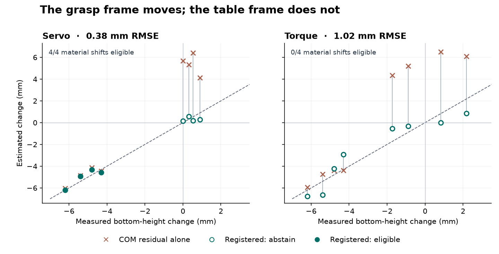

# 착지 전에 박스 바닥 높이 추정하기 (R13–R14)

**무엇이 달라졌나:** 허용 센서로 얻은 무게중심 이동을 곧바로 박스 바닥의 이동으로 보던 오류를 고쳤다. 원본 키트에서 R14의 높이 추정은 무게중심 잔차만 쓸 때보다 정확했다. 실제 온라인 서보 보정은 별도 두 사례의 착지 피크를 크게 낮췄다. 그러나 힘이 잠깐 작아진 것과 작업대에 무게가 계속 실리는 것은 다르다. **기본 제출은 R10이다.**

## 내 키트에서 확인

기존 Python·MuJoCo 환경에서 저장소 루트를 기준으로 실행한다. `/path/to/icpbl_sim`은 강의에서 받은 **원본** 폴더로 바꾼다. 출력은 서로 다른, 아직 없는 폴더여야 한다.

```sh
python tools/r14_grasp_audit.py --kit /path/to/icpbl_sim --out ./my-r14-height
python tools/r13_grasp_audit.py --kit /path/to/icpbl_sim --out ./my-r13-height
```

두 도구는 원본을 검증하고 임시 사본에서 기본 제어를 실행한다. `summary.json`의 `metrics`, `evaluation.json`의 건별 추정·구간·실측값, `calibration.json`의 보정 계수를 함께 본다. 원시 센서 기록이나 키트 원문은 배포하지 않는다. R14는 **같은 관측 기록**으로 등록 전후를 비교한다. 정답에 쓰는 실제 상자 상태와 해당 조건의 정상 픽업 결과는 추정기에 넘기지 않는다. 연구용 강성·마찰·난수 변화를 원본 러너가 지원하지 않으므로 두 환경의 숫자를 섞지 않는다.

## 어떻게 측정했나

3.55 s까지의 엔코더·관절 토크 센서, 그립 상태, 주어진 질량·COM, 공개 명목 모델을 사용한다. 상자 높이는 **교시된 적재 자세에서 상자 바닥면의 가장 낮은 점의 수직 위치**를 뜻한다. 운반 중 실제 상자와 플랜지의 상대 자세 네 표본으로 채점한다. 픽업 작업대를 +5 mm 옮겨도 충돌·기울기·흡착 자세에 따라 실제 바닥이 +5 mm가 되는 것은 아니다.

1. R13은 측정한 파지 자세에서 동역학을 맞춰 COM의 변위를 구했다. 그런데 그 COM 잔차는 **움직인 파지 기준**에 상대적인 값이다. 이를 작업대 기준의 높이 변화로 바로 해석하니 특히 위로 어긋난 픽업에서 틀렸다. 섭동 시뮬레이션 42회 중 높이 변화 8건씩의 RMSE는 서보 3.31, 토크 4.31 mm, 보정 허용은 합계 0/16이었다. 원본 키트 R13에서도 모드마다 받아들인 추정 4건이 보고 구간을 벗어났다. [연구 결과](../results/r13/carried_height.json) · [원본 키트](../results/r13/stock_height.json).
2. R14는 **파지 자세와 교시 자세 사이의 바닥 높이 차이 + 같은 방향의 추정 COM 잔차 − 정상 픽업에서 예상한 높이**를 사용한다. 정상 기준은 모드당 정상 12회의 공개 신호와 질량으로 맞춘다. 보정용으로 승인하려면 질량·변위 범위 안이고, 불확실성 반폭이 2.5 mm를 넘지 않으며 구간에 0이 없어야 한다. 반폭은 정상 한 건씩 제외한 오차, 운반 신호 블록을 제외한 민감도, 고정 0.75 mm 여유의 합이다. 통계적 신뢰수준이나 절대 거리 센서를 의미하지 않는다.
3. 추정값은 **위가 양수**다. 예를 들어 바닥이 정상보다 5 mm 낮다는 추정은 −5 mm이며, 원래 위치로 복원하는 명령은 반대로 TCP를 +5 mm 올린다. 아래 표의 ‘허용’은 센서 판정이다. 실제로 움직인 시험은 별도로 표시한다.



## 센서 결과: 원본과 섭동을 분리

**원본 키트, 수동 운반:** 56회 = 모드당 정상 보정 12회 + 새로운 네 조건의 0·수평·수평+상·수평+하 16회. 아래 RMSE의 분모는 모드당 평가 16건 **전체**다. 두 번째 완전 반복의 JSON 세 개가 모두 바이트 일치했다. 반복은 새 시험 조건으로 세지 않았다.

| 모드 | COM 잔차만 쓴 RMSE → 등록 후 | 실제 2.5 mm 이상 중 보정 허용 | 보류를 0으로 한 최악 오차 | 받아들인 구간 밖 정답 |
|---|---:|---:|---:|---:|
| 서보 | 2.467 → **0.164 mm** | 4/4 | 0.708 mm | 0 |
| 토크 | 2.768 → **0.144 mm** | 4/4 | 0.419 mm | 0 |

두 모드 모두 작은 변화 12건에서는 불필요한 보정을 제안하지 않았다. 기능 기준은 통과했지만, 아무리 작은 변화라도 8건 전부 부호를 확정해야 하는 기존 R13 기준은 둘 다 실패했다. 이 네 큰 변화의 실제 방향은 모두 아래였다. 모든 방향·질량에 대한 보장이 아니다. [원본 키트의 조건·결과](../results/r14/stock_height.json).

**강성·마찰·센서 시드 섭동, 112회:** 수동/자세 자극 × 서보/토크 × (정상 보정 12회 + 평가 16회). 이번 표의 RMSE는 모드·운반 방식마다 **수직 오차를 가한 8건**에서 계산했다.

| 운반·모드 | COM 잔차만 → 등록 후 RMSE | 실제 2.5 mm 이상 중 정확한 보정 허용 | 보류를 0으로 한 최악 오차 |
|---|---:|---:|---:|
| 수동 서보 | 3.59 → **0.384 mm** | 4/4 | 0.901 mm |
| 자세 자극 서보 | 3.55 → **0.292 mm** | 4/4 | 0.900 mm |
| 수동 토크 | 3.90 → **1.017 mm** | 0/4 | 6.207 mm |
| 자세 자극 토크 | 3.82 → **1.108 mm** | 0/4 | 6.207 mm |

1.98–3.40 s 사이 TCP 위치는 고정하고 피치만 최대 1.324° 바꾼 자극에서, 명목 모델의 4 mm 구분 신호는 센서 잡음 단위 **0.237 → 0.303**이었다. 명목 TCP 위치 오차는 4.3×10⁻¹⁴ m 미만이었지만 실제 움직임 비용은 서보 16/16, 토크 11/16만 통과했다. 토크는 신호가 커져도 현장 보정 정확도가 좋아진 것은 아니며, 서보는 자극 없이도 기능 기준을 통과하므로 수동 운반을 우선한다. [조건별 추정·비용](../results/r14/registered_height.json) · [명목 자극](../results/r14/nominal_probe.json).

토크용 추가 방식은 상자를 잡기 전 1.252 s까지의 엔코더·관절 토크로 기구의 탄성 및 추종 특성을 추정해 정상 파지 기준을 예측했다. 정상 누락 검증 최대 오차는 1.705 → 0.678 mm. 추가 섭동 16회에서 전체 RMSE **0.530 mm**, 큰 변화 5/5에서 부호와 보정 정확도가 맞았고 1 mm 미만 10건에서 잘못된 보정은 없었다. 그러나 실제 −2.408 mm 사례를 보류해 최악 오차 2 mm 기준을 넘었다. 이 결과로 섭동 토크 제어를 열지 않았다. [별도 결과](../results/r14/empty_reference.json). **‘그립 해제’는 ‘공구 비접촉’이 아니었다.** 같은 16회를 재생해 보존된 다섯 물리·감지 배열의 바이트 일치를 확인했다. 5회에 실제 공구 접촉이 있었고, 3회는 1.18–1.25 s 특징 구간과 겹쳤다. 정답을 입력한 것은 아니지만, 이 방법이 항상 자유 공간의 탄성만 측정했다고 해석할 수 없다. [시각별 접촉 대조](../results/r14/pregrasp_contact_audit.json).

## 실제로 움직인 결과

### 원본 키트 토크 — 자세를 유지하며 손에서 작업대로 하중 넘기기

R14 추정이 허용될 때만 TCP를 반대 방향으로 옮기고, flange 자세를 유지해 상자의 모든 모서리가 같은 양만큼 움직이도록 했다. R12 하중 인계와 정상 해제 보상 감지기를 결합하되, 같은 조건에서 R10 및 **높이 보정 없는 동일 R12 조합**과 비교했다. 새 여섯 조건 중 네 조건이 인계·비용 기준을 통과했다. 아래에서 ‘지지’는 그리퍼 해제 직전 마지막 20 ms의 작업대 지지력, ‘피크’는 착지 최대 힘이다. 모두 상자 무게에 대한 비율이다.

| 원본 키트 조건 | 보정 동작 | 보정 없는 R12 평균 지지 → R14 | R14 최소 지지 | 피크 R10 → R14 | G4 |
|---|---|---:|---:|---:|---|
| 3.15 kg, 정상 | 보류 | 76.6% → 76.6% | 42.6% | 1.00 → 1.05배 | 통과 |
| 4.40 kg, 수평+하향 | +5.19 mm | 33.3% → **85.9%** | 66.6% | **2.90 → 1.03배** | 통과 |
| 5.75 kg, 수평+하향 | +4.58 mm | 36.0% → **73.0%** | 71.0% | **2.36 → 1.01배** | 통과 |
| 7.90 kg, 수평+하향 | +5.84 mm | 44.1% → **78.0%** | 73.9% | **2.31 → 1.00배** | 통과 |
| 7.10 kg, 수평만 | 보류 | 43.9% → 43.9% | 33.1% | 1.33 → 1.33배 | 평균·피크 미달 |
| 6.65 kg, 수평+상향 | 보류 | 59.4% → 59.4% | 4.1% | 1.05 → 1.04배 | 최소 지지 미달 |

허용된 세 개는 **기존 R10 평균 지지가 사실상 0**이었던 사례다. 추가 포화나 오경보 없이, 두 대조 제어기 대비 추종·지령·힘 비용 기준도 지켰다. 반대로 6.65 kg 사례에는 R12/R14 조합에서 3.879 s, 3.906 s에 오경보 두 개가 있었고 R10에는 없었다. 보류할 때는 R12 조합의 10개 물리·감지 배열과 같으므로 이 실패도 그대로 이어진다. 여섯 정상 조건을 모두 통과해야 여는 별도 충돌 여섯 건은 **미실행**이다. [조건별 세 제어의 실제 결과](../results/r14/stock_handoff_normal.json) · [코드·체크섬 요약](../results/r14/stock_handoff_summary.json).

**실패 원인 대조:** 위 두 실패만 다시 열고 질량·COM·제어기를 고정해 픽업 위치만 바꾼 18회는 원인 진단용이다(추가 합격 사례가 아니다).

- **7.10 kg:** 같은 질량의 정상 픽업은 평균/최소/피크 76.9%/66.8%/105.3%로 통과했다. 수평 오차만 주면 접촉이 11 ms 빨라지고, 제어가 지지를 인식해 동작하기 **2 ms 전**에 이미 피크 132.6%가 발생했다. 이 시점의 문제는 높이 추정의 부호를 바꾸거나 접촉 뒤 복원력을 키워서 해결할 수 없다.
- **6.65 kg:** 정상과 수평만 준 경우는 통과했다. +4.8 mm 수직 위치 오차만으로 초기 픽업에서 약 **88 N**의 실제 공구 접촉(1.242–1.324 s)이 생겼다. 나중의 작업대 접촉과 하중 인계 개시는 각각 약 10/12 ms 늦어지고 최종 최소 지지는 6.7%였다. 수평 오차까지 더하면 모서리 높이차가 1.55 mm 더 벌어지고 최소 지지가 4.1%로 낮아졌다. 두 경우 모두 R12/R14 감지기는 오경보 두 건, R10은 0건이었다.

착지 높이 하나를 맞추는 것만으론 이 두 현상을 구별하지 못한다. 진단에 사용한 실제 모서리 자세·작업대 힘을 실시간 제어기 입력으로 쓰지 않았다. [동일 질량·제어기로 축별 대조한 결과](../results/r14/face_attribution.json).

원본 키트 높이 측정에서 만든 보정 파일을 그대로 사용해 같은 폐루프 결과를 확인할 수 있다.

```sh
python tools/r14_registered_check.py --kit /path/to/icpbl_sim \
  --calibration ./my-r14-height/calibration.json --out ./my-r14-handoff
```

공개 검사는 같은 실행의 정상 결과를 다시 확인하며, 기존 R10과 R12 각각에 대해 오경보 시각을 일대일로 대조한다. 충돌 비교기 자체는 **이미 공개한 R12 사례**에서 힘 이력과 충격 전 물리·감지 이력이 세 제어기 모두 정확히 일치하는지 확인했다. 기존 R10은 143 ms에 감지하고 새 조합은 놓친다는 결과도 재현했다. 이는 검사기 검증·기존 반례이지 닫아 둔 R14 충돌 여섯 건을 실행한 것이 아니다. [재현한 이전 반례](../results/r14/archived_event_recheck.json).

### 다른 제어·감지의 한계

- **섭동 서보:** 실시간 센서 처리기로 계산한 허용값에만 3.55–3.79 s 동안 부드럽게 반대 방향의 수직 보정을 적용했다. 새 정상 조건 네 개 중 두 개는 보류하여 기존 제어와 같았고, 적용한 두 개의 작업대 힘 피크는 **상자 무게의 3.104 → 1.010배**, **1.938 → 1.007배**였다. 네 개 모두 추종·지령 변화·오경보·포화 기준을 지켰다. 반면 마지막 20 ms의 최소 지지는 전부 0, 평균은 최대 0.284%에 불과해 **완전한 하중 인계(G4)는 0/4**였다. 그래서 뒤의 충돌 시험은 실행하지 않았다. 3축 위치 자코비안만 쓴 경우 TCP를 +5 mm 움직여도 회전 탓에 가장 낮은 모서리는 +4.25–4.29 mm만 움직였다. [폐루프 결과](../results/r14/servo_closed_loop.json).
- **접촉 뒤에만 대응하는 방식:** 토크 제어에서 지지가 연속 관측되기 전에는 R1 출력을 그대로 보존했다. 새 4조건 모두 오경보는 없었지만 0/4 G4. 두 조건의 초과 힘은 관측에 따른 동작 개시보다 6–7 ms 먼저 발생했다. R13에서 16 ms 안에 3.80 mm를 보정하려던 방식은 힘을 무게의 13.60배까지 키웠다. [접촉 후 제어](../results/r14/contact_only_control.json) · [R13 빠른 보정](../results/r13/touch_estimator.json).
- **충돌 감지:** 수직 작업대 반력을 제거한 채널은 새 충돌 20건에서 기존과 같은 16건만 찾고 정상 경보를 추가했다. 현재 상태에서 8 ms 앞의 정상 하중을 예측한 방식은 약충돌 세 건을 추가한 것처럼 보였으나, 같은 정상 조건도 정확히 같은 시각에 울렸다. 3.907 s 정상 점수 34.443, 좌우·사선 충격 점수 34.371–34.467로 이 단일 점수 임계값은 문제를 해결하지 못한다. 모든 감지기의 불가능성 주장이 아니다. [방향 채널](../results/r13/tangent_detector.json) · [국소 예측](../results/r14/normal_shadow.json).

R13에서는 중복 명목 계산을 줄인 후보도 시험했다. 16차례 교대 실행에서 출력은 일치했지만 토크 모드 합산 CPU p99가 **8.65% 증가**해 채택하지 않았다. [시간·동등성 검증](../results/r13/shared_runtime.json).

온라인 센서 특징은 3.527 s에 완성되며 두 수동·자극 기록에서 배치 방식과 결과 바이트가 같았다. 관측기 단독 실행 시간·필요 메모리와 초기화는 별도다. 제어기·감지기 전체가 항상 1 ms 이내라는 주장은 하지 않는다. [증분 처리 검증](../results/r14/stream_parity.json). 이전 기준·G4·충돌 사례는 [R12](R12_HANDOFF.md)에서 확인할 수 있다.
