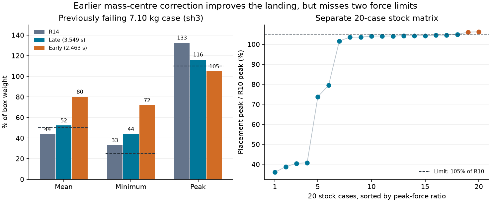

# R15 — 무게중심을 언제 보정해야 상자를 부드럽게 내려놓을 수 있나

**원본 토크 시뮬레이션에서 두 종류의 실패를 개선했다.** 옆·위쪽으로 어긋난 상자는 늦은 보정만으로도 안정적으로 내려놓고 기존 오경보 두 번을 없앴다. 7.10 kg 상자가 옆으로만 어긋난 조건은 **수평 보정을 1.086초 앞당겨야** 착지 최대 힘 기준을 만족했다. 별도의 20조건에서는 모두 하중 인계에 성공했지만 **그중 2조건이 기존 제출본 R10 대비 최대 힘 기준을 넘었다.** 이 결과는 실물 또는 새 충돌에서의 보호를 검증하지 않는다. 제출하는 세 파일은 R10 그대로다.



## 같은 상자의 실제 착지 비교

아래 수치는 상자 무게를 100%로 환산한 **작업대 접촉력**이다. 평균·최소는 그리퍼 해제 **직전 20 ms**, 최대는 **해제 300 ms 전부터 200 ms 후 미만**까지 잰다. G4는 평균 ≥50%, 최소 ≥25%, 최대 ≤110%, 평균이 같은 조건 R10보다 ≥25%p 높아야 통과한다. 이 기준과 별도로 제어 오차·힘·포화·감지를 검사한다.

| 조건 | 모델에 반영한 보정 | 평균 | 최소 | 최대 | 충돌 오경보 |
|---|---|---:|---:|---:|---:|
| 7.10 kg 측면 어긋남 (`sh3`) | R14 높이만 | 43.9% | 33.1% | 132.6% | 0 |
| 같은 조건 | R15 높이 + 늦은 수평 보정 | 52.3% | 44.0% | 116.2% | 0 |
| 같은 조건 | R15 높이 + 조기 수평 보정 | **80.1%** | **71.9%** | **104.7%** | **0** |
| 6.65 kg 측면·상향 어긋남 (`sh5`) | R14 높이만 | 59.4% | 4.1% | 104.4% | 2 |
| 같은 조건 | R15 높이 + 늦은 수평 보정 | **84.7%** | **63.9%** | **106.4%** | **0** |
| 같은 조건 | R15 높이 + 조기 수평 보정 | **76.2%** | **67.0%** | **104.8%** | **0** |

이미 알고 있던 4조건을 비교한 늦은 보정은 R14의 **2/4 → 3/4**다. 바뀐 1건은 `sh5`; `sh3`는 최대 힘만 남았다. 감지기 문턱과 교시 궤적을 바꾸지 않았고, `sh5`의 실제 공구 접촉 검출 지연도 11 ms로 유지됐다. 이것은 처음 보는 조건의 성공률이 아니다. [4조건의 실제 수치와 기준별 판정](../results/r15/late_handoff.json).

**왜 시점이 중요했나?** `sh3`에서 늦게 보정했을 때 최대 힘은 3.844초에 발생했고, 실제 하중 인계 제어가 처음 개입한 시각은 3.849초였다. 이미 5 ms 늦었다. 조기 보정에서는 첫 접촉 직전 상자의 낮은 모서리가 내려가는 속도가 **252 → 207 mm/s**로 줄었다. 가장 큰 힘은 개입(3.858초) 후인 해제 시점(3.900초)에 발생했다. 이 시각과 모서리 속도는 사후 진단값이지 제어기에 제공한 입력이 아니다. [실측 시각·속도와 기록 일치 검사](../results/r15/sh3_contact_timing.json).

## 센서가 구하는 값과 보정을 하지 않는 경우

그리퍼가 닫힌 뒤 엔코더·관절 토크, 알려진 질량과 설계 무게중심, 공칭 동역학만으로 **정상 파지에 비해 실제 하중의 무게중심이 플랜지 가로·세로 방향으로 얼마나 달라졌는지** 추정한다. 이는 상자의 기하학적 중심, 바닥의 경사, 접촉 압력 중심을 측정한 값이 아니다. 실제 박스 자세와 접촉력은 제어 입력이 아니라 사후 채점에만 쓴다. 추정이 불확실하면 공칭 모델을 바꾸지 않는다.

| 늦은 수평 추정: 새로운 4개 질량 × 5개 파지 조건 | 추정하지 않았을 때의 수평 오차(RMS) | 추정 오차(RMS) | 큰 이동에서 방향까지 맞춰 보정 | 거의 안 움직인 경우 불필요한 보정 |
|---|---:|---:|---:|---:|
| 원본 모델 20건 | 7.13 mm | **0.090 mm** | 12/12 | 0/8 |
| 강성·마찰 등을 바꾼 연구 모델 20건 | 7.35 mm | **0.879 mm** | 12/12 | 0/8 |

두 모델의 보정값은 따로 학습했다. 작은 이동은 실제 수평 변화 1 mm 미만, 큰 이동은 3 mm 이상이다. 실제 자세를 열기 전에 40건의 예측을 고정했다. 원본 키트 독립 실행도 12회 보정 + 20회 평가에서 같은 결과를 냈다. `pick_offset=None`과 명시적인 영벡터는 원본 4쌍에서 물리·경보 기록이 같았다. 연구 모델에서는 영벡터라도 공구 접촉이 활성화돼 4쌍 중 2쌍이 달랐다. [조건별 벡터·오차·영벡터 비교](../results/r15/horizontal_sensing.json).

## 조기 보정이 해결한 것과 아직 남은 것

늦은 보정은 3.549초에 내린 결정을 3.550–3.710초에 부드럽게 반영한다. 조기 보정은 **1.84–2.44초의 센서 구간**만으로 2.463초에 판단하고 2.470–2.670초에 반영한다. 둘 다 보정하는 것은 공칭 모델의 하중 무게중심이다. 상자를 수평으로 미는 별도의 위치 지령을 만들지 않는다.

- **별도 원본 20조건:** 조기 추정 오차는 0.159 mm RMS, 큰 이동 12/12의 방향이 맞았다. 폐루프에서 20/20이 G4를 통과했고 추가 오경보는 없었다. 이후 R14가 내린 높이 추정은 늦은 방식과 최대 0.114 mm 차이였다.
- **상대 비용:** 이전 연구 제어(R14·늦은 R15)와 비교한 조기 연구 기준은 20/20 통과했다. 그러나 배포 기준선 R10과 비교하면 두 상향 어긋남(`ec1:up`, `ec3:up`)에서 놓기 구간(3.6–4.1초)의 최대 힘이 각각 **1.0623배, 1.0611배**였다. G4의 절대 최대 힘 기준과 R10 대비 **1.05배 이하**라는 상대 기준은 다른 검사다. 하나를 통과했다고 다른 하나가 면제되지 않는다.
- **모델 오차:** 조기 추정은 연구 모델에서 보정 불확실성이 3.409 mm로 허용치 2.5 mm를 넘었다. 큰 이동 12건 모두 조기 보정을 보류했다. 늦게 추정하면 이 12건을 맞췄지만, 두 방식을 자동 선택하는 폐루프의 성능은 검증하지 않았다.
- **검출:** 상자 놓기 중 발생한 오경보가 줄어든 것과 새로운 외부 충돌을 여전히 잡는 것은 다르다. 이 조기 제어로 완료한 새 충돌 시험은 없다. [조기 보정 조건별 지지·힘·경보 시각](../results/r15/early_handoff.json).

원본 키트에서 **위 20조건 + 기존 실패 2조건**을 다시 돌려 R10과 직접 비교했다(22쌍, 44회). 조기 보정은 **22/22 하중 인계 통과, 20/22 전체 정상 기준 통과**였다. 두 실패에서 놓기 최대 힘은 각각 **36.09 N(한도 35.67 N)**, **68.40 N(한도 67.69 N)**였다. 포화, 공구 검출 지연, 기존 대비 추가 오경보는 없었다. 같은 조건을 다시 실행한 것이므로 최초 평가와 합산해 사례 수를 부풀리지 않는다. [22쌍 재현 결과표](../results/r15/early_stock_reproduction.json).

## 원본 키트로 재현하기

수업용 키트 및 평가기는 배포하지 않는다. 원본 키트의 Python 의존성을 설치한 환경에서, 아래 출력은 **키트·저장소 밖의 새 경로**로 지정한다.

```bash
KIT=/path/to/icpbl_sim
OUT=/path/to/existing/external-directory
python -B tools/r15_payload_audit.py --kit "$KIT" --out "$OUT/r15-payload"
python -B tools/r14_grasp_audit.py --kit "$KIT" --out "$OUT/r14-height"
python -B tools/r15_handoff_check.py --kit "$KIT" \
  --height-calibration "$OUT/r14-height/calibration.json" --out "$OUT/r15-late.json"
python -B tools/r15_early_check.py --kit "$KIT" \
  --height-calibration "$OUT/r14-height/calibration.json" --out "$OUT/r15-early.json"
```

첫 검사는 원본 토크 32회를 직접 실행한다. 늦은 보정 검사는 별도 임시 공간에서 센서 보정을 다시 만들고 동일한 4조건을 R10·R14·늦은 R15로 돌린다. 결과는 **`r15_g4_cases=3`, `r14_g4_cases=2`, `qualified=false`**다. 마지막 조기 보정 검사는 정상 12회에서 얻은 [수평 보정 모델](../results/r15/early_stock_calibration.json)의 해시와 높이 보정 파일의 출처를 확인한 뒤 22쌍을 재현한다. **`g4_cases=22`, `qualified=false`**가 기대 결과다. 재현 도구가 성공적으로 끝났다는 뜻과 연구 후보가 채택 기준을 통과했다는 뜻을 구분한다. [이전 R14 높이 보정](R14_GRASP_HEIGHT.md) · [공식 제출·R10 회귀 자료](R10_RELEASE.md).
