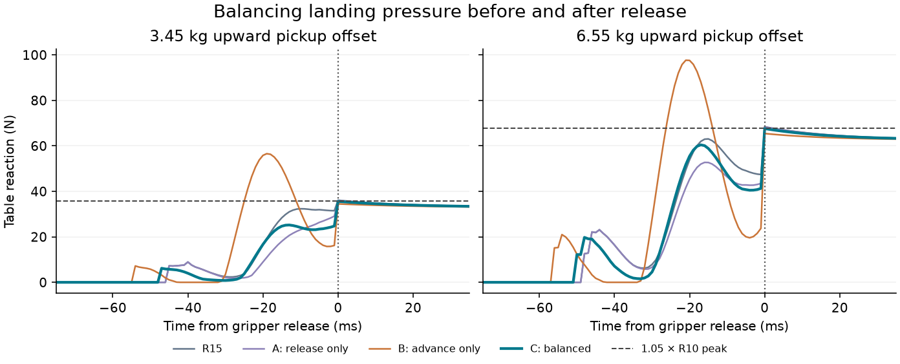

# R16 — 닿을 때의 힘과 놓는 순간의 힘을 함께 줄이기

**이전 단계에서 실패한 두 상향 파지를 원본 토크 시뮬레이션에서 해결했다.** 작업대가 상자를 충분히 받치면서도 R10보다 놓기 최대 힘이 5% 넘게 커지지 않아야 한다. 두 조건에서 이 증가율은 **6.23% → 4.75%, 6.11% → 4.85%**로 줄었다. 이는 하중 인계 결과이며 모든 충돌 조건이나 실기에서 안전하다는 뜻은 아니다.

## 원인: 두 시점의 힘을 구분해야 한다



3.45 kg(`ec1:up`)과 6.55 kg(`ec3:up`) 상자는 R15에서 **해제 전** 각각 무게의 95.5%, 98.1% 이하의 힘만 작업대에 전달했다. 그런데 **3.900초, 흡착이 풀린 첫 샘플**의 힘은 각각 106.6%, 106.4%로 뛰었다. 작업대와 상자는 이미 접촉해 있었고 상자는 위로 되튀기 시작한 상태였다. 하중 인계(G4)의 절대 최대 110%에는 들어가지만, 해당 조건 R10 대비 105% 이내라는 별도 기준을 넘겼다.

두 가지 작용을 따로 시험했다.

| 원본 키트 토크 제어 | 3.45 kg 최대 힘 | 6.55 kg 최대 힘 | 관측한 대가 |
|---|---:|---:|---|
| R10 기준 | 33.97 N | 64.46 N | 두 조건 모두 해제 직전 충분한 지지를 확보하지 못함 |
| R15 조기 무게중심 보정 | 36.09 N | 68.40 N | 하중 인계는 통과, R10 대비 5% 상한 초과 |
| A: 지지 확인 후 해제 직전 작은 수직 보정 | 35.97 N | 68.30 N | 해제 힘 감소가 부족하고 다른 한 조건에서 오경보 |
| B: 접근 경로에서 수직 이동만 앞당김 | 56.56 N | 97.65 N | **해제 후** 힘은 줄었지만, 그 전에 누르는 힘이 커져 22조건 모두 G4 최대치 초과 |
| C: 두 작용의 크기를 함께 정함 | **35.59 N** | **67.59 N** | 두 조건 모두 하중 인계·상대 힘 통과 |

A의 원본 상태를 해제 시점에 복제해 4조건 모두 첫 힘과 접촉 상태를 정확히 재현했다. 0·15·40 ms의 세 분리 시점과 작은 위치·속도·기울기 변화에서 6,240스텝 모두 접촉점은 네 개였다. 두 실패 조건에서 실제 해제 수직속도가 위쪽으로 1 mm/s 더 커지면 첫 힘이 각각 약 0.196 N, 0.371 N 줄어드는 **국소 민감도**가 있었다. 반대로 단순히 그리퍼를 먼저 열면 네 조건 모두 첫 힘이 늘었다. 실제 박스 자세와 힘은 이 사후 진단에만 사용했다. [시점별 힘과 독립 복제에 의한 민감도](../results/r16/detachment.json).

## C를 고른 방법과 검증 범위

이미 공개한 양의 하중 정상 9조건에서 R15·A·B를 각각 실행했다. 시점이 다른 최대 힘을 섞지 않도록 **해제 전 최대·해제 후 최대·해제 직전 20 ms 최소·평균**의 여유를 동시에 계산했다. 그중 가장 작은 여유를 크게 하는 전 구간 공통 계수는 A **1.0000**, B **0.26818**이었다. 사례 이름이나 진짜 접촉력으로 런타임 계수를 바꾸지 않는다. [원자료를 배포하지 않고 재계산 가능한 계수·조건별 표](../experiments/r16_balanced/coefficients.json).

- **알고 있던 22조건:** C는 22/22에서 G4, R10·R15 대비 추종 오차·토크 계단·힘, 오경보 시각·공구 검출·포화·측정된 제어기 p99 기준을 함께 통과했다. 이 중 9조건을 계수 계산에 썼으므로 22건 전부가 독립 시험은 아니다.
- **별도 양의 하중 6조건:** 6/6 통과. 해제 직전 지지는 상자 무게의 평균 **67.2–76.8%**, 최소 **49.8–68.0%**였다.
- **빈 그리퍼:** 위의 C 자체는 채택하지 않았다. 상자가 없을 때 원래 R10은 조용했지만, 기존 R15와 C는 모두 **3.873초에 오경보**를 냈다. 기본 판단이 맞아야 할 빈 구간에서 다른 제어식을 실행해도 된다고 가정한 것이 문제였다. 이 실패를 그대로 남기고, 알려진 질량이 0이면 **제어기와 감지기 둘 다** R10 구현을 그대로 쓰는 D를 별도로 만들었다. 양의 질량에서는 C의 수식을 그대로 쓴다. [단계별 판정 및 조건별 비교](../results/r16/qualification.json).

## D의 최종 판정: 정상 인계는 개선, 충돌 보호는 실패

**기본 제출은 R10으로 유지한다.** 충돌 없는 적재 시험과 실제로 외력을 가한 시험을 분리했다. 모두 원본 키트 토크 시뮬레이션이며 실기 결과는 아니다.

| 동결된 D를 검사한 조건 | 결과 | 해석 |
|---|---:|---|
| 기존에 확인한 적재 28조건 | CPU를 지정한 배포 사본 28/28; 별도 실행 26/28 | 두 실행의 힘·추종·감지 결과는 같다. 별도 실행의 두 실패는 제어기 시간 기준뿐이다. 앞의 C 22+6을 중복 합산하지 않는다. |
| 새 적재 6조건, 별도의 빈 그리퍼 | 6/6 통과, 빈 그리퍼도 통과 | 무부하 6,000주기에서 제어·감지 기록이 R10과 일치하고 3.873초 오경보가 없어졌다. |
| 외력 7조건(새 6개, 기존 1개) | 기존 검출 등 보호 기준 6/7 통과 | **검출률 6/7이 아니다.** R10은 3건을 검출했고, D는 그중 2건만 보존했다. 나머지 4건은 둘 다 미검출이다. |

**결정적 반례:** 5.38 kg 상자를 놓은 뒤 3.940초에 시작한 16 N 수직 외력에서 R10은 **3.980초(+40 ms)**에 경보를 냈지만, D는 경보를 내지 않았다. 동일한 외력을 가했고 외력 이전 궤적은 각 제어기의 무충격 대조와 일치했다. 적재 중 D는 C와 같았고 기존 R15도 이 외력을 놓쳤다. 따라서 빈 그리퍼 예외 처리가 새로 만든 손실은 아니다. 다만 지금 기록만으로는 감지식 자체의 영향과 제어가 바꾼 센서 잔차의 영향을 구분할 수 없다. 별도의 중량 사선 충격은 R15가 놓쳤지만 R10은 143 ms, D는 134 ms에 검출했다. 한 조건의 개선이 다른 양성의 손실을 상쇄하지 않는다.

- 비교기 감사에서 기존 충돌 도구는 R10 양성 보존(+5 ms), 양쪽 대비 추가 오경보·공구 경보를 확인하지만 **R15 양성 지연 +5 ms와 충돌 중 포화도**는 확인하지 않는다는 점도 발견했다. 더 엄격한 검사기는 결과 열람 전에 따로 고정했다. 기존 기준에서 이미 탈락했으므로 같은 충격을 다시 실행해 통과라고 주장하지 않는다.
- 3개의 별도 적재 조건에서 D=C, 비교용 제어=R15가 11개 궤적 배열과 모든 비시간 지표에서 일치했다. 질량이 0인 경우만 특별 처리한다. 양의 질량이면 보정 범위(2.86–8.00 kg) 밖에서도 적재 경로를 선택하므로, 범위 밖 안전성을 보장하지 않는다.
- R10 세 제출 파일은 그대로다. **공식 평가 58회, 비시간 채점값 132개**는 이전 기본 제출 결과와 일치했다. [빈 그리퍼·적재의 동일성 검사](../results/r16/contract_identity.json) · [충돌 결과와 검사기 한계](../results/r16/impact_audit.json).

### 제어 시간: 제어기 단독과 감지 포함 시간을 분리

D의 제어기 단독 p99 상한은 800 µs다. CPU를 지정한 배포 사본의 기존 28조건은 최악 **756 µs**였지만, 별도 실행에서는 같은 두 하향 조건이 **1,023 µs·1,340 µs**로 초과해 그 실행의 다음 단계는 열지 않았다. 처리시간은 실행 환경에 따라 달랐다.

적재 경로 C에서 제어기와 감지기를 **같이** 측정한 별도 벤치마크는 높이 보정이 실제 동작할 때 p99 **1.044 ms**, 최대 **1.692 ms**, 12,000주기 중 **185회가 1 ms 초과**였다. 두 보정 결정 시점만 제외해도 p99 1.042 ms였다. 캐시를 켠 별도 교대 비교에서는 출력은 같고 p99가 885→827 µs로 줄었지만 최대는 1.208→1.304 ms로 늘었다. 하드 실시간이나 실기 적용 가능성을 확인한 것이 아니다. [시간·반복 수·비교 조건](../results/r16/timing.json).

## 별도 결과: 모델 오차가 있을 때의 수평 무게중심 추정

R15의 2.463초 추정은 모델 오차가 있는 큰 이동 12건을 모두 보류했다. R16의 다른 추정기는 **3.447초까지**의 엔코더·관절 토크에서 먼저 관측한 동작 차이를 보정에 반영했다. R15의 늦은 추정(3.549초)보다는 **102 ms 빠르지만**, R15의 조기 추정보다는 늦다. 새로운 원본·섭동 조건 20개씩에서 수평 벡터 오차(RMS)는 **0.098 mm, 0.295 mm**였고, 각 영역의 큰 이동 12/12에서 방향이 맞았으며 작은 이동에 불필요하게 작동한 경우는 없었다. 강성을 마찰과 독립적으로 알아냈다는 뜻은 아니다.

이 추정기를 바로 넣은 제어는 한 상향 파지의 상대 힘이 1.0626배여서 중단했다. 위 C/D는 이 추정 결과를 자신의 제어 성과로 합산하지 않는다. 공개 도구는 정상 보정에서 얻은 수치만 배포하고 원본 키트로 원본 20조건을 다시 실행한다. 원본 키트 하나로 연구용 섭동 학습까지 재현한다고 주장하지 않는다. [오차·조건별 판정과 한계](../results/r16/pooled_payload.json).

## 별도 결과: 더 많이 감지해도 제출하지 않은 이유

기존 토크 제어에 관절 잔차의 방향이 32 ms에 걸쳐 일관되는지 보는 보조 감지기를 추가했다. 기계적으로 동일한 조건의 독립 검사에서 R10이 놓친 약충돌을 원본 **6/6**, 섭동 **6/6** 추가 검출했다. 그러나 **양의 하중에서 보정한 모델을 빈 그리퍼에도 적용**해 1.429초에 오경보가 났고, 기존 R10이 검출한 공식 40 N·100 N 두 사례를 구분할 수 없게 만들었다.

무부하에서 R10을 그대로 쓰는 후속 감지기는 6,000주기 무부하 출력이 R10과 일치했다. 그래도 외력을 받은 뒤 다시 착지하는 세 사례에 추가 경보가 남았다. 평상시보다 늦게 발생한 정상 지지를 새 외력과 혼동한 것이며, 충돌 감지를 단순히 끄는 방식으로 없애지 않았다. **이 보조 감지기들은 C/D 제어에 넣지 않았다.** [독립 검사·공식 회귀·보류 근거](../results/r16/weak_collision_audit.json).

## 내 원본 키트로 실행하기

공개 저장소 밖의 원본 키트와 새 출력 경로를 쓴다. 키트, 평가기, 로봇 모델 원문과 센서 원시는 배포하지 않는다.

```bash
KIT=/path/to/original/icpbl_sim
OUT=/path/to/existing/external-directory
python -B tools/r16_payload_audit.py --kit "$KIT" --out "$OUT/r16-sensor"
python -B tools/r14_grasp_audit.py --kit "$KIT" --out "$OUT/r14-height"
python -B tools/r16_handoff_check.py --law payload-contract --stage exposed \
  --kit "$KIT" --height-calibration "$OUT/r14-height/calibration.json" \
  --early-calibration results/r15/early_stock_calibration.json --out "$OUT/d-exposed.json"
```

같은 도구에서 다음 단계는 `--stage fresh --upstream "$OUT/d-exposed.json"`, 충돌 단계는 `--stage impact --upstream "$OUT/d-fresh.json"`이다. 각각 별도 새 `--out`을 지정한다. 앞 단계의 모든 조건 통과와 소스·모델 해시 일치가 필요하다. 한 사례만 골라 실행한 결과로는 다음 단계를 열 수 없다. 도구가 오류 없이 끝났다는 말과 후보가 성능 기준을 통과했다는 말은 다르다. 기본 제출 확인은 기존 [R10 검증 절차](R10_RELEASE.md)를 따른다.
