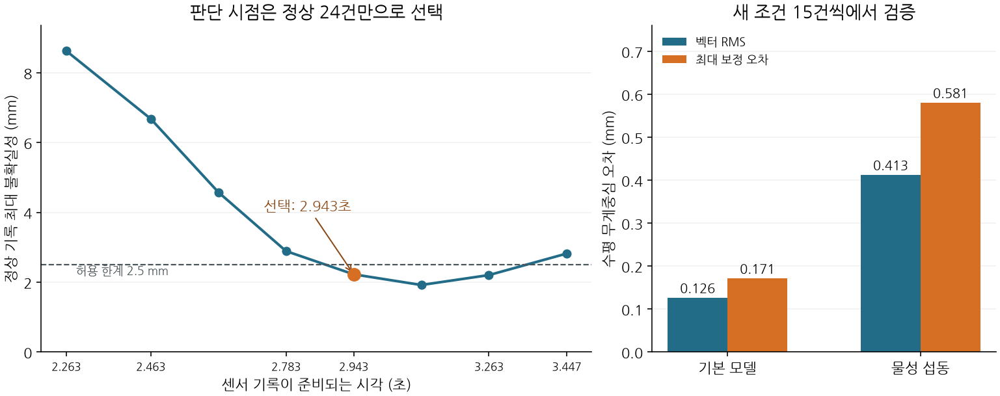
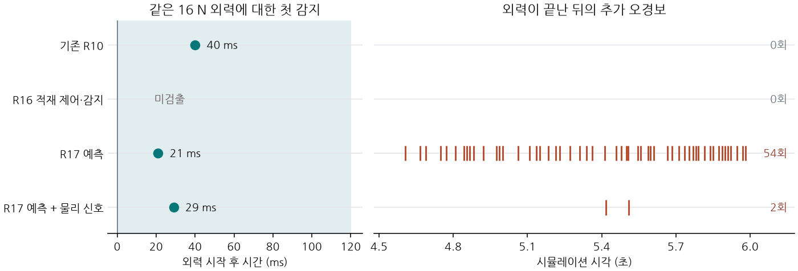

# R17 — 언제 무게중심을 믿을 수 있고, 놓은 뒤의 외력을 어떻게 구분하는가

**무게중심 추정에는 쓸 수 있는 개선이 생겼다.** 서로 다른 물성에서도 수평 무게중심을 판단하는 시점을 **3.447초 → 2.943초(504 ms 단축)**로 앞당겼다. 이에 비해 충돌 판별과 1 ms 주기 보장은 아직 별도 과제다. 아래 결과는 유한한 시뮬레이션 연구이며 제출 기본값은 R10이다.

## 1. 하중을 옮기기 전에 얻은 센서 기록으로 판단하기



2.463초까지 기다린 첫 시도에서는 마찰에 따른 움직임 차이를 두 변수로 보정했지만, 정상 1건씩을 빼고 다시 맞춘 최대 오차가 **2.731 mm**였다. 기존 물리 여유 0.75 mm를 더하기도 전에 2.5 mm를 넘겼다. 결과 숫자를 작게 보이게 하려고 거부된 사례를 제외하지 않았다. 이전에 본 두 영역의 큰 이동 **각 12건을 모두 보류**했다.

다음 시도에서는 기존 정상 기록 **24건**으로만 판단 시점을 정했다. 빈 팔일 때 센서로 본 움직임 차이와, 그 뒤 상자를 든 동안 관절 토크가 알려진 질량·무게중심에 어떻게 반응하는지를 함께 썼다. 가상 모델의 실제 마찰·강성, 실제 상자 자세나 접촉력은 추정 입력이 아니다. 시간을 8단계로 늘려 가며 한 정상 기록 전체 또는 연속 시간 블록을 뺐을 때도 불확실성이 2.5 mm 이내인지 확인했다. **연속 두 단계가 통과한 최초 시점**을 고정했다. 2.783초에서는 최대 2.891 mm로 부족했고, 2.943초와 3.103초에서는 각각 2.225 mm와 1.920 mm였다. 마지막 3.447초에서 같은 데이터로 이전 R16 계수도 그대로 복원했다. 이는 더 오래 볼수록 모든 불확실성이 단조롭게 줄어든다고 가정한 방법이 아니다.

| 분리한 새 평가 | 조건 수 | 벡터 RMS | 보류를 포함한 최대 보정 오차 | 큰 이동 중 방향이 맞은 보정 | 작은 이동 오작동 |
|---|---:|---:|---:|---:|---:|
| 기본 모델 | 15 | 0.126 mm | 0.171 mm | 9/9 | 0 |
| 강성·마찰 등 물성 섭동 | 15 | 0.413 mm | 0.581 mm | 9/9 | 0 |

각 영역은 세 가지 질량·무게중심 조합에 다섯 가지 파지 위치를 적용했다. 입력 기록은 **2.943초에서 잘랐고**, 두 영역의 예측을 모두 고정한 뒤 실제 박스 자세로 채점했다. 수락한 예측 중 오차 구간을 벗어난 경우는 양쪽 모두 0건이다. 이 숫자는 임의의 환경에서의 성공 확률이 아니다. [선택 곡선·조건별 예측과 채점](../results/r17/information.json)

### 독립적으로 확인하려면

공개 저장소 밖에 별도로 받은 원본 키트와, 이미 의존성이 설치된 Python이 필요하다. 다음은 **원본 엔진 위에서 연구용 R1 토크 제어기와 추정기를 시험**한다. 수업 원본 데모를 실행하는 명령은 아니다.

```bash
python -B tools/r17_payload_audit.py --kit /path/to/icpbl_sim --out /path/to/new-r17-result
```

기본 모델 15건을 다시 실행하며, 파생 결과만 기록한다. 원시 센서나 수업 모델은 배포하지 않는다. 이 명령의 예측과 채점은 연구용 15건과 모두 일치했다. 원본 키트만으로 연구용 섭동 보정 데이터까지 재생성하지는 않는다. 적법하게 확보한 정상 센서 기록 24개가 있다면 같은 보정 계산을 `experiments.r17_information_prefix.fit_normal`로 다시 수행할 수 있다.

## 2. 추정이 나아졌다고 하중 인계까지 보장되지는 않는다

같은 200 ms에 걸쳐 무게중심 보정을 적용하고, 비교할 때는 R10·R15·R16과 동일한 물리 조건을 사용했다. 놓기 직전의 작업대 지지, 최대 힘, 추종, 토크 변화, 오경보, 공구 접촉, 포화 및 제어기 시간을 각각 확인했다.

- **기본 모델 4/5 조건 통과.** 3.28 kg 상향 파지에서 이전 보정의 놓기 힘은 R10 대비 6.26% 증가해 상한 5%를 넘었다. 새 조합은 **4.49%**로 통과했다. 대신 6.65 kg 상향·수평 오차(`sh5`)에서는 힘 기준을 지켰지만 외력이 없는데 **3.903초에 추가 경보**가 났다.
- **물성 섭동 3/4 조건 통과.** 7.83 kg 상향 파지에서 최대 힘은 상자 무게의 101.3%, 마지막 20 ms의 최소 지지는 33.0%였지만, **평균 지지가 42.6%**라서 50% 기준을 넘지 못했다. 늦은 비교 제어기는 평균 71.6%였으나 해제 후에 추가 경보를 냈다.

공개 센서로 이 지지력 부족을 제어할 수 있는지도 따로 확인했다. 7.83 kg 사례에서 기존 지지 추정치는 실제 지지가 더 낮은 제어를 오히려 높게 평가했다. 대신 최근 10 ms의 관측으로 계산한 상자 바닥 상승 속도가 3.875초부터 양수였고 최대 28.13 mm/s였다. 이 신호로 하향 보정을 상자 무게의 5% 이내로 제한한 후속 제어는 첫 필수 회귀 `sh5`에서 기존 3.903초 경보를 없애지 못했다. **9건 중 첫 건에서 중단했으므로 7.83 kg에서 이 보정이 효과가 있었다고 말하지 않는다.** [후속 제어의 판정](../results/r17/support_shape.json)

위 9건은 이미 조건을 알고 수행한 폐루프 대조다. 추정기의 별도 검증 30건과 합산하지 않는다. [조건별 힘·경보 시각 및 비교 제어기](../results/r17/handoff.json)

## 3. 16 N 외력: 외력 신호가 없는 것과 감지기가 놓치는 것은 다르다

R16이 놓친 조건(5.38 kg, 3.940초부터 상향 16 N)을 **이미 본 반례**로 표시하고, 외력을 준 실행마다 외력이 없는 같은 제어기 실행을 대조했다. R10 경로에서 R10 감지기는 +40 ms에 구분했다. R16 적재 경로에서는 R10 감지기를 그대로 붙여도 외력이 오기 전 3.903초에 정상 해제 경보를 냈고, 진짜 외력을 구분하지 못했다. R16 감지기는 그 정상 해제 경보는 없앴지만 진짜 외력도 놓쳤다. 두 감지기가 **동일한 센서 입력**을 보게 한 대조에서 외력 때의 수직 성분은 남아 있었고, 강한 신호가 연속 샘플 조건을 채우지 못한 것을 확인했다.

| 정상 기록으로만 설계한 감지기 | 확인한 결과 |
|---|---|
| A: 끊어진 수직 잔차를 누적 | 파지 전 공구 접촉이 가장 큰 정상 신호였다. 정상 최대치에 여유를 두면 16 N은 미검출. |
| B: 실제 그리퍼 열림 이후에만 누적 | 파지 전 간섭은 없어졌다. 그러나 무충격 중량물의 해제 18 ms 후 누적값 6.026이 16 N 외력 때의 5.145보다 컸다. 하나의 크기 상한만으로 분리할 수 없었다. |
| C: 실제 해제 이후의 정상 방향별 신호를 예측 | 34개 정상 조건 중 동일한 입력을 묶고, 질량 15그룹을 하나씩 제외해 기준을 학습했다. **16 N을 +21 ms에 실제 검출**했으나 같은 충격 뒤 4.605–5.982초에 **추가 경보 54회**가 났다. 다른 두 충격에서도 29회·42회가 추가돼 채택하지 않았다. |
| D: 같은 방향의 예측 오차와 기존 물리 신호 한도를 동시에 확인 | 16 N을 **+29 ms**에 검출했다(R10 +40 ms). 이 사례의 충격 후 오경보는 C의 **54→2회**, 다른 두 충격은 **29→1회, 42→1회**로 줄었다. 그래도 네 번의 추가 경보가 남아 전체 기준은 실패다. |



단 한 번의 외력 이후 반복 경보가 난 것은 54개의 다른 충돌을 잘 찾았다는 뜻이 아니다. 또한 경보를 계속 켜 두거나 재감지를 막아 점수를 개선하는 방법은 쓰지 않는다. [감지기별 판정·양성/오경보 시각](../results/r17/collision.json)

남은 네 경보는 **실제 추가 접촉이 아니었다.** 모두 마지막 복귀 지령(5.3초) 뒤인 5.358·5.370·5.417·5.509초였고, 그때 가해진 외력과 공구 접촉력은 모두 0 N, 그리퍼는 열린 상태였다. 작업대에는 이미 분리된 상자의 무게만 실렸다. 수직 방향 **센서 기반 추정 신호**는 2.94–3.65 N으로 기존 2.813 N 한도를 실제로 넘었으나, 이것은 새 외력이 2.94–3.65 N 가해졌다는 뜻이 아니다. 같은 시각의 무충격 대조에는 경보가 없었다. 외력 이후 복귀 운동에서 정상 모델과 달라진 센서 신호를 후속 충돌과 분리하지 못한 것이다. 기존 양성을 모두 유지하는 것만으로는 충분하지 않아 **새 외력 조건은 열지 않았다**.

### 이미 보고한 실패를 원본 키트로 재현하기

아래 검사는 새 충격을 만들지 않는다. 위에서 사용한 **5.38 kg·16 N 반례 한 개**를 각 제어기의 무충격 실행과 짝지어 비교한다. `KIT`에는 별도 확보한 원본 키트, `OUT`에는 키트와 저장소 밖에 있는 기존 출력 폴더를 지정한다. 출력 이름은 새 것이어야 한다.

```bash
python -B tools/r14_grasp_audit.py --kit "$KIT" --out "$OUT/r14-height"
python -B tools/r17_release_replay.py --kit "$KIT" \
  --height-calibration "$OUT/r14-height/calibration.json" \
  --early-calibration results/r15/early_stock_calibration.json \
  --out "$OUT/release-replay.json"
```

R10·R15는 각각 자기 제어기를 쓰며, R16과 연구 감지기 C·D만 같은 제어 궤적에서 감지를 비교한다. 매 실행의 충격 전 이력과 실제 외력을 확인한다. 배포용 감지기는 시간 입력과 반환형 표기 두 곳을 제외한 실행 구문이 동결한 연구 코드와 동일한지 검사한다. 로컬 배포 사본에서 R10 +40 ms, R15·R16 미검출, C +21 ms·추가 경보 54회, D +29 ms·추가 경보 2회가 재현됐다. [다섯 비교군의 판정과 입력 해시](../results/r17/release_replay.json). `NEGATIVE_CONTROL_REPRODUCED`는 **미채택 사유를 재현했다**는 뜻이지 제어기가 합격했다는 뜻이 아니다.

**후속 실측에서 바로잡은 점:** 신호 기록을 별도 관측기로 재생한 수치와, 제어기·감지기를 한 에피소드에서 함께 실행한 수치는 구분해야 한다. 위 16 N 사례의 R10·R17C·R17D 값은 동시 실행으로 확인됐다. 다른 질량에서는 감지기가 제어기와 공유하는 공칭 무게중심이 실행 중 바뀌어, 동일 센서 기록을 처음 상태의 관측기로 재생한 결과를 그대로 적용할 수 없다. [R18의 직접 실행과 재생 대조](R18_REPEAT_IMPACTS.md).

## 4. 제어 시간: 99백분위와 최악값은 둘 다 중요하다

매 주기 반복하는 높이 보정 역기구학의 공통 참조점을 재사용했다. 같은 CPU의 순서를 바꾼 비교에서 제어기 p99는 **1.043 → 0.455 ms**, 감지 포함 p99는 **1.295 → 0.733 ms**로 줄었다. 1 ms 초과는 12,000주기 중 **881 → 8회**로 줄었지만 최악은 **1.467 ms**였다.

다음으로, 필요한 센서가 이미 들어온 뒤 수행할 수 있는 높이 계산을 3.527–3.541초의 15주기에 나눴다. 3.550초의 최대 소요는 가벼운 적재에서 **1.012 → 0.492 ms**, 무거운 적재에서 **1.084 → 0.607 ms**였다. 계산을 나눈 주기 자체도 0.652 ms 이하였고, 제어 판단과 물리 결과는 수치 허용 범위에서 보존됐다. 그러나 전체 주기의 가벼운 적재 p99는 재사용만 한 대조의 **0.663 → 0.764 ms**, 1 ms 초과는 **3 → 25회**로 악화했다. 개선된 특정 시점만 골라 실시간 검증 통과라고 하지 않는다. [각 실행의 최대·초과·제어기/감지 합산 측정](../results/r17/timing.json)

질량 0 또는 보정 범위(2.86–8.00 kg) 밖은 연구 수식을 외삽하지 않는 별도 경로도 시험했다. 0·2.21·8.07 kg에서 6,000주기씩 R10과 제어·경보가 일치했다. 이는 범위 밖에서도 하중 인계가 개선됐다는 주장이 아니라, **알려지지 않은 영역에서 R10 동작을 보존한다는 확인**이다. [무부하·범위 밖·적재 경로](../results/r17/domain.json)

수업 기본 예제, 저장소 첫 비교 영상, 위 연구용 조건을 혼동하지 않도록 [데모 출처와 원래 조건](DEMO_SOURCES.md)을 구분해 두었다.
