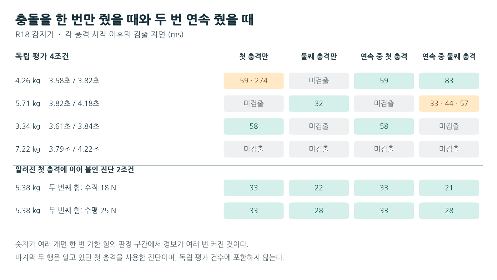

# R18 — 한 번의 충돌에서 생긴 재경보와 두 번째 충돌 구분하기

R17 감지기는 상자를 놓은 뒤 가해진 수직 외력을 알아챘지만, 팔이 복귀한 뒤 실제 접촉 없이 다시 울렸다. R18은 센서 기반 예측과 물리 신호가 같은 방향으로 함께 커지는지를 그대로 보되, **최근 8개 센서 샘플 중 4개 이상에서** 그 조건이 성립해야 추가 경보를 낸다. 한 번 경보가 난 뒤 일정 시간 꺼 두는 방식은 아니다. 기본 충돌 감지와 공구 접촉 감지는 계속 작동한다.

## 이미 알고 있던 사례로 원인과 수정 확인

R17에서 실제 충돌 두 건은 8개 중 7~8개 샘플에 증거가 남았지만, 정상 복귀 중 잘못 울린 네 번은 한 샘플짜리였다. **이것을 본 뒤 만든 규칙이다.** 정상 기록으로만 학습한 기존 예측 모델과 6방향 힘·모멘트 한도는 바꾸지 않았다. 여기서의 개선만으로 독립적인 검출 성능을 주장할 수는 없다.

| 같은 5.38 kg 상자 / 수직 16 N / 외력 시작 3.940초 | 실제 첫 검출 | 충돌 뒤 오경보 |
|---|---:|---:|
| R10 제출 제어·감지 | 40 ms | 0 |
| R16 적재 제어·감지 | 미검출 | 0 |
| R17D 감지기, R16 적재 제어 | 29 ms | 2 (5.417초, 5.509초) |
| R18 감지기, 동일한 R16 적재 제어 | **33 ms** | **0** |

단발성 오경보를 거르는 대신 첫 반응이 R17D보다 **4 ms 늦어졌다**. 같은 시뮬레이션에서 R10보다는 7 ms 빨랐다. 이미 본 충돌 7조건에서 **3건의 실제 양성을 유지했고 4건은 여전히 미검출**이다. 16 N 검출 시각은 33 ms였다. 7.42 kg·20 N의 경우, 센서 기록을 새 관측기로 재생하면 22 ms가 나오지만 같은 제어기에 감지기를 실제로 연결하면 **28 ms**였다. 두 숫자는 같은 시험이 아니다. 실제 제어에서는 보정된 공칭 무게중심을 관측기와 공유한다. 그때 한 해제 특성이 학습 범위를 0.0676 표준화 단위 벗어나, 보조 예측은 외삽하지 않고 기본 감지기가 28 ms에 응답했다. 각 조건의 외력 전 센서 이력과 실제로 가해진 힘, 무충격 대조의 경보 상태를 확인했다. 34개 기존 정상에서 추가·손실 경보가 없었고 공구 양성, 빈 팔, 서보 경로도 별도로 확인했다. [조건별 비교와 실행 입력](../results/r18/sentinel.json)

## 무엇을 두 번째 충돌로 세는가?

한 조건마다 **무충격 / 첫 충격만 / 두 번째만 / 둘 다**를 독립적으로 실행한다. 연속 두 번째 검출은 직전 20 ms에 경보가 꺼져 있었고, 두 번째 충격을 빼고 돌린 동일한 실행에서는 후보 경보 전후 20 ms에 경보가 없어야 인정한다. 플랜지에 실제 기록된 3축 힘(부호 포함), 첫 충격 전 대조, 둘째 시작 전 첫 충격만 있는 대조도 확인한다. 계속 켜진 경보, 이미 정상에서 난 경보, 충격 시작과 동시에 미리 켜는 경보는 인정하지 않는다.



- **독립 4조건:** 첫째·둘째와 각 단독 대조까지 모두 만족한 것은 **0/4**다. 두 힘을 모두 가한 실행에서 두 번째 힘을 구별한 것은 **2/4**였다. 4.26 kg에서는 둘을 연속으로 가하면 59·83 ms에 각각 잡았으나, 둘째 힘만 가하면 놓쳤다. 5.71 kg에서는 첫 힘을 놓쳤고 두 번째 한 번의 힘에 33·44·57 ms로 세 번 울렸다. 나머지 두 조건에서는 두 번째를 놓쳤다.
- **늦은 재경보에 대한 별도 진단 2조건:** 5.38 kg·16 N의 알려진 첫 충격 뒤, 원래 오경보가 나던 때에 새 힘을 가했다. 5.415초의 수직 18 N은 **21 ms**, 5.505초의 수평 25 N은 **28 ms**에 구별했다(R10은 28·33 ms). 둘째 힘을 빼면 같은 시각에 울리지 않았다. 이 두 경우에는 실제 후속 충돌을 놓치지 않고 잔류 신호를 걸렀지만, 이것을 네 독립 조건의 합격 건수에 더하지 않는다.
- 네 비교군 모두가 두 충격을 잡아야 한다는 가장 엄격한 공동 판정은 진단 두 조건에서도 실패했다. R15·R16 대조가 첫 16 N을 놓쳤기 때문이다. 반대로 추가 외력 구간 밖에 오경보가 없다고 해서, 한 번 가한 힘에 여러 번 켜진 경보를 다른 충격으로 세지 않는다.

**왜 놓치고, 왜 세 번 울렸는가?** 7.22 kg 복귀 조건은 그리퍼가 열린 순간부터 해제 전 명령·센서 특성이 학습 범위 밖이었다. 두 번째 충격이 없었던 게 아니다. 같은 첫 충격만 준 대조보다 관절각이 최대 0.0109 rad 변했고 수직 추정 신호가 기존 한도의 2.12배였지만, 범위 밖이라 보조 예측은 작동하지 않았다. 5.71 kg 사례는 반대로 범위 안이었다. 한 번의 연속 수직 힘(0이 아닌 119샘플)이 11개의 짧은 센서 신호 구간으로 나뉘어, 최근 8샘플 중 4개를 요구하는 경보가 세 번 켜졌다. [같은 네 대조 실행에서의 원인 확인](../results/r18/pair_attribution.json)

**힘 기록 검증에서 발견한 차이:** 세 독립 조건은 기존 평가기의 엄격한 비트 일치 항목에도 걸렸다. 원본은 한 시점씩 힘의 크기를 계산하고 기존 검사기는 여러 시점을 묶어 계산해 최대 1.78×10⁻¹⁵ N의 반올림 차이가 났다. 원본과 같은 단일 벡터 연산으로 다시 비교하면 6조건 모두 정확히 일치했고, 플랜지에 가한 **부호 있는 3축 힘**은 원래부터 일치했다. 원래 판정을 지우지 않았으며, 연산 차이가 없어도 독립 네 조건의 미검출은 남는다. [두 계산 방식의 검산](../results/r18/force_reporting.json)

[6조건의 방향·시각·모든 비교군의 판정](../results/r18/paired.json)

## 하중 인계는 별개다

6.65 kg 상자의 수평·상향 파지에서는 여전히 **무충격인데 3.903초에 울리는 문제**가 있다. 이는 위 16 N 재경보와 다른 제어기·다른 원인이다. 놓은 직후의 토크 지령이 튀는지를 확인하려고 40 ms 동안 지령을 부드럽게 넘겼다. 놓는 순간 지령 변화율은 **1,106.5 → 0 N·m/s**, 다음 주기도 **1,888.1 → 0.2**로 줄었지만 경보 시각은 그대로였다. 이 사례에서는 그리퍼가 열리면서 작업대에 대한 판정이 바뀔 때, 이미 누적된 상태 때문에 보정된 Y축 모멘트가 네 샘플 연속 한도를 넘었다. 보정 후보는 첫 필수 사례에서 기각했다. [지지력·채점 및 감지 채널](../results/r18/continuity.json)

수평 무게중심 판단을 기존 2.943초보다 다시 앞당기는 별도 시도도 검증했다. 기본 물성에서 2.463초 추정이 얼마나 믿을 만한지 보여 주는 듯했던 범위가, 실제로는 동일한 시뮬레이터 난수 시드의 수치 반복성에 불과했다. 엔코더 한 카운트나 토크 센서 잡음 표준편차 크기의 변동을 주자 **9개 중 0개**가 그 범위에 남았다. 기본 물성 3개 질량에서도 시드를 바꿔 실제 센서와 제어기를 연결한 12회로 재확인했다. 원래 시드는 세 경우 모두 이전 센서 기록을 그대로 재현했고, 다른 시드의 9회는 모두 그 범위를 벗어났다. 센서 시드가 달라진 것만으로 생긴 차이다. 이 방법을 착지 제어에는 넣지 않았다. [반복성·음성 대조](../results/r18/early_support.json)

## 시간 비용은 같은 감지기끼리 비교

기존 구현은 매 주기 같은 방향별 예측을 두 번 계산했다. 알려진 질량만 쓰는 보정은 초기화 때 구하고, 해제 전 센서가 필요한 항은 실제 그리퍼가 열렸을 때 한 번만 준비한다. 이후 매 주기 예측을 한 번만 계산한다. 같은 제어기를 쓰고 같은 CPU에서 실행 순서를 바꿔 비교했다. 감지 비트와 6축 잔차, 물리 궤적, 방향별 상태가 같아야 시간 비교에 포함했다.

감지기만 비교하면 회복 판정까지 포함한 R18에서 해제 후 p99가 5.38 kg에서 **278→250 µs**, 7.90 kg에서 **213→199 µs**였다. 그러나 제어기까지 합치면 5.38 kg에서는 전체 p99가 612→675 µs로 악화했다. 7.90 kg은 1,336→1,206 µs로 줄었지만 여전히 1 ms를 넘었고, 최악은 2.08→4.17 ms였다. CPU 스케줄링을 포함한 실제 벽시계 측정이므로 전체 주기의 최대를 보장하지 않는다. [두 순서 교차 실험의 전체 분포와 최악값](../results/r18/timing.json)

### 같은 조합으로 하중 인계와 충돌 기준을 한 단계씩 통과했는가?

질량 범위 밖에서 R10으로 돌아가는 R17 제어기에 단일 계산 방식 R18 감지기를 연결해, 사전에 정한 네 단계를 **같은 조합**으로 순서대로 평가했다. 정상에서는 그리퍼를 열기 전후의 실제 지지, 힘 피크, R10·R15 대비 비용, 오경보 시각, 포화와 시간을 함께 확인했다.

| 단계 | 비교 기준을 통과한 조건 | 의미 |
|---|---:|---|
| 기존 정상 34 + 무부하·범위 밖 3 | 37/37 | 범위 밖의 제어·감지는 R10과 일치 |
| 기존 단일 충돌 | 7/7 | 이전 양성·지연과 정상 대조를 보존; 7건 모두 검출했다는 뜻은 아님 |
| 새 정상 | 6/6 | 하중 인계와 비교 비용 기준 충족 |
| 새 단일 충돌 | 8/8 | **실제 양성은 3/8**, 기존 세 양성을 보존. 나머지 5건은 모든 비교군이 미검출 |

새 세 양성은 하향 15 N **76 ms**(R10 149 ms), 상향 15.5 N **48 ms**(R10 50 ms), 하향 17 N **130 ms**(R10 130 ms)였다. 이 속도는 같은 조건의 R16D와 같아서 R18만의 새 검출 이득은 아니다. 최종 배포 기준과 중간 선별도 구분한다. 각 조건의 제어+감지 p99는 1 ms 이내였지만, **총 438,000주기 중 35회**가 1 ms를 넘었고 최악은 **1.783 ms**였다. [단계별 공개 결과와 탈락하지 않은 이유](../results/r18/combined.json)

## 원본 키트에서 재현

별도로 확보한 수업 키트와 의존성이 설치된 Python이 필요하다. 아래는 **키트 위에 연구 제어기·감지기를 얹는 시험**이다. [수업의 원본 데모 실행법](DEMO_SOURCES.md)과 다르다. `KIT`은 키트 폴더, `OUT`은 키트·저장소 밖에 이미 만든 출력 폴더다. 각각의 출력 이름은 새 것이어야 한다.

```bash
python -B tools/r14_grasp_audit.py --kit "$KIT" --out "$OUT/r14-height"
python -B tools/r18_recovery_audit.py --kit "$KIT" \
  --height-calibration "$OUT/r14-height/calibration.json" --out "$OUT/r18-sentinel.json"
```

연속 충돌 여섯 조건은 `--study pairs`로, 네 단계의 하중 인계·감지 결합 시험은 `--study progressive`로 같은 명령을 다시 실행한다. **각각 별도 새 출력 파일**을 지정한다. 전자는 알려진 사례 재현 후 네 비교군·최적화 구현까지 120개 에피소드를 대조하며, 후자는 해당 컴퓨터에서 한 단계라도 실패하면 다음 단계를 열지 않는다. 같은 결과를 재현했다는 표시는 검출기가 모든 충돌을 찾았다는 뜻이 아니다.
