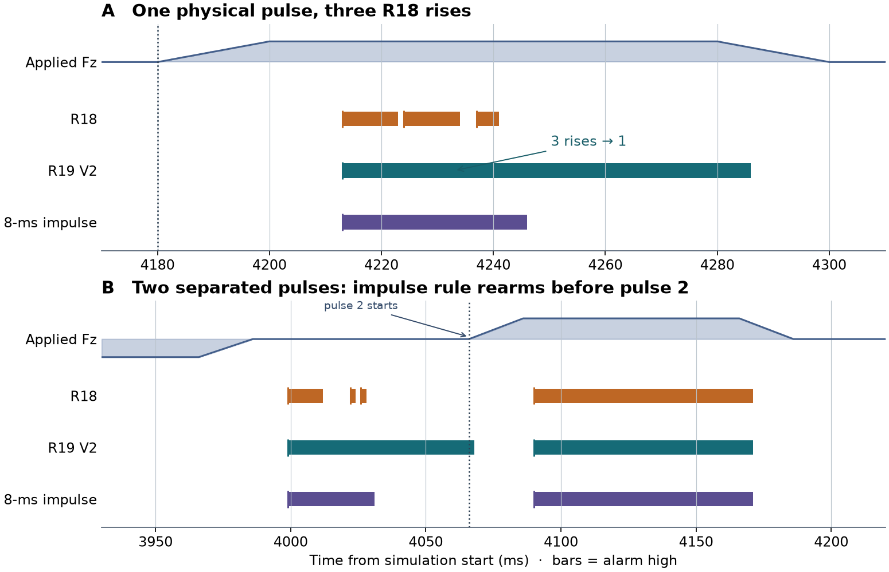

# R19: 경보를 한 번으로 묶으면 다음 충격도 보이는가?

**수업 원본 데모가 아니라 원본 물리 시뮬레이터에 연결한 연구용 감지기다. 기본 제출은 R10 그대로다.** 한 번의 충격에 세 번 울리던 현상은 없앴지만, 새로운 6조건 중 하나에서는 첫 경보가 실제 둘째 충격의 시작까지 남았다. 단일 경보 비트를 이렇게 바꾸는 것은 아직 권하지 않는다.

## 첫 경보는 그대로, 종료만 변경

R18은 예측 오차와 센서로 추정한 힘이 같은 방향으로 동시에 커진 샘플이 최근 8개 중 4개 이상일 때 보조 경보를 낸다. 이 방식은 약한 충격의 시작을 보지만 하나의 힘을 여러 건으로 쪼갤 수 있다. R19는 그 **시작 조건, 물리적 힘의 문턱, 정상 예측 모델, 기본 경보**를 그대로 둔 채 보조 경보의 종료만 바꾼다.

- 처음에는 물리 신호와 예측 오차가 모두 정상으로 돌아올 때까지 기다렸다. 이미 본 조건에서 한 번의 경보가 최장 **621 ms** 이어졌다. 위치 복귀 중의 예측 오차까지 외력으로 취급한 이 버전은 기각했다.
- 두 번째 버전은 보정한 6축 힘·모멘트 신호가 기존 물리 문턱 안에 **8샘플 연속** 돌아오고 R18의 시작 조건도 풀리면 종료한다. 이후 감지를 차단하는 시간은 없다.
- **5.71 kg, 복귀 중 수직 13 N:** R18은 충격 뒤 33·44·57 ms에 울렸고 R19는 **33 ms 한 번**만 울렸다. 4.286초에 경보가 꺼졌는데, 실제 외력은 4.300초까지 이어졌다. 따라서 이것은 *관측 신호가 문턱 아래로 돌아온 때*이지 실제 접촉이 끝났다는 증명은 아니다. 이전에 확인한 두 후속 충격은 각각 **21·28 ms**로 유지했다. [동결한 두 설계와 비교](../results/r19/event_design.json)



주황색은 R18, 청록색은 8샘플 연속 물리 문턱형(V2), 보라색은 아래의 8 ms 누적형이다. 위쪽은 5.71 kg 사례 중 두 번째 외력만 보이도록 확대한 것이다. 아래쪽은 새 6.84 kg 사례다. 점선은 두 번째 힘을 가하기 시작한 시점이고, 막대는 실제 경보가 켜져 있던 구간이다. [물리 입력과 관측 경보 구간](../results/r19/timelines.json)

## 새 여섯 조건: 경보 수와 진짜 검출을 분리

후보를 고정한 뒤 각 조건을 **외력 없음 / 첫째만 / 둘째만 / 둘 다**로 실행했다. 모든 제어기에서 플랜지에 가한 부호 있는 3축 힘과 외력 전 이력을 확인했다. 실제 시작 시점에는 힘 크기가 0이므로 그 샘플의 경보는 인정하지 않았다. 충격 직전 **20 ms** 동안 경보가 없어야 하고, 해당 충격을 뺀 대조군이 관측 상승 시각의 ±20 ms에 이미 울리고 있으면 그 상승은 인정하지 않았다. 단독 실행과 연속 실행을 모두 구별해야 최종 통과다.

| 두 힘 사이 간격·방향 | 연속 실행에서 R19 첫째 / 둘째 | 결과를 가른 이유 |
|---|---:|---|
| 12 ms, 같은 수직 방향 | 31 / 38 ms | 단독·연속 검출과 기준 제어기 대비 지연 모두 통과 |
| 24 ms, 반대 수직 방향 | 22 / 49 ms | 둘 다 잡았지만 둘째만 가했을 때 R15의 43 ms보다 6 ms 늦어 허용차 5 ms 초과 |
| 40 ms, 수평→수직 | 30 / 불인정 | 둘째 뒤 +22 ms에 다시 울렸지만, 시작 전 20 ms 무경보 조건 미달 |
| 80 ms, 해제를 걸친 약한 하향→상향 | 133 / 불인정 | 아래 설명처럼 +24 ms 상승은 관측됐으나 첫 경보가 둘째 시작 때 아직 켜져 있었음 |
| 160 ms, 수평 두 방향 | 49 / 33 ms | 모든 기준 통과 |
| 24 ms, 복귀 끝에서 같은 수평 방향 | 36 / 불인정 | +28 ms 상승은 있었지만 시작 전 20 ms 무경보 조건 미달 |

결과는 **첫째 6/6**, 두 충격을 함께 가했을 때 **둘째 3/6**(R18은 4/6), 모든 대조·지연 기준을 만족한 것은 **2/6**이다. 동일한 시나리오의 단독·연속 반응을 나눈 네 채점 구간에서 목표당 첫 상승을 제외한 추가 상승은 **R18 4건 → R19 0건**이었다. 이 4건은 서로 다른 실제 충격 네 건을 뜻하지 않는다. 새로 열린 정상 6조건에서는 기존 경보와 잔차를 보존했다. [다섯 비교군의 조건별 지연·종료·실패 기준](../results/r19/separation.json)

**80 ms 간격이 12 ms보다 오히려 어려웠던 이유:** 첫 14 N 하향 힘은 3.986초에 끝나는데 첫 경보는 그 뒤인 3.999초에 시작했다. 둘째 16 N 상향 힘은 4.066초에 시작했다. R19는 두 힘을 모두 가했을 때와 첫째만 가했을 때 모두 4.068초가 돼서야 첫 경보를 껐다. **4.090초에 둘째에 의한 별도 상승은 실제로 있었다.** 이를 기록에서 지우지도, 둘째 시작을 정상적으로 구별했다고 채점하지도 않았다. 힘 사이의 시간만으로 재검출을 보장할 수 없는 사례다.

실제 제어와 감지기를 함께 다시 실행해 보니, 두 힘 사이에 플랜지 외력이 정확히 0인 표본이 81개였다. 그중 수직 추정 신호만 37샘플에서 문턱을 넘었고 다른 다섯 축은 한 번도 넘지 않았다. 둘째 힘이 시작될 때는 여섯 축 모두 낮았지만 최근 8개 중 7개만 낮아서 종료하지 못했다. 첫 신호가 난 축만 보더라도 같은 8샘플 규칙으로는 해결되지 않는다. [같은 첫째만 준 대조를 포함한 내부 상태 검증](../results/r19/gap80.json)

## 후속 해법: 문턱 밖에 한 번 나갔는지 대신, 8 ms 동안 힘이 얼마나 쌓였는지

80 ms 사례에서 Fz가 간헐적으로 튀어 경보가 연장된 것을 확인한 뒤, **별도의 후보**를 만들었다. 최근 8개 관측값을 모두 사용하되 축별로 힘·모멘트의 절댓값을 기존 부호별 문턱으로 나누어 더한다. 여섯 축 모두 누적값이 8 이하이고 R18의 시작 신호도 꺼졌을 때 이벤트를 끝낸다. 양·음의 힘이 상쇄되어 조기에 꺼지지 않도록 절댓값을 먼저 취한다. 창을 단축하거나, 시작 문턱을 낮추거나, 재감지 금지 시간을 넣지 않았다. 이것은 측정량의 변경이지 물리적인 접촉 종료 시각의 직접 추정은 아니다.

- **이미 본 6.84 kg 조건에서 실제 개선:** 첫 경보 종료가 4.068→**4.031초**로 앞당겨졌다. 실제 둘째 시작 전 **35 ms** 동안 경보가 꺼졌고, 둘째를 **+24 ms**에 구분했다. 5.71 kg에서는 여전히 **+33 ms 한 번**, 알려진 수직·수평 둘째도 **+21/+28 ms**였다. 이미 노출된 12조건의 양성·힘·잔차·추가 경보를 보존했다. [동일 조건 네 쌍의 관측 구간](../results/r19/impulse_known.json)
- **다시 고정하고 처음 연 별도 여섯 조건:** 정상 6조건을 먼저 통과했다. 연속 실행 첫 충격 **5/6**, 둘째 **3/6**, 단독·연속 네 반응에 각각 정확히 한 경보가 있고 대조 지연까지 통과한 건 **2/6**이었다. 18 ms 간격의 같은 방향과 100 ms 간격의 교차 방향이 각각 **+23/+32 ms**, **+65/+20 ms**로 통과했다. 같은 여섯 조건에서 R18의 둘째도 3/6이어서 새 조건에서 검출 수가 늘었다고 할 수 없다. [새 여섯 조건과 모든 대조군](../results/r19/impulse_test.json)
- **남은 중복은 어디서 생겼나?** 55 ms 간격에서는 둘째에 +41 ms와 +59 ms 두 번 울렸다. 같은 물리 이력에서 보조 경로가 없는 기본 감지기도 +59 ms에 울렸다. 65 ms 간격에서는 첫째에 누적형이 +82/+131 ms, 기본 감지기만 쓴 대조도 +82/+138 ms로 두 번 울렸다. 보조 경보의 종료만 고치면 모든 중복이 없어진다는 가정은 이 두 대조와 맞지 않는다. 두 번째를 놓친 35 ms 사례에서는 첫째만 가해도 +156 ms에 경보가 생겨, 두 힘을 모두 가했을 때 둘째 뒤 +1 ms 경보와 구별되지 않았다.

두 번의 여섯 조건은 질량, 방향, 시각이 **서로 다른** 집합이다. 어느 쪽의 2/6도 다른 쪽보다 좋아졌다는 증거로 합산하지 않는다. 두 후보를 **마지막 여섯 조건의 동일한 물리 이력**에 직접 대조하는 48회도 따로 실행했다. 첫째·둘째 단독과 연속을 나눈 **24/24구간에서 두 후보의 상승 시각과 인정 여부가 모두 같았다.** 이미 본 80 ms 사례의 복구는 재현되지만 이 여섯 조건에서까지 좋아졌다는 증거는 없다. [동일 조건의 두 후보 대조](../results/r19/same_tuple.json). 누적형 역시 기본 제출에 넣지 않았다.

## 단일 충돌과 실제 계산 주기

같은 R19 물리 문턱형을 범위 밖 하중에서 R10으로 돌아가는 R17 계열 제어기에 연결했다. 이미 노출된 정상·범위 밖 37건, 충돌 비교 7건, 다른 정상 6건, 다른 단발 충돌 비교 8건은 각각 **37/37, 7/7, 6/6, 8/8** 기준을 통과했다. 충돌 7건 중 실제 검출은 3건, 8건 중 실제 검출도 3건이다. 이 15개 단발 충돌에서 R18과 R19의 상승 시각이 같았지만 이것이 연속 충돌의 재무장을 검증하지는 않는다. 조건별 제어+감지 p99의 최댓값은 0.804 ms였지만 **438,000주기 중 53회**가 1 ms를 넘었고 최악은 **8.986 ms**였다. 하드 실시간과 실기 동작은 보장하지 않는다. [검출 수·타이밍·범위 밖 대조](../results/r19/protected.json)

## 하중 인계와 정상 예측: 다른 원인, 다른 판단

- **6.65 kg 수평·상향 파지:** 작업대가 하중을 받기 시작하면 추가 수평 무게중심 보정만 줄여, 해제 27 ms 전에 9.91 mm 보정을 완전히 없앴다. 해제 직전 평균·최소·최대 지지는 상자 무게의 61.9%·47.9%·103.9%로 네 지지 기준을 충족했지만, 무충격 **3.903초 오경보**는 변하지 않았다. 보호 충돌이나 새 조건은 열지 않았다. [물리 시험](../results/r19/load_transfer.json)
- **센서 입력과 모델 이력을 분리:** R16과 R17의 실제 제어·센서 입력 두 개와 두 공칭 무게중심 이력을 교차해 네 번 재생했다. 원래 조합 두 가지는 각 6,000샘플에서 경보, 잔차, 점수가 모두 일치했다. 모델을 교환해도 판정은 바뀌지 않았고 실제 입력 이력을 교환할 때만 3.903초 경보가 바뀌었다. 이 사례의 원인을 공칭 모델만의 문제로 볼 수 없다. [네 조합과 점수](../results/r19/factorial.json)
- **7.22 kg에서 보조 감지기가 작동하지 않았던 문제:** 실제 제어기와 연결한 6개 질량·무게중심·오차 조합 × 3개 센서 시드로 정상 기록을 만들었다. 새 정상 8회에서 예측을 허용한 경우는 1→8개였지만 정상 신호의 예측 오차가 8회 모두 원래 허용 범위를 넘었다. 정상 경보 비트만 같다고 안전한 예측은 아니다. 시간축을 24개 지점으로 줄인 별도 모델은 최대 비율 22.22→1.66이었지만 1.25 기준을 7/8에서 넘었다. 이 두 번째 비교는 같은 8건을 다시 본 **개발 결과**다. 이 모델들로 7.22 kg 충격 시험은 열지 않았다. [정상 예측 검증](../results/r19/bound_normals.json)

정상 예측의 실패를 단순히 센서 잡음으로 돌릴 수도 없다. 16 ms 이상 지난 측정값만 쓰는 별도 예측기는 8개 새 정상 보정에서 예측 가능 구간을 모두 관측했지만 원래 오차 범위는 **0/8**만 충족했다. 별도의 미사용 평가와 충격 검증은 열지 않았다. 실제 기계·명령 이력을 고정하고 관절 토크 센서의 잡음만 바꾼 16 ms 재생에서 두 관측값 차이는, 단일 예측으로 양쪽을 동시에 맞출 수 없는 한계의 **8.7~18.9%**였다. 이 한 시점·두 잡음 실현에서는 잡음만으로 불가능함을 보이지 못했다. [시차 예측](../results/r19/rolling_forecast.json) · [같은 기계 상태에서의 잡음 대조](../results/r19/noise_witness.json)

## 내 키트에서 다시 실행

아래 명령은 수업 프로그램을 수정하거나 저장소에 키트를 복사하지 않는다. 별도로 확보한 키트와 설치된 의존성으로 임시 실행 폴더를 구성한다. `OUT`은 키트와 저장소 밖의 기존 폴더로 잡고 새 출력 이름을 사용한다.

```bash
python -B tools/r14_grasp_audit.py --kit "$KIT" --out "$OUT/r14-height"
python -B tools/r19_event_audit.py --kit "$KIT" \
  --height-calibration "$OUT/r14-height/calibration.json" --out "$OUT/r19-events.json" --jobs 2
```

이미 확인한 6조건과 새 정상 6조건의 관문을 이 순서로 통과해야 새 연속 충돌 조건을 연다. 다섯 비교군과 네 대조 실험을 포함한 전체 **270회**를 배포 사본에서도 반복해 연구 사본의 판정·시각·힘 검증 결과가 바이트 단위로 일치했다. 같은 270회의 재현은 새 독립 표본 270개가 아니다. 연구의 전체 성공 표시가 거짓인 것은 이번에 기록된 실패를 보존한 정상적인 결과다.

누적형 후속 후보는 방금 생성한 전체 V2 파일을 대조군으로 사용한다. 기존 비교에서 아직 해결하지 못한 문제가 있다는 사실을 그대로 보존한 파일만 입력으로 인정한다. 양성 보존에 실패할 경우 다음 단계를 실행하지 않는다.

```bash
python -B tools/r19_impulse_audit.py --kit "$KIT" \
  --height-calibration "$OUT/r14-height/calibration.json" --v2-audit "$OUT/r19-events.json" \
  --out "$OUT/r19-impulse.json" --jobs 2
```

마지막 여섯 조건에서 물리 문턱형과 누적형을 같은 힘에 대조한 48회는 `tools/r19_same_tuple_audit.py --kit "$KIT" --height-calibration "$OUT/r14-height/calibration.json" --impulse-audit "$OUT/r19-impulse.json" --out "$OUT/r19-same-tuple.json" --jobs 2`로 재현한다. 이 재실행은 추가 평가 표본이 아니다.

위 단일 충돌·하중 인계 회귀를 같은 보호 제어기에서 다시 측정하려면 다음 명령을 사용한다. 컴퓨터별 실행 시간은 다를 수 있고, 어느 단계가 실패하면 다음 단계는 실행하지 않는다.

```bash
python -B tools/r19_integrated_audit.py --kit "$KIT" \
  --height-calibration "$OUT/r14-height/calibration.json" --out "$OUT/r19-integrated.json"
```

[수업의 원본 8 kg 데모와 첫 저장소 영상](DEMO_SOURCES.md) · [R18 결과](R18_REPEAT_IMPACTS.md)
