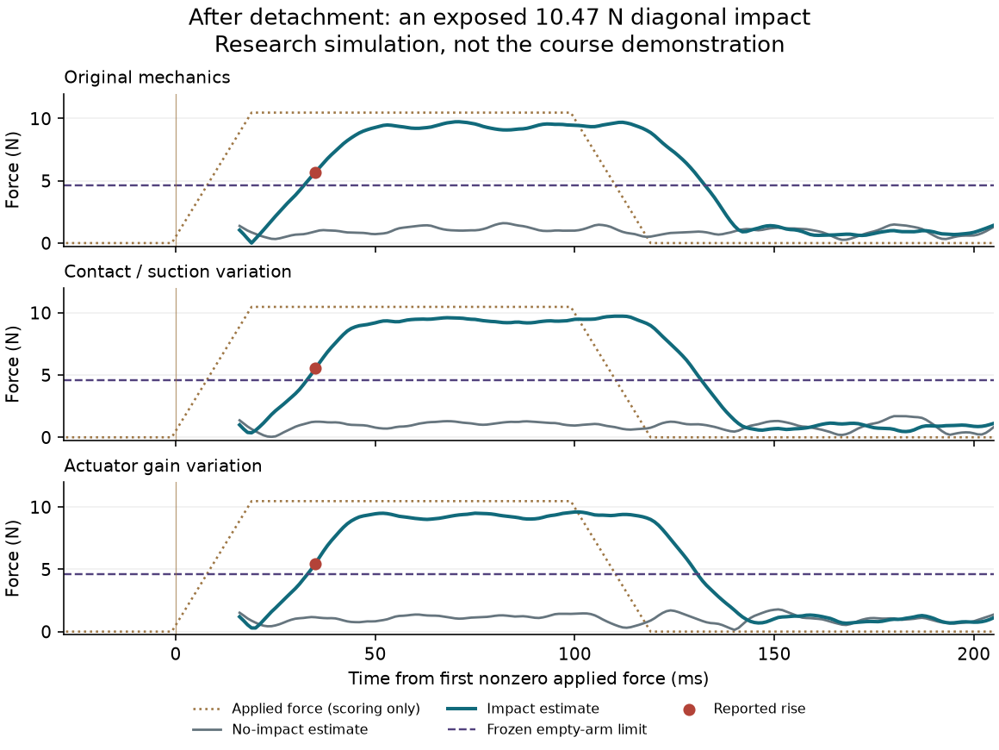

# R23: 상자를 놓은 직후의 충격을 구별할 수 있는가?

**이 문서의 그래프는 수업 원본 데모가 아니다.** [수업 제공 코드와 가이드로 원본 8 kg 서보 예제를 재현하는 방법](DEMO_SOURCES.md)과 구분한다. R10 제출 파일은 그대로다. 아래 충돌 시험은 실제 로봇이 아니라 수업 시뮬레이터의 원본 계산 루프로 수행했다.

## 실제 센서에 남은 신호

R22에서 놓쳤던 사례는 4.83 kg 상자를 놓은 직후, 수평으로 (−7.7, −7.1) N을 가한 경우다. 예정 시각은 3.927 s이며 첫 **0이 아닌** 외력 표본은 3.928 s였다. 같은 질량·무게중심·물성에서 외력을 제거한 동작을 별도로 실행했다. 첫 외력이 들어가는 표본까지 감지기가 본 이력은 두 동작에서 같았다.

R22가 쓰던 지연 보정 힘 추정기에는 충격이 보였다. R22에서 **전 구간에** 그 신호를 썼던 탈락 후보도 이 한 사례는 검출했지만, 전체 개발 세트에서 오경보와 중복이 증가했다. 따라서 이번에 바꾼 것은 문턱값이 아니라 **어떤 물리 상태에서 그 센서를 추가 근거로 쓸지**다. 실제 집게 명령이 닫힘에서 열림으로 전환되면, 같은 동작 초기에 구한 편향을 사용해 빈 팔 추정기의 미분·평균 이력을 새로 시작한다. R22 기본 감시 경로는 모든 구간에 그대로 남긴다. 작동 중에는 외력을 가한 시각·방향·센서 정답을 참조하지 않는다.

| 물성 | 무충돌 수평력 추정 최댓값 | 충격 시 수평력 추정 최댓값 | 첫 실제 외력 → 추가 경보 |
|---|---:|---:|---:|
| 기본 | 1.60 N | 9.74 N | 35 ms |
| 접촉·흡착 변경 | 1.91 N | 9.73 N | 35 ms |
| 구동기 이득 변경 | 2.12 N | 9.61 N | 35 ms |

수치는 기록한 놓기 구간(3.899–4.280 s)의 12표본 평균 수평력 크기다. 실제 외력 최댓값은 10.47 N, 동결 문턱은 4.60 N이었다. 빈 팔 추정기는 해제 뒤 33 ms인 3.933 s에 첫 유효 벡터를 냈고, 이 값은 지연된 관측이다. 해제 순간을 포함한 모든 충격을 즉시 볼 수 있다는 뜻이 아니다. [실제 충격/무충격 쌍의 기록](../results/r23/post_detachment.json).



## 놓기 전후에 충격이 두 번 들어오면

두 관측 방식을 비교했다. **크기 방식(free)**은 해제 뒤 새 이력이 준비되면 기존 문턱·지속 조건으로 추가 경보를 낸다. **선행 정숙 방식(onset)**은 기존 경보가 조용하고 수평력이 낮은 유효 표본 세 개가 먼저 있어야 새 사건을 인정한다. 두 방식 모두 이미 울리던 기본 경보를 끄거나, 일정 시간 전체 감지기를 차단하지 않는다.

이전에 공개된 R22 66조건을 486회 재실행했다. R22 / 크기 방식 / 선행 정숙 방식의 단일 충격은 **18/21/21 (각 24조건)**, 두 충격 개별 판정은 **79/84/79 (각 96개)**, 네 가지 판정을 모두 만족한 쌍은 **15/17/15 (각 24조건)**였다. 선행 정숙 방식은 추가 상승을 더 조심스럽게 인정하지만, 놓기 경계를 지난 실제 둘째 충격의 근거도 놓쳤다. 신규 단일 성공은 위 사례의 세 물성이다. 모두 이미 공개한 조건이지 R23 독립 검증은 아니다. [조건별 판정과 보호 검사](../results/r23/previous.json).

같은 R10 토크 제어기로 원본 공식 평가기를 각 29회 실행해 세 감지기 모두 24/24, 무외력 공식 3조건 오경보 0회를 확인했다. 이전 약충격 12개를 포함한 기존 단일 충격 15개도 세 방식 모두 15/15였다. 이전 표면 쌍은 각 8/8, 이전 이력 쌍은 각 4/6으로 136 ms 짧은 간격의 실패는 남았다. [공식표](../results/r23/official.json) · [이전 약충격](../results/r23/weak.json) · [이전 연속 충격](../results/r23/pairs.json).

## 385조건 보호 검사와 독립 시험에 보낸 후보

같은 189개 정상 기준 동작·180개 충격·16개 오프셋에서 세 감지기를 각각 새로 실행했다(총 1,155회). 힘의 부호와 원본 순서로 계산한 크기, 시작 경계와 무충격 쌍, 감지기별 실제 물리 궤적을 검사했다. 모든 조건에서 R22 비교군의 판정 기록도 이전 실행과 일치했다.

| 수업 토크 시뮬레이션의 감지기 | 구별한 충격 / 180 | 전체 오경보 | 같은 충격의 중복 | 유지한 공구 접촉 |
|---|---:|---:|---:|---:|
| 기존 R22 LIGHT | 137 | 9 | 2 | 6 |
| R23 선행 정숙 | 140 | 9 | 2 | 6 |
| **R23 크기 방식** | **146** | **9** | **2** | **6** |

두 방식 모두 이 개발 세트의 기존 R22·R21·R10 성공을 잃거나 조건별 오경보·중복을 늘리지 않았다. **독립 평가에는 크기 방식 한 개만** 보냈다. 두 방식의 성공 집합을 비교했을 때 크기 방식은 선행 정숙 방식의 성공을 모두 포함했고, 추가 성공도 있었다. 선택 규칙의 구체적 비교는 이전 66조건 결과를 본 뒤, 이번 독립 결과를 보기 전에 기록했다. 독립 점수가 낮더라도 뒤늦게 다른 후보로 바꾸지 않는다. [전체 D4 결과](../results/r23/d4.json) · [독립 평가 전 고정한 선택 기록](../results/r23/exposed_choice.json).

## 미사용 조건에서 다시 검증: 일부 개선, 전체 기준은 미통과

후보 선정에 쓰지 않은 45조건에서 R22와 선택된 크기 방식을 각각 108회씩(총 216회) 실행했다. 기본·접촉 물성 변경·구동기 이득 변경 조건을 포함한다. 두 충격의 귀속은 **없음·첫째만·둘째만·둘 다**로 분리했고, 새 시험에서는 시작 전 24 ms 무경보와 정확히 한 번의 상승을 요구했다. ‘정답을 늘렸는가’와 ‘모든 보호 기준을 충족했는가’를 따로 본다.

| 독립 시험 | R22 LIGHT | 선택 R23 |
|---|---:|---:|
| 단일 충격에서 조용하다가 정확히 한 번 검출 | 15/18 | 15/18 |
| 이중 충격의 개별 판정 | 33/60 | **45/60** |
| 네 판정을 모두 맞힌 이중 충격 조건 | 5/15 | **8/15** |
| 귀속할 상승이 아예 없는 개별 판정 | 19/78 | **7/78** |
| 외력·실제 공구 접촉 구간 밖의 오경보 상승(각 108회 전체) | 17 | 17 |
| 한 판정 구간에 여러 번 울린 개별 판정 | 6 | 6 |
| 무외력 오프셋에서 실제 공구 접촉 검출 | 3/6 | 3/6 |

기존의 엄격 성공을 잃은 경우는 0개였다. 새로 성공한 12개는 **모두 한 가지 해제 후 사선 충격 쌍**에서 나왔다(세 물성 × 네 개별 판정). 12종의 새로운 충격에 성공했다는 뜻은 아니다. 최종 45조건 중 15개(무외력 1, 단일 5, 이중 9)는 미통과했다. 실제 충격의 귀속을 개선했지만 모든 구간의 거짓 상승·중복이 0이어야 하는 보호 기준이나 전체 검출 기준을 만족하지 못했다. **기본 제출본으로 승격하지 않았다.** [조건별 실패·정확한 분모](../results/r23/independent.json) · [선택과 독립 결과를 구분한 영수증](../results/r23/selection.json).

조건과 판정 규칙을 담은 계획은 R23 센서의 결과가 나오기 전에 해시로 고정했다. 그 시점에 별도로 기록한 평가기 초안에는 닫는 괄호 하나가 빠져 실행할 수 없었다. 독립 실행 전의 최종본과 비교해 **그 괄호 한 글자만** 추가된 것을 확인했다. 실행을 위한 원본 키트 파일 분류·선정 후보 경로와 해시도 잠금 시점에 명시했다. 최초 초안 자체를 실행한 자료로 제시하지 않는다. [최초·실행본 해시와 차이](../results/r23/holdout_provenance.json).

같은 독립 결과에서 남은 오경보를 시간순으로 대조했다. **17번 모두 구동기 이득을 바꾼 물성의 3.857–3.870 s**에 있었다. 두 감지기 사이에서 조건·시각·충격 조합까지 일치했다. 중복이 남은 개별 판정 여섯 개도 모두 가까운 두 사선 충격을 가한 한 조건군에서 나왔다. 다음 진단에서는 해당 시각을 차단하지 않고, 놓기 전 하중 이양에 대한 센서 응답을 비교한다. 이는 이미 공개한 실패의 분류이지 새로운 독립 성적이 아니다. [오경보 표본 시각과 중복 조건](../results/r23/failure_timing.json).

## 집기 전 공구 접촉: 놓기 후 감지기와 별도로 검사

R22가 놓친 두 사례는 외력을 따로 가하지 않았지만, 집기 전 공구가 상자에 닿아 실제 모의 접촉력이 **10.34 N과 11.08 N**에 이르렀다. 질량·무게중심·물성을 유지하고 위치 오차만 없애자 접촉도 경보도 없었다. 정상 접근 동작 12회에서 관절 토크 센서의 정상 범위를 구하고, 집게를 닫기 전 같은 구간에서 이 범위를 지속해서 벗어날 때만 알리는 방식을 별도로 시험했다. 작동 중에는 실제 접촉력도 위치 오차도 읽지 않는다.

| 같거나 미리 고정한 조건에서의 대조 | 별도 접근 감지기 결과 |
|---|---|
| R10·R22가 놓쳤던 위 두 접촉 | 두 건 모두 첫 접촉 뒤 **9 ms**. 배포 사본에서도 접촉·대조 동작을 다시 실행해 확인 |
| 후보 고정 뒤 새 위치 오차를 적용한 동작 | 실제 접촉 **6/6** 검출(9–11 ms). 위치 오차는 있었으나 닿지 않은 **6/6**은 추가 경보 없음 |
| 더 약한 접촉에서의 한계 | **2.00 N·8 ms**, **2.63 N·10 ms** 모두 놓침 |

이 방식은 수업의 고정된 1.2–1.4 s 접근 궤적을 전제로 하므로 임의 속도의 접근에 그대로 쓸 수 없다. 개발 세트 385조건에서는 기존보다 이른 공구 경보가 두 조건에서 나와 **경보 시각 완전 일치** 검사는 실패했다. 추가·지연·선행 오경보가 없는지 따로 검사한 보조 판정은 통과했으나 원래 실패를 대신하지 않는다. **이 감지기는 놓기 후 감지기와 결합하거나 연구 ZIP에 넣지 않았다.** [접촉·무접촉 쌍의 재실행](../results/r23/pregrasp_replay.json) · [새 접촉과 놓친 약접촉](../experiments/r23_tool_contact/public_result.json) · [최초 판정과 보조 검사](../experiments/r23_tool_contact/public_d4_result.json).

## 실제 하중 이양: 한 조건을 고친 제어를 왜 채택하지 않았나

별도 제어 실험에서 착지 중 상자 바닥 중심의 피치 각속도를 줄이는 모멘트를 가했다. 외력이 없던 기존 실패 조건(6.65 kg)에서 3.903 s 오경보가 사라지고 네 가지 지지 기준, 추종, 접촉 피크와 포화도 모두 유지됐다. **하지만 8 kg 오프셋에서 기존에 없던 3.876 s 경보가 발생했다.** 해당 표본의 관측에서는 피치 모멘트가 아니라 수직 힘 성분이 한계를 넘었다.

두 번째 제어는 명목 모델에서 순간 수직가속도에 영향을 주지 않도록 토크를 투영했다. 계산된 수직가속도 변화는 최대 7.35×10⁻¹⁸ m/s²까지 줄었지만, 실제 탄성 관절·작업대 접촉에서는 여러 표본에 걸친 수직력 응답이 남아 같은 8 kg 오경보가 다시 났다. 둘 다 미채택했다. 감지 문턱을 올리거나 하중 이양의 성공으로 바꾸어 세지 않았다. [첫 제어의 실제 보호 검사](../results/r23/transfer_pitch.json) · [투영 제어와 남은 수직력](../results/r23/transfer_projection.json).

## 직접 실행하기

원본 키트·저장소 밖에 새 결과를 기록한다. 시뮬레이션 의존성이 있는 Python 환경에서, `KIT`는 원본 `icpbl_sim`, `OUT`은 기존 결과를 덮어쓰지 않을 별도 디렉터리다. 다음 명령은 원본 시뮬레이터를 인증한 뒤 **임시 복사본**에만 연구 코드를 얹는다.

```sh
python -B tools/r23_detached_replay.py --kit "$KIT" --study target --workers 2 --out "$OUT/target.json"
python -B tools/r23_detached_replay.py --kit "$KIT" --study tool --out "$OUT/pregrasp.json"
python -B tools/r23_detached_replay.py --kit "$KIT" --study previous --workers 2 --out "$OUT/old-66.json"
python -B tools/r23_detached_replay.py --kit "$KIT" --study d4 --workers 3 --out "$OUT/d4.json"
python -B tools/r23_plot_response.py --input results/r23/response_traces.json --out "$OUT/response.png"
```

처리 시간은 이 PC에서 제어와 감지를 합쳐 48,000주기씩 비교했다. R22/크기/선행 정숙 방식의 에피소드별 벽시계 p99 최댓값은 각각 350/331/346 µs였고, 1 ms 이상은 1/1/0주기였다. 크기 방식의 최악 표본은 약 3.91 ms였다. 평균적인 속도 개선이나 하드 실시간 보장을 입증하는 측정은 아니다. [실제 호출 시간](../results/r23/timing.json).

고정된 독립 시험은 다음과 같이 외부 키트에서 재현한다. 216회의 새 결과에서 원래의 실패도 남아 있어야 한다. 원본 파일은 고치지 않는다.

```sh
python -B tools/r23_holdout_replay.py --kit "$KIT" --lock results/r23/independent.lock.json --jobs 2 --out "$OUT/independent"
python -B tools/r23_research_package.py --kit "$KIT" --variant free --out "$OUT/week09-r23-free-research.zip"
```

키트 소스가 없는 배포 사본에서 외부 원본 키트를 사용해 다시 실행했다. 독립 시험 216회의 결과 파일과 별도 생성한 연구 ZIP은 각각 연구 사본의 결과와 바이트 단위로 같았다. ZIP에는 작성한 토크 제어기·감지기·설명서·검증 기록 네 파일만 있다. 개발 세트도 각 사본에서 1,155회분 결과가 기록됐고 두 결과 파일이 바이트 일치했다. 다만 긴 실행을 감싼 두 셸의 종료 코드는 143이어서 정상 종료의 증거로 쓰지 않는다. 같은 명령의 짧은 검사(`--study six`, 총 33회)는 종료 코드 0을 별도 확인했다. [재현 결과](../results/r23/reproduction.json) · [개발 세트 비교 범위](../results/r23/cross_version_d4.json) · [ZIP 파일 구성·해시](../results/r23/package.json).
