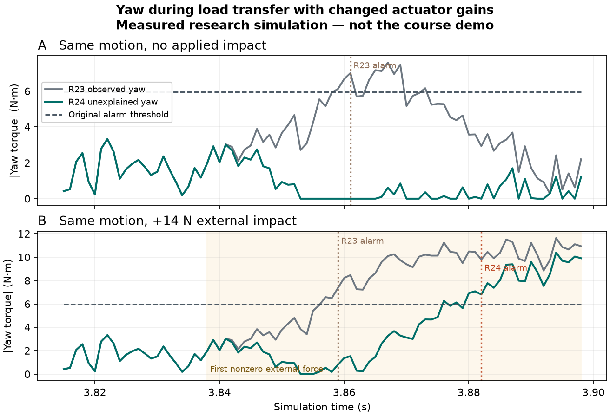

# R24: 놓기 전 정상 하중과 충격을 가르는 방법

**아래 그래프는 수업 원본이 아니라 원본 시뮬레이터에서 수행한 연구 실험이다.** [제공 코드만으로 원본 8 kg 서보 예제를 재현하는 방법](DEMO_SOURCES.md)은 별도다. 기본 제출 세 파일은 R10으로 유지한다. 이 문서에서 ‘실제 충격’은 시뮬레이터에 외력을 실제 적용했다는 뜻이며 실기 시험은 아니다.

## 왜 무충돌인데 17번 울렸나?

이전 R23 독립 시험에서 발생한 오경보 17회를 같은 시뮬레이터 입력으로 다시 실행해, 어떤 감지 경로가 켜졌는지 표본마다 기록했다. 17회 모두 구동기 이득이 달라진 조건의 **베이스 회전 모멘트 경로 하나**에서 나왔다. 경보 시점의 추정값은 기존 한계의 1.06–1.23배였다. 같이 관찰한 수평력·R10 기본 감시·놓은 뒤 추가 감시는 그 시점에 모두 꺼져 있었다.

6.53 kg 무충돌 예에서 작업대가 상자를 받치는 최대 힘은 공칭 구동기에서 45.46 N(3.850 s), 변경한 구동기에서 90.46 N(3.839 s)이었다. 후자의 작업대 반력은 베이스에 −18.55 N·m(3.838 s)를 실제로 전달했다. 센서로 추정한 회전 모멘트는 그보다 늦은 3.867 s에 −7.59 N·m로 정점에 이르렀다. 3.861 s 경보 시점에는 작업대의 순간 회전 모멘트가 이미 +0.82 N·m로 방향까지 바뀌어 있었다. **순간 지지력만 빼는 두 방식은 경보를 3.867 s로 옮겼을 뿐 없애지 못했다.** 이 반력 정답은 실행 후 원인 분석에만 이용했다. [17회 경보의 센서 경로·물리 대조](../results/r24/cause.json).

## 어떻게 고쳤나?

1. **지지력의 과거 응답을 추정한다.** 외력이 없는 24회에서 팔이 하중을 옮긴 뒤의 추정 수직 지지력과 기저축 회전 반응을 맞췄다. 지난 40 ms를 8표본씩 다섯 구간으로 나눠 쓴다. 추정한 정상 반응이 관측한 회전과 같은 방향일 때만 그만큼 빼며, 부호를 뒤집거나 새 경보를 더하지 않는다. 원래 감지 한계는 그대로다.
2. **정상 구동기에서도 무조건 빼지는 않는다.** 항상 보정하면 새 20조건에서 합계는 좋아도 원래 잡던 충격을 최대 59 ms 늦췄다. 최종 비교 방식은 집기 전 엔코더·명령 토크·관절 토크 센서로 각 모터의 전달 특성을 먼저 확인한다. 한 관절에서 전체 토크 충격량 비율과 평균을 뺀 명령-전달 토크 기울기가 공칭 범위의 같은 쪽을 벗어나야 보정을 쓴다. 실제 구동기 이득·충격 예정 시각·작업대 힘 정답은 읽지 않는다. 공칭 범위는 같은 교시 접근의 무외력 센서 잡음 시드 29개로 정했으며, 서로 다른 29가지 작업을 학습했다는 뜻은 아니다.
3. **집기 경계의 중복은 별도로 고친다.** 이미 회전 경보가 켜진 중에 집게가 닫히면, 모델에 상자 질량이 추가되면서 계산상 변하는 각운동량만 보정하고 측정 이력을 보존한다. 다른 센서 근거까지 조용해지면 경보를 해제한다. 미리 정해진 시간 동안 두 번째 충격을 무시하는 방식이 아니다. 두 수정을 결합한 경우도 하나의 추정 이력으로 직접 실행했다. 아래 ‘하중 보정’은 1–2번, ‘결합’은 1–3번이다.

모터 전달 특성 자체도 한계가 있다. 적합에 쓰지 않은 잡음 시드 8개에서 공칭 구동기를 잘못 분류한 경우는 0/8, 기존 다축 이득 변경을 알아본 경우는 8/8이었다. 한 축만 ±2% 바꿨을 때 J2는 각 부호 8/8이었으나 J1은 각 1/8, J3는 각 0/8이었다. 모든 구동기 변화를 식별하는 기능은 아니다. [시도한 방식·보정 계수·측정 한계](../results/r24/mechanisms.json).

## 무충돌과 같은 시각의 실제 충격을 맞대어 비교



위는 같은 동작에서 외력을 주지 않은 경우, 아래는 +14 N을 준 경우다. 이 구동기에서 R23은 두 실행 모두 거의 같은 시각에 울려 충격을 구별하지 못했다. 하중 보정 후보는 무충돌 때 울리지 않았고, 실제 외력이 처음 들어온 뒤 **44 ms**에 울렸다. 기본 물성에서 같은 충격의 **39 ms** 검출은 그대로였다. 점선 한계는 두 방식에서 같다. [그래프의 측정값·판정](../results/r24/measured_twins.json).

| 이미 공개됐거나 개발에 사용한 시험 | R23 | R24 하중 보정 | R24 결합 |
|---|---:|---:|---:|
| 이전 45조건: 단일 충격 엄격 성공 | 15/18 | 15/18 | 15/18 |
| 이전 45조건: 연속 충격 개별 판정 | 45/60 | 45/60 | **51/60** |
| 이전 45조건: 연속 충격 네 판정 모두 성공 | 8/15 | 8/15 | 8/15 |
| 이전 45조건: 구간 밖 오경보 / 중복이 난 개별 판정 | 17 / 6 | 0 / 6 | **0 / 0** |
| 별도 개발 20조건: 놓기 직전 충격 엄격 성공 | 10/20 | **17/20** | **17/20** |

20조건은 두 시각·다섯 힘·두 물성의 조합이다. 조건마다 무충격 기록과 대조했다. 두 최종 비교 방식 모두 이 세트의 구간 밖 오경보 10회와 중복 판정 3건을 0으로 줄였고, 기존 성공의 손실이나 5 ms 초과 지연도 없었다. 반면 이전 45조건은 결합 후에도 **10조건 미통과**다. 일부 충격을 놓치거나, 둘째 충격 전 요구한 무경보 24 ms를 확보하지 못했다. 합계나 ‘오경보 0’만으로 전체 검출을 보장할 수 없다. [45조건별 실패](../results/r24/disclosed.json) · [같은 시각대 20조건](../results/r24/nearby.json).

집기 경계의 수정만 떼어 본 실험에서도 한계가 분명했다. 첫 힘은 표본 **1353–1472**, 집기 전환은 **1400**, 두 번째 힘 시작은 **1494**였다. 중복을 없애도 두 힘 사이의 21개 빈 표본만으로는 요구한 24 ms 무경보를 충족하지 못했고, 구동기 변경 조건에서는 두 번째 힘 자체를 여전히 놓쳤다. 그래서 이 단독 방식은 자격을 통과한 감지기로 내놓지 않았다. 결합 방식도 엄격 판정 전체를 통과했다는 뜻은 아니다. [집기 단독 실험·파형 귀속](R24_PICKUP.md).

## 새 독립 시험: 개별 판정은 8개 개선, 전체 기준은 실패

위의 45조건과 20조건은 이미 개발 과정에서 본 자료다. 별도 검증자가 새 13가지 동작과 네 가지 물성, 판정 코드와 기준을 먼저 고정했다. 기존 자료에서 선별한 **결합 감지기 하나만** R23과 비교했다. 같은 동작에서 무충격·첫 힘만·둘째 힘만·두 힘을 주는 식으로 나눠 실제 시뮬레이션 **240회**를 수행했다. 힘 입력과 물리 궤적은 방식 간에 일치했다.

| 새 시험 지표 | R23 | R24 결합 |
|---|---:|---:|
| 단일 충격 엄격 성공 | 11/20 | 11/20 |
| 연속 충격 개별 판정 성공 | 32/64 | **40/64** |
| 네 판정(단독 두 번·연속 두 번) 모두 성공 | 0/16 | 0/16 |
| 중복 경보가 있는 개별 판정 | 10 | **2** |
| 허용 구간 밖 오경보 / 활성 표본 | 2회 / 16 | 2회 / 16 |
| 실제 공구 접촉을 검출한 대조 조건 | 2/5 | 2/5 |

**R24 전체 판정: 23/52조건 통과, 29/52조건 미통과.** 8개의 새 엄격 성공은 가까운 사선 연속 충격 한 종류에서 네 물성의 ‘첫 충격 단독’과 ‘두 충격 중 첫 충격’을 각각 구분한 것이다. 이전에 성공한 충격을 놓치거나 5 ms 넘게 늦춘 경우는 없었다. 그러나 23개 개별 판정에는 힘 때문이라고 볼 상승이 없었고, 14개는 요구된 25 ms 무경보 선행 구간을 확보하지 못했다(두 수는 겹칠 수 있다). 공칭 구동기의 이른 사선 충격에서는 검출 지연이 동일한 60 ms인데도 경보를 켜 둔 시간이 **6→77 표본**으로 늘어, 허용 증가 5표본을 넘었다. 독립 시험 결과로 후보를 재선택하거나 임계값을 바꾸지 않았다. [고정된 선택](../results/r24/exposed_choice.json) · [독립 시험 조건별 결과](../results/r24/independent.json) · [선별과 기본값에 대한 기록](../results/r24/selection.json).

**남은 오경보는 앞서 고친 17회와 원인이 다르다.** 공개 후 문제가 된 한 물성에서 무충격과 나중에 충격을 주는 동작을 두 감지기로 다시 실행했다(4회). 3.922 s의 8표본 경보는 양쪽 모두 같은 원인이었다. 이때는 집게가 이미 열려 회전 모멘트 경로가 비활성이고, **기본 R10 방향성 감지 경로**가 보고했다. 외력과 공구 접촉은 0 N, 작업대 반력은 83.07 N이었다. 하중 보정을 더 강하게 거는 것으로 이 경보를 고칠 수 있다는 근거는 없다. 이 진단을 새 독립 성공으로 세지 않았다. [재실행에서 확인한 경로·센서값](../results/r24/post_false_path.json).

경보가 길어진 경우와 중복이 남은 경우는 **결과 공개 후** 감지기 네 조합으로 각각 다시 분리했다(24회). 이른 사선 충격에서 R23과 하중 보정만 쓴 경우에는 **1394–1399 ms**, 집기 보정만 쓴 경우와 결합한 경우에는 **1394–1470 ms**에 경보가 켜졌다. 실제 힘은 1334–1452 ms였다. 최초 검출은 변하지 않았고, 길어진 원인은 집기 후 경보를 이어 주는 부분이었다. 반면 구동기 지연 조건에서 둘째 힘만 주면 네 방식 모두 **1714, 1737, 1786 ms**에 세 번 울렸다. 이 세 번은 기본 R10의 경보 경로에서 나왔고 두 R24 보정은 원인이 아니었다. 실패한 33개 개별 판정을 우선순위에 따라 겹치지 않게 나누면 **귀속 가능한 상승 없음 23, 중복 2, 선행 무경보만 미충족 8**이다. [구성요소별 실행과 힘·경보 구간](../results/r24/post_alarm_duration.json).

네 물성의 공구 확인 시험 중 실제 공구 접촉이 있었던 다섯 조건에서 두 방식 모두 2건을 구분했다. 그중 두 조건은 실제 공구 접촉 경보가 정상 이양 구간과 겹쳐 각각 39·34표본 활성으로 기록됐다. 사전 조건은 이 구간에서 어떤 경보도 허용하지 않았으므로 두 건 모두 독립 시험 실패로 남겨 두었다. 이를 새 오경보나 후보 성능 저하로 더 세지도 않았다.

## 기존 기능과 주기 비용

기존 66조건은 각 방식으로 실제 시뮬레이터를 다시 실행해 단일 충격 **21/24**, 이중 충격 개별 판정 **84/96**과 보호 조건이 유지됨을 확인했다. 별도의 약충돌 15개는 **15/15**, 과거 연속 충격 두 계열은 **8/8·4/6**으로 같았다. D4의 385조건을 결합 방식으로 다시 실행했다. 기존 기록과 같은 조건에서 엄격 성공 **146**, 오경보 **9**, 중복 **2**, 공구 접촉 검출 **6**으로 같았다. D4의 오경보 9회는 위 45조건의 오경보 17회와 다른 집합이다. 원래 토크 평가기에 R23·하중 보정·결합을 각각 넣은 87회에서는 3개 방식의 결과표가 같았다. 이것은 수업 기본 R10의 공식 성능이 개선됐다는 뜻이 아니다. [이전 66조건](../results/r24/joint-legacy66.json) · [D4 385조건](../results/r24/d4-joint.json) · [공식 평가기](../results/r24/official.json).

같은 6.53 kg의 무충격/14 N 대조를 두 물성에서 순서를 바꿔 각 방식당 48,000주기씩 측정했다. 제어와 감지 메서드를 합친 실행시간의 에피소드별 wall p99 최댓값은 R23 **388 µs**, 결합 후보 **423 µs**였다. wall 1 ms 이상은 **3→32주기**, 최댓값은 **3.657→4.172 ms**였다. 결합 후보의 스레드 CPU 최댓값은 **0.557 ms**, 따로 잰 감지기 reset의 최대 wall 시간은 **7.52 ms**였다. 공유 컴퓨터 위 계측이고 시뮬레이터의 모든 연산을 포함하지 않는다. 이 값으로 1 kHz 실시간 실행을 보장할 수 없다. [두 방식 전체 시간 측정](../results/r24/cpu.json).

## 착지 제어는 감지기와 별도 실험이다

상자가 충분히 지지된 뒤에만 바닥면의 피치 진동을 감쇠하도록 했다. 추정 지지가 상자 무게의 25% 미만이면 작동하지 않고, 25–50%에서는 부드럽게 올리며, 그 이상에서 지정한 상한까지 허용한다. 6.65 kg의 정상 동작에서 3.903 s 오경보를 없앴고, 이전 방식이 8 kg 사례에 새로 만들었던 3.876 s 오경보도 만들지 않았다. 기존 3.917 s 경보는 남았다. 개발 4조건과 이후 연 3조건에서 판정 기준을 충족했고, 양의 질량 6조건에서 네 가지 지지 기준을 모두 만족했다.

그 뒤 고정된 제어기로 별도 질량·무게중심·작업대 물성 및 늦은 충격을 시험했다. 추가 정상 3조건은 통과했지만, **±X 12 N을 R10·R19·R24 모두 놓쳤다.** +Z 16 N은 모두 38 ms였고, −Z 16 N은 R19 129 ms에서 R24 145 ms로 **16 ms 늦어져** 허용한 5 ms를 넘었다. 그래서 착지 제어를 기본값으로 바꾸지 않았다. 이 실험은 위의 충돌 감지기를 동시에 적용한 성적도 아니다. [알려진 착지 조건](../results/r24/transfer_known.json) · [별도 검증과 실패](../experiments/r24_transfer_replay/RESULT.json).

## 전달본에서 같은 결과가 나오는지 확인

원본 키트를 포함하지 않은 연구 ZIP을 연구 저장소와 별도의 키트 없는 공개 배포 사본에서 만들었다. 두 ZIP은 바이트 단위로 같았다(파일 항목 159개). 추출한 소스와 인증한 외부 키트로 독립 시험 240회를 다시 실행했다. **실행은 정상 종료했고 과학적 판정은 다시 실패**했으며, 모든 조건·실패를 담은 결과 파일이 첫 실행과 바이트 단위로 같았다. 별도로 공개 배포본에서 인접 개발 조건도 80회 다시 실행해 원래 측정 결과와 대조했다. ZIP은 연구 재현용이며 제출용 세 파일이나 수업 원본 키트가 아니다. [파일 지문과 재현 확인](../results/r24/reproducibility.json).

## 직접 실행

원본 키트는 배포하지 않는다. `KIT`는 로컬 원본 `icpbl_sim`, `OUT`은 원본·저장소 밖에 만든 결과 폴더다. 이미 있는 결과 경로는 덮어쓰지 않는다. 아래 재생 도구는 키트가 없는 공개 배포본(또는 연구 ZIP)에서 실행한다. 외부 키트를 검증한 뒤 임시 복사본을 사용한다. 마지막 그래프 도구는 공개 배포본에서 사용할 수 있다.

```sh
python -B tools/r24_sensor_replay.py --kit "$KIT" --arm joint --study target --out "$OUT/normal.json"
python -B tools/r24_sensor_replay.py --kit "$KIT" --arm joint --study nearby --workers 2 --out "$OUT/nearby.json"
python -B tools/r24_sensor_replay.py --kit "$KIT" --arm joint --study disclosed --workers 2 --out "$OUT/known-45.json"
python -B tools/r24_holdout_replay.py --kit "$KIT" --lock results/r24/independent_lock.json --jobs 2 --out "$OUT/independent"
python -B tools/r24_transfer_replay.py --kit "$KIT" --workers 2 --out "$OUT/transfer"
python -B tools/r24_plot_response.py --input results/r24/measured_twins.json --out "$OUT/yaw.png"
```
