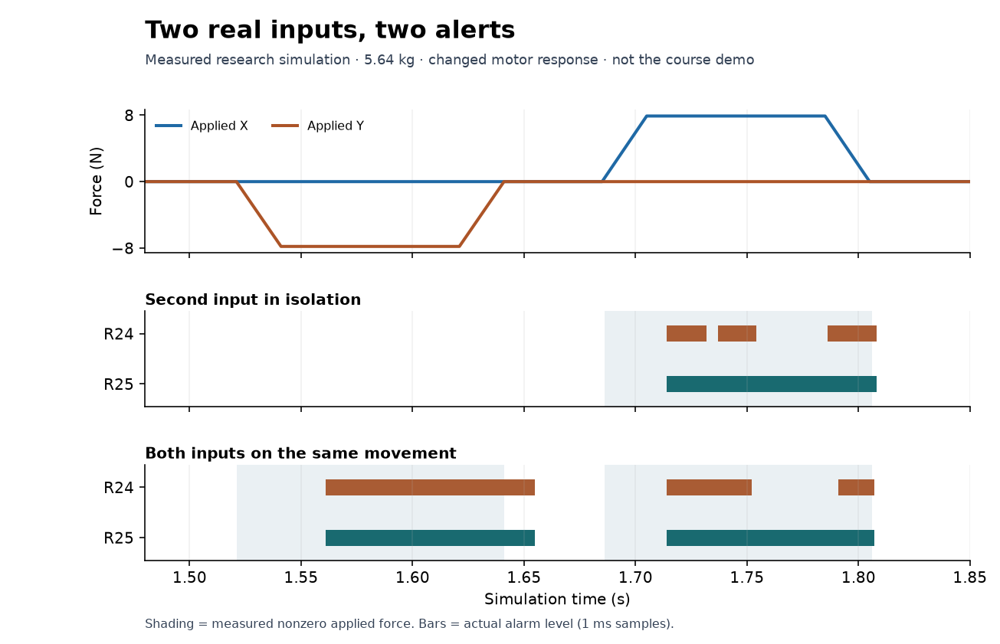

# R25: 한 번의 충격을 여러 번 세지 않으면서 두 번째 충격 보존하기

이 자료는 원본 로봇 시뮬레이터에서 연구용 감지기를 바꿔 검증한 결과다. **수업 원본 데모나 실기 시험이 아니다.** [수업 8 kg 서보 예제의 출처와 재현법](DEMO_SOURCES.md)은 별도다. 기본 제출 `my_servo.py`, `my_torque.py`, `my_detector.py`는 R10으로 유지한다. R24 독립 시험의 결과는 이제 R25 **개발용** 자료다.

## 무엇이 경보를 쪼갰나

5.64 kg 상자를 잡고 이동할 때 두 번째 힘은 1686–1805 ms 동안 끊기지 않았다. 그런데 R24는 이 힘만 준 실행에서 **1714, 1737, 1786 ms**에 세 번 켜졌다. 무충격 동작에서는 켜지지 않았다. 원인은 회전 모멘트 경로가 아니라 **R10에서 정상 동작의 수평력을 예측해 실측값과 비교하는 경로**였다. 예측 오차가 원래 경계(약 8.04 N) 근처에서 오르내렸기 때문이다.

예를 들어 1754 ms에 기본 경보가 꺼졌지만, 수평 예측 오차의 X 성분은 **7.4 N**, 엔코더·관절 토크·역동역학에서 독립적으로 추정한 X 힘은 **6.7 N**이었다. 외력을 주지 않은 대조 동작의 같은 힘 추정은 **−0.7 N**이었다. 이 시점의 실제 X 외력은 7.9 N이었다. 실제 힘은 실행 *후* 대조에만 사용했다. [경보·센서·실제 힘을 같은 시각에 대조한 기록](../results/r25/fragment_mechanism.json).

## 서로 다른 두 수정

- **진행 중인 수평 충격:** 이미 기본 경보가 켜진 동안 두 힘 추정치의 방향과 크기를 각각 기록한다. 기본 경보가 꺼질 때 각 신호가 ‘정상으로 돌아간 상태’보다 ‘같은 힘이 이어지는 상태’에 더 가까운지 검사한다. 단순히 크기만 비교하면 부호가 뒤바뀐 힘도 같은 충격이라고 오인할 수 있어 내적을 사용한다. 두 추정치가 모두 같은 해석을 지지해야 한다. 지연된 역동역학 추정기의 하강 추세도 반영해 실제 힘이 끝났을 때 불필요하게 경보를 늘리지 않는다. 원래 수평 모형이 현재 표본을 관측하지 않는 경우에는 이력을 버린다. 이 보정은 스스로 경보를 시작하거나 기존 경보를 끄지 않는다.
- **집게가 닫힐 때:** R24는 회전 경보가 켜진 채 상자를 잡으면 새 질량의 영향을 보상했다. 그러나 전환 직후에는 이미 약해진 기존 충격을 다른 신호가 계속 붙잡아 경보가 길어질 수 있었다. R25는 보상 전후 회전 모멘트의 부호가 같고 크기가 줄었을 때에만 그 **이미 보고한 회전 사건**을 끝낸다. 다른 감지 경로는 계속 동작하며, 반대 부호의 한계 초과 회전도 새 사건으로 받을 수 있다. 모든 경보를 일정 시간 막는 방식이 아니다.

## 한 힘과 두 힘을 실제로 분리했는가



위쪽은 두 힘을 모두 준 실행의 실제 X·Y 힘이다. 아래 두 패널은 둘째만 준 경우와 둘 다 준 경우다. 음영은 해당 실행에서 **실제로** 외력이 0이 아닌 구간이다. R25 결합 방식은 둘째 힘만 주면 **1714–1807 ms 한 번**, 두 힘을 모두 주면 각각 **1561–1654 ms, 1714–1806 ms**에 보고했다. 두 경우 모두 첫 검출 시각을 바꾸지 않았고, 둘째 힘만 있을 때 마지막 해제 시각도 바뀌지 않았다. [네 대조 실행의 측정값](../results/r25/measured_pair.json).

실제 두 힘을 한 경보로 잘못 합치는지도 별도로 시험했다. 새로운 개발용 12조건에서 두 번째 힘의 방향·세기와 간격을 바꿔 두 물성으로 실행했다(두 방식과 네 대조 입력을 합쳐 **96회**). 엄격한 개별 판정은 **24→36/48**, 네 판정 모두 성공한 조건은 **0→6/12**, 중복이 난 개별 판정은 **12→0**이었다. 기존 성공을 잃거나 5 ms 넘게 늦춘 사례는 없었다. [간격·방향 개발 시험](../results/r25/same_and_opposite_pairs.json).

다만 **집기 시점에 걸친 별도 16조건**(128회)에서는 개별 성공이 두 방식 모두 42/64였고 중복이 난 판정도 양쪽 **18개**였다. 한 입력에 대한 중복을 모든 동작에서 해결했다는 뜻은 아니다. [집기 전후 같은 방향·반대 방향 대조](../results/r25/grip_pairs.json).


## 이전 시험과 비교한 수정 효과

이전 R24 독립 자료의 52조건을 **현재 알려진 개발 조건**으로 다시 실행했다(두 방식 합계 240회). 무외력·외력 입력과 원래 R24의 전체 결과가 당시 기록과 일치했다. 52조건 중 50조건은 결합 방식에서도 판정과 경보 길이까지 같았다. 바뀐 곳은 딱 두 곳이다.

| 달라진 조건 | R24 | R25 결합 |
|---|---:|---:|
| 한 번의 둘째 힘이 쪼개진 교차 충격 | 둘째 단독 3회, 연속 중 둘째 2회 | 각각 **1회**, 둘 다 28 ms에 첫 검출 |
| 집기 직전 사선 충격 | 60 ms 뒤 검출, 77표본 활성 | 같은 60 ms 뒤 검출, **6표본** 활성 |

따라서 84개 개별 판정은 **51→53**, 세 개의 불필요한 추가 상승은 **3→0**, 연속 네 판정 모두 성공한 행은 **0→1/16**이었다. 원래 존재하던 구간 밖 오경보 2회는 그대로다. 별도로 R23 공개 45조건의 66/78 엄격 성공, 놓기 주변 20조건의 17/20 성공도 보존됐다. [52조건 변화·시각·표본 수](../results/r25/disclosed52.json) · [이전 45조건](../results/r25/disclosed45.json) · [놓기 주변 20조건](../results/r25/nearby20.json).

## 놓쳤던 약한 힘: 신호는 있지만 경보를 더하면 생기는 문제

상자를 든 채 작은 사선 힘을 줬던 이전 미검출 사례에서, 단순히 관절 토크의 큰 값만 찾으면 정상 동작과 구분되지 않았다. 그래서 관절 엔코더와 스프링 토크에서 작업 공간의 수평력을 역산했다. 작업대가 실제로 상자를 지지한다고 추정될 때만 가능한 마찰력과 지지력에 비례한 불확실성을 뺐다. 힘 방향을 아는 경우만 검사한 게 아니다. 연속 두 표본의 추정 방향이 서로 일치하는지 확인했다.

무외력 18회로 정한 경계는 **8.394 N**이었고, 다른 물성의 무외력 18회에서 가장 큰 값은 **7.705 N**이었다. 이 경계를 고정한 뒤, 이전 감지기가 한 번도 울리지 않던 사선 힘에서 **71 ms 뒤 한 번, 8표본** 보고했다. 그러나 이 관측을 기존 경보에 단순히 더하는 방식은 **기각**했다. 별도로 정한 부호·세기·하중·충격 시점 조합 32조건(128회) 중 16개는 새로 맞혔지만, 나머지 16개에서는 이전에 한 번만 보고하던 힘을 두 번 보고했다. 예를 들어 기존 76 ms 경보 앞에 56 ms 경보를 추가해 한 번의 힘이 두 번처럼 보였고 경보도 43→51표본으로 늘었다. 32개 무충격 대조에서 오경보가 없었다는 사실만으로는 이 실패를 덮을 수 없다. [목표 사례와 32조건의 실제 상승 시각](../results/r25/weak_onset_v1.json).

## 보호 확인과 측정 범위

두 가지 경계 수정만 결합한 옵션은 기존 D4 전체 385조건을 다시 시뮬레이션했다. 인증한 R24 보관 로그에서 같은 기준을 다시 계산하고 새 실행과 대조했다. 엄격 충돌 검출 **146/180**, 구간 밖 오경보 **9**, 추가 상승 **2**, 감지한 공구 접촉 **6**으로 동일했다. 기존 66조건 물리·판정, 약충격 15개 각각의 지연·경보 길이, 이미 공개된 연속 힘 14조건의 보호 기준도 통과했다. 원본 토크 평가기의 수평 충돌은 R24와 두 수정 결합 모두 **24/24**, 무충격 공식 정상 행 오경보는 0이었다. 알려진 공식 충돌 실행 중에는 기존 오경보가 남는다. [D4](../results/r25/d4-joint.json) · [66조건](../results/r25/legacy66.json) · [약충격 지연·길이](../results/r25/weak_duration.json) · [공식표](../results/r25/official.json).

공유 CPU에서 같은 네 입력을 두 번씩 실행해, 방식별 **48,000주기**의 제어기·감지기 호출시간을 측정했다. R25 두 수정 결합의 에피소드별 벽시계 p99 최댓값은 **354 µs**, 단일 주기 최대 **524 µs**, 1 ms 이상 0주기였다. 이는 솔버·입출력을 제외한 특정 실행의 측정이며 마감 보장이나 실물 기계의 안전 검증은 아니다. [측정 조건과 수치](../results/r25/cpu.json).

약충격 보조의 두 번째 안은 기존 경로가 원래 문턱에 가까우면 새 보고를 잠시 보류하고, 기존 경로가 먼저 울리면 같은 사건으로 취소했다. 71 ms 검출은 유지했지만, 이미 본 32조건 재시험의 완전 성공은 **18/32**에 그쳤다. 놓기 전 오경보가 있던 과거 조건 중 따로 고른 6조건에서는 2조건에 **무외력 3.855 s 오경보**도 추가했다. 두 수정을 넣은 결합 감지기에 이 보조를 붙여도 이른 집기 충격이 둘로 갈라지는 등 실제 보호 실패가 확인됐다. 따라서 두 약충격 보조 모두 독립 시험 후보에서 제외했다. 이는 약충격을 관측할 수 없다는 결론이 아니라, **해당 신호를 기존 경보와 합치는 규칙을 아직 검증하지 못했다**는 결과다. [보류 방식 32조건·과거 6조건](../results/r25/weak_onset_v2.json) · [결합 방식에서 드러난 중복](../results/r25/triple-v2_sample.json) · [독립 결과를 열기 전 고정한 선택과 근거](../results/r25/exposed_choice.json).


## 독립 시험: 36조건 중 21조건 통과, R24와 같은 결과

개발용 조건을 모두 평가한 뒤 두 수정의 결합을 고정하고, 기존과 다른 **힘의 지속시간·방향·간격**을 가진 12가지 상황을 세 물성에서 실행했다. 긴 힘 한 번과 가까운 두 힘을 구분하기 위해, 쌍 조건마다 무외력·긴 힘·첫째만·둘째만·둘 다의 **다섯 입력**을 실제로 시뮬레이션했다. 수업 지정 **MuJoCo 3.17.0**의 두 감지기 합계 **198회**가 기준이다. [결과를 열기 전 선택 기록](../results/r25/exposed_choice.json) · [조건별 검산과 집계](../results/r25/independent_ledger.json).

| 지표 | R24 | 고정한 R25 |
|---|---:|---:|
| 개별 충격의 엄격 성공 | 54/75 | 54/75 |
| 단일 충격 성공 | 9/15 | 9/15 |
| 이중 조건에서 둘째 힘만 주었을 때 성공 | 6/12 | 6/12 |
| 두 힘을 모두 주었을 때 둘째 성공 | 3/12 | 3/12 |
| 긴 힘과 두 짧은 힘 관련 5개 판정이 모두 성공한 조건 | 3/12 | 3/12 |
| 구간 밖 오경보 / 실제 공구 접촉 검출 | 0회 / 4/6 | 0회 / 4/6 |

**새 독립 이득은 0개였다.** 36개 행의 전체 판정·시각·경보 길이가 R24와 같았다. 21개 미달 판정은 귀속할 상승이 없던 경우 15개, 중복 상승 3개, 직전 20 ms 정숙 기준만 어긴 경우 3개였다. 새로 나빠진 행은 없었지만 한 긴 사선 힘에 세 물성 모두 중복 경보를 내어, ‘중복 0’이라는 절대 보호 기준도 미달이다. 정상·충격 외 구간의 오경보 0회는 모든 힘을 찾았다는 뜻이 아니다. [공식 독립 판정: FAIL, 기본 승격 없음](../results/r25/selection.json).

**검증 과정에서 바로잡은 두 가지.** 처음 시도한 채점기는 공구 판정 함수를 가리키는 모듈 경로가 잘못돼 결과 파일 없이 중단됐다. R24가 이미 사용하던 R23의 동일 함수로 연결만 바로잡고, 정상·단일·이중의 16회 실행으로 호출을 확인했다. [코드 지문과 정정 범위](../experiments/r25_holdout/amendment.json). 그 뒤 시스템 MuJoCo 3.11.0에서 얻은 198회는 수업 지정 버전이 아니어서 참고로만 보관했다. 물리 궤적 지문이 달라 이 문제를 발견했으며, 선택·채점 기준을 바꾸지 않고 3.17.0에서 다시 실행했다. 두 버전의 집계는 같았지만 원자료는 같지 않다. [의존성 조건과 두 실행의 구분](../results/r25/runtime_context.json).

**놓친 짧은 둘째 충격을 따로 측정했다.** 독립 결과를 연 뒤, 원래 단독·연속 모두 미검출이던 동일한 55 ms 지령을 추가 5회 비교했다. 실제 3축 힘은 54표본 동안 0이 아니었고 최댓값은 7.96 N이었다. 원래 수평 모형은 단독 실행에서 문턱의 0.812배에 머물렀지만, 개발 때 기각한 보조 추정치의 최댓값은 **9.97 N**이었다(무충격 2.88 N, 보조 경계 8.394 N). 연속 입력에서도 둘째가 있는 쪽 **10.34 N**, 첫째만 있는 쪽 **3.84 N**이었다. 따라서 이 사례에서 센서 정보가 완전히 없었던 것은 아니다. 오경보·중복 없는 경보 결합이 남은 문제다. 이 대조는 독립 성적에 더하지 않았다. [측정한 실제 힘과 관측값](../results/r25/short_second.json).

미검출을 재현한 뒤, **설정을 바꾸지 않은 기존 미채택 보조** 두 개를 별도 28회 비교했다. 둘 다 위 55 ms 충격을 **둘째만 주거나 첫째와 함께 주거나 35 ms 뒤 정확히 한 번** 보고했다. 반면 대조로 둔 긴 사선 힘은 두 방식 모두 여전히 여러 번 보고했다. 개발 중 확인한 새 무외력 오경보도 취소되지 않는다. 따라서 이 한 사례는 ‘짧은 둘째를 관측할 수 있다’는 후속 근거이지, 보조의 채택이나 독립 성적 수정이 아니다. [두 입력의 전체 시각·중복·무외력 대조](../results/r25/declined_after_disclosure.json).

## 직접 재현하기

아래 경로는 세 종류의 시험을 **서로 구분**한다. `KIT`는 수업에서 받은 원본 키트, `GUIDE`는 원본 HTML 교안, `OUT`은 키트와 저장소 밖에 만든 폴더다. 결과 파일명은 아직 존재하지 않아야 한다. 키트가 없는 공개 소스 사본에서 실행한다. 원본 그래프를 보는 데 연구 감지기는 필요 없다.

```sh
# 수업 원본: 제공된 서보·감지기로 8 kg 예제를 그림까지 대조
python -B tools/course_example.py --kit "$KIT" --guide "$GUIDE" --out "$OUT/course"
# 연구: 같은 두 힘에서 각각의 경보가 언제 켜졌는지 검증
python -B tools/r25_replay.py --kit "$KIT" --candidate joint --study target --workers 2 --out "$OUT/twins.json"
python -B tools/r25_replay.py --kit "$KIT" --candidate joint --study stress --workers 2 --out "$OUT/stress.json"
# 선택한 연구 감지기의 독립 시험: MuJoCo 3.17.0을 확인하며, FAIL도 그대로 보존
python -B tools/r25_holdout_replay.py --kit "$KIT" --lock results/r25/independent_lock.json --jobs 2 --out "$OUT/independent"
# 선택되지 않은 약충격 보조: 성공과 중복 실패를 함께 재생 (각 128회; 전체 공개 소스 사본)
python -B tools/r25_weak_replay.py --kit "$KIT" --candidate immediate --workers 2 --out "$OUT/weak-immediate.json"
python -B tools/r25_weak_replay.py --kit "$KIT" --candidate deferred --workers 2 --out "$OUT/weak-deferred.json"
```

### 이전 놓기 동작의 오경보도 따로 추적했다

공개된 R24의 **7.43 kg** 조건(구동기 응답 변화)에서 무충격·기존 충격과 반대 부호 충격을 5회 실행했다. 3.922 s 오경보를 만든 것은 R10의 빠른 **양의 수직력 변화량**이었다. 처음 경계를 넘은 시각은 3.860 s였고, 경보가 올라간 표본에서는 연속 계수가 8, 정규화된 수직 변화량이 문턱의 1.76배였다. 실제 외력과 공구 접촉력은 모두 0이었다. 이후 같은 동작에 반대 방향의 두 실제 힘을 각각 주면 회전 감시 경로가 32 ms와 25 ms에 감지했다. 두 경우의 팔 이동 방향은 거의 같았다(단위속도 내적 0.99974). 따라서 팔이 움직이는 방향 하나로 이 오경보를 끄는 방법은 채택하지 않았다. [측정과 대조](../results/r25/postrelease_probe.json).

### 배포본 재생 확인

원본 키트가 없는 공개 소스와 연구 소스에서 만든 ZIP이 바이트 단위로 같았다. 이 ZIP을 새 경로에 풀고, 별도로 인증한 **수업 지정 MuJoCo 3.17.0** 환경에서 독립 시험 **198회**를 다시 돌렸다. 모든 행과 실패를 담은 결과 파일이 첫 3.17.0 실행과 바이트 단위로 같았다(SHA-256 `83987dba…8c4f4fe`). 잘못된 3.11.0 인터프리터로 같은 공개 명령을 실행하면 결과 파일을 쓰기 **전에** 거절한다. 별도로 공개 소스에서 두 약충격 보조의 128회씩을 재실행해, 미채택 근거 역시 원래 기록과 바이트 일치함을 확인했다. [ZIP과 결과의 지문·재현 범위](../results/r25/reproducibility.json). 원본 수업 자료와 실물 로봇은 이 ZIP에 포함되지 않는다.
