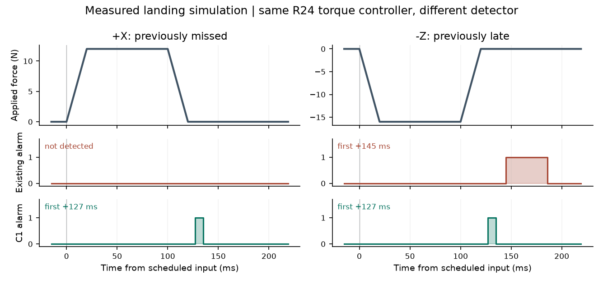

# R26: 같은 착지 제어기에서 하중 이양과 충돌을 함께 검증

**수업 원본을 찾는다면:** [8 kg 수업 예제 실행법과 기존 영상의 출처](DEMO_SOURCES.md)를 먼저 본다. 원본은 제공 `servo_controller`와 `collision_detector`로 `run.py --box 8`을 실행한 결과다. 이번에도 결과 PNG가 교안 내장 PNG와 바이트 단위로 일치했다(`82cb22df…e6436c`). 아래 그림은 **수업 예제가 아니라** 재현 가능한 별도 토크 실험이다.

## 무엇이 실제로 나아졌나

박스를 놓은 뒤에는 팔에 상자의 하중이 걸리지 않는다. 착지 제어 명령은 그대로 두고, 실제 그립이 열린 후 **엔코더와 관절 토크**로 빈 팔의 외력을 추정했다. 추정한 힘이 줄 때까지 기존 감지기가 보고하지 않은 사건에 한 번만 경보를 추가한다. 이미 보고한 충격이 끝날 때의 반동은 별개의 충격과 구분한다. 추가 센서나 시뮬레이터의 정답은 감지기에 전달하지 않는다.

같은 5.8 kg 조건에서 방향만 바꾼 120 ms 외력의 결과다. 숫자는 **외력 명령 시작부터** 귀속 가능한 첫 경보까지의 ms다. `—`는 경보가 없었다는 뜻이다.

| 플랜지 외력 | 기존 착지 제어+감지 | 같은 제어+새 감지(C1) | C1 경보 유지 |
|---|---:|---:|---:|
| +X 12 N | — | 127 ms | 8 ms |
| −X 12 N | — | 125 ms | 8 ms |
| +Z 16 N | 38 ms | 38 ms | 75 ms |
| −Z 16 N | 145 ms | 127 ms | 8 ms |

좌우 힘을 구별하게 됐지만 두 경보 모두 **120 ms 외력이 이미 끝난 뒤**다. 충돌 전에 정지하는 기능이 아니고, 8 ms 경보가 끝났다고 해서 접촉이 해소됐다는 뜻도 아니다.

## 하중 이양·추가 충격·원래 평가

- 정상 착지 **13/13조건**에서 마지막 20 ms의 평균 지지력 ≥ 무게 50%, 최소 ≥ 25%, 착지 피크 ≤ 110%, 기존 R10 제어 대비 평균 지지 증가 ≥ 0.25배를 모두 만족했다. 같은 R24 제어를 쓴 두 감지기의 궤적·지지력·토크 포화·제어 비용은 정확히 같았다. 이는 감지기가 착지를 개선했다는 뜻이 아니라, **착지 개선과 감지 개선이 같은 실행 안에서 양립**했다는 뜻이다. 13개 중 6개에 이미 있던 오경보는 남았다.
- 후보 고정 후 다른 질량·무게중심·물성에서 8방향씩 가한 **16/16**에서 귀속 가능한 경보가 한 번씩 있었다. 단, 6.73 kg 하향 충격은 133→127 ms로 빨라졌지만 유지가 66→72표본으로 늘어 사전 한도 +5를 넘었다. 알려진 +Z도 R24와는 75표본으로 같지만 더 이른 R10 제어·기존 연구 감지기의 68표본에 비해 7표본 길었다.
- **같은 방향 두 번, 수직 반전, 서로 다른 축**의 세 쌍을 두 물성에서 검증했다. 무외력·장시간 단일·첫째만·둘째만·모두의 대조로 출처를 가리자 엄격 개별 판정은 **8→30/30**, 실제 연속 입력의 둘째는 **0→6/6**이었다. 두 방식 모두 구간 밖 오경보가 10회(같은 2조건의 5개 대조 실행에 반복)여서 절대 무오경보 기준은 4/6조건만 통과했다.
- 원본 공식 평가기에서 R24 착지 시스템과 C1의 결과는 비시간 66셀 모두 같다. 공식 수평 충격은 **15/24**로, 기본 R10 토크의 **18/24**보다 낮다. R10 서보도 **23/24**가 그대로 재현됐다. 별도 제어기의 이득을 합산하지 않는다.
- 공유 CPU에서 36,000주기씩 맞춘 측정에서 C1의 에피소드별 제어+감지 wall p99 최댓값은 약 **422 µs**, 1 ms 이상은 **6주기**였다. 솔버·입출력·종단 지연을 포함하지 않으며 실기나 하드 실시간을 검증한 것이 아니다.

더 일찍 알리는 별도 방식(C2)은 외력 변화량을 사용해 +Z를 24 ms에 구분했으나 좌우를 모두 놓쳤다. −Z는 30 ms에 잡고도 145 ms에 다시 울렸다. 따라서 신규 판정에 넣지 않았고 C1 대신 선택하지 않았다.

**결론:** C1은 착지 후 수평 충격·연속 충격에 대해 쓸 수 있는 연구용 재생 후보이며, 기본 제출본과 하드웨어는 변경하지 않았다. [재생 명령](R26_REPLAY_KO.md) · [조건별 측정·보호 기준·코드 지문](../results/r26/landing.json) · [공유 CPU 측정](../results/r26/timing.json) · [원본 확인 기록](../results/r26/course_identity.json).
