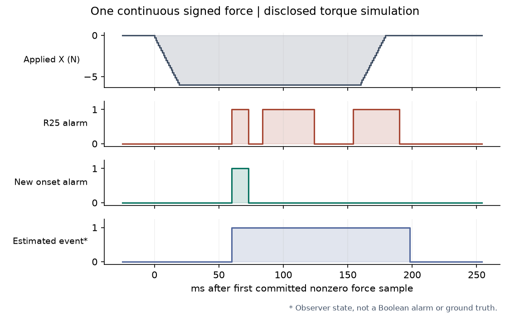
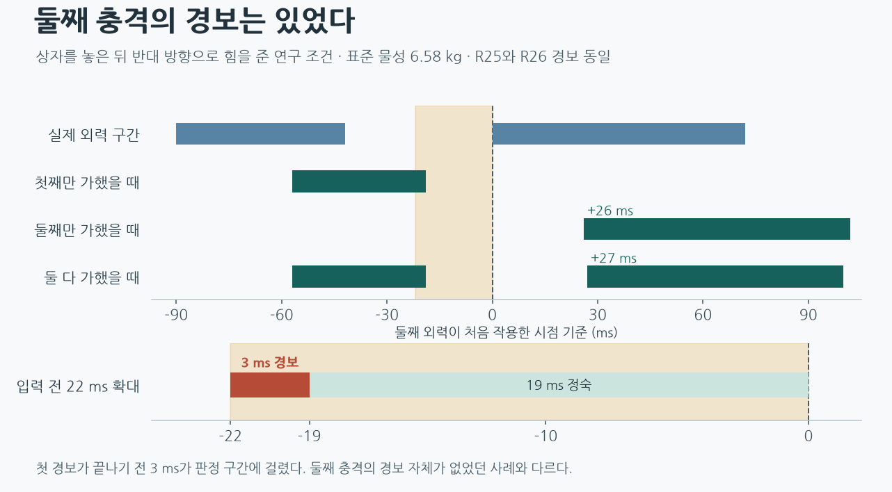

# R26: 한 번의 긴 힘과 실제 둘째 힘 구분

이 문서는 **수업 원본 데모나 R10 제출 결과가 아니다.** R25 토크 연구 감지기의 경보 경계를 수업 물리 엔진으로 실험했다. [실제 착지 제어와 함께 검증한 별도 연구](R26_COMBINED_LANDING.md)와도 서로 다른 제어기이므로 효과를 합산하지 않는다.

### 한 힘에 여러 경보가 난 이유

이미 공개한 180 ms 외력은 실제로 한 번 연속해서 가해졌고 방향도 바뀌지 않았다. 끊긴 것은 외력이 아니라 **수직축 주위의 회전 반응을 보는 감지 경로**였다. 기존에는 표준 물성에서 +60, +84, +154 ms로 울렸다. 회전 신호의 부호와 독립된 수평 관측이 같은 사건을 가리키면 그 사이를 하나로 잇는 후보는, 세 가지 물성에서 각각 **+60, +60, +51 ms에 한 번**만 울렸다. 출력 경보 유지 여부와 실제 외력 지속 여부는 같은 뜻이 아니다.

- 다시 실행한 공개 R25 조건 198회에서, 두 방식의 엄격한 개별 판정은 **54→57/75**, 중복 상승 **4→0**, 구간 밖 오경보는 모두 0이었다. R25에 이미 있던 54개 성공은 그대로였다.
- 이 후보를 채택하지 않은 이유도 수치로 확인했다. 이전 연속 충격의 첫째는 두 물성에서 **26→44, 24→42표본**, 과거 385조건 중 299번 100 N 입력에서는 기존 첫 경보 +19 ms는 같았지만 **166→301표본**이 됐다. 기존보다 +5표본을 넘기지 않는 보호 기준을 위반했다.
- 원본 키트에서 해당 *공개 장시간 입력만* 검증하려면 `python -B tools/r26_signed_yaw_replay.py describe`로 확인하고 `python -B tools/r26_signed_yaw_replay.py replay --help`로 인자를 본다. 세 물성의 무외력·외력 대조 12회에서 기준 경보와 후보 경보를 모두 재현한다. 이 도구의 성공은 새 조건 전체에 대한 승인이 아니다.

### 놓친 약한 둘째 충격

55 ms의 둘째 충격에서 실제 발생한 외력이 줄어드는 것을 확인하는 별도 방식은 둘째만 가하면 **+60 ms**, 첫째와 함께 가하면 **+57 ms**에 한 번 잡았다. 그러나 놓기 직전 두 무외력 조건에서 3.855초에 잘못 울렸고, 한 긴 대각선 입력에서 경보 세 개를 만들었다. 작업대가 설명할 수 있는 마찰력 전체를 제외하는 별도 검사도 이 두 오경보를 없애지 못했다. 최초 입력에만 맞는 결과를 기본 감지기에 넣지 않았다.

### 경보를 길게 켜 두지 않고, 이미 보고한 사건만 기억하기

같은 수직축 회전 신호를 쓰되 **경보 출력**과 **힘이 아직 이어진다는 추정**을 분리한 후속 방식을 만들었다. 이 방식은 첫 경보가 끝나면 출력을 끈다. 같은 방향의 사건임이 계속 확인되고 다른 감지 경로가 울리지 않았을 때만, 회전 경로가 다시 켜진 것을 새 경보로 세지 않는다. 힘이 꺾이거나 그립 상태가 바뀌거나 원인 판단이 불확실하면 독립적인 경보를 그대로 통과시킨다.



이 실험의 세 물성에서 첫 시각은 그대로 +60/+60/+51 ms였고 중복은 없었다. 문제였던 100 N 입력에서 경보 구간이 두 방식 모두 정확히 **1919–2084 ms(166표본)**로 일치했다. 이전 두 물성의 첫 충격 경보 길이도 각각 26·24표본으로 돌아왔다. 이 확인만으로 새로운 검증 조건이나 실제 로봇에서도 통한다는 뜻은 아니다.

### 도입 전 검사와 새 조건에서의 결과는 달랐다

재검증한 기존 10개 자료 묶음(시뮬레이션 합계 1,744회, 중복 조건 포함 가능)과 과거 D4 385조건에서, 후속 방식은 이전 방식이 지키던 기준을 새로 깨지 않았다. 180 ms 입력의 첫 경보 시각은 유지하면서 엄격 성공이 54→57/75로 늘었다. 그 뒤에만 후보를 [고정](../results/r26/exposed_choice.json)했고, 새로운 시험 데이터로 다시 고르지 않았다. 수업 공식 평가기와 학생 기본 토크 제어를 쓴 세 연구 감지기 비교(87회)에서는 각각 24/24였다. **고정된 R10 제출본의 토크 점수는 18/24**이며, 다른 착지 제어와 조합한 R26의 15/24와도 구분해야 한다.

**처음 실행한 독립 시험은 미통과했다.** 외력·제어 조건을 맞춰 세 물성에서 총 156회(방식별 78회)를 수행했다. 아래 숫자는 경보가 울렸는지만이 아니라, 입력 전 정숙과 대조 실험에도 없었던 상승이 정확히 한 번인지까지 확인한 결과다. 한 번의 긴 힘은 두 짧은 힘을 합친 것으로 세지 않았다.

| 새 시험 | R25 | R26 |
|---|---:|---:|
| 별도의 단일 충격 | 6/12 | 6/12 |
| 연속 충격과 시작점이 같은 긴 힘을 한 번만 가함 | 8/9 | 8/9 |
| 첫째만 / 둘째만 가함 | 6/9 · 3/9 | 6/9 · 3/9 |
| 둘 다 가함: 첫째 / 둘째 | 6/9 · 0/9 | 6/9 · 0/9 |
| 엄격 성공 합계 | **29/57** | **29/57** |

30개 조건·물성 조합 중 15개 통과, 구간 밖 오경보와 중복 상승은 양쪽 모두 0, 실제로 공구 접촉이 있었던 4회는 양쪽 모두 검출했다. **28개 미통과 판정** 중 25개는 해당 충격에 귀속할 경보 상승이 없었고, 3개는 상승이 한 번 있었지만 입력 전 22 ms 정숙 조건을 만족하지 못했다. 이는 “둘째 충격 9건 모두 신호가 없었다”는 뜻이 아니다. 관측된 모든 충격 판정 기록은 시간과 경보 길이까지 두 방식이 같았다. 새 조건에서 순이득은 0이며 기본값을 변경하지 않았다. [조건별 판정](../results/r26/independent_ledger.json) · [선택·재현 기록](../results/r26/selection.json).

### 공개 후 원인 대조: 둘째를 못 본 것과 정숙 기준 미달은 달랐다

상자를 놓고 반대 방향으로 두 번 힘을 준 6.58 kg 표준 물성에서 같은 둘째 충격의 경보는 단독 **+26 ms**, 연속 **+27 ms**에 각각 한 번 있었다. 그런데 둘째 입력 직전 22 ms 중 3 ms에 첫 경보가 아직 켜져 있어 정숙은 19 ms뿐이었다. 그 세 표본에서 켜진 경로는 집게가 열린 뒤 수평력을 추정하는 경로 하나였다. 첫째만 준 실험과 두 힘을 모두 준 실험의 기록은 둘째가 시작되기 전까지 같았다. 이 원인 대조는 이미 공개된 실패를 설명한 것이지 독립 점수를 바꾼 것이 아니다. [입력·경보 구간과 원인별 측정값](../results/r26/detached_reverse.json).



이후 별도로, 방향이 실제로 돌아섰다는 센서 근거가 있을 때에만 첫 경보를 일찍 끄는 방식을 미리 고정해 26회 시험했다. 문제의 세 표본에서 수평력 추정은 작아졌지만 여전히 처음 방향으로 **2.29, 1.97, 1.68 N**이었다. 새 방식은 한 표본도 끄지 못했고 정숙은 19 ms 그대로였다. 이 시도도 기각했다. 알려진 3 ms를 맞추기 위해 타이머를 자르거나 정숙 기준을 바꾸지 않았다.

### 공개 후 원인 대조: 경보 자체가 없었던 두 약충격

상자를 든 채 이동할 때의 6.84 N 입력과 내려놓기 직전의 7.74 N 입력은, 위의 반대 방향 충격과 달리 경보가 한 번도 없었다. 같은 움직임을 충격 없이 재생해 빼 보면 센서로 추정한 힘의 차이는 최대 **8.66 N, 8.89 N**이었다. 신호는 달라졌으나 동결된 감지기의 수평 경로가 이 구간에는 열리지 않았고 다른 경로도 경보를 만들지 못했다. 특히 놓기 직전에는 정상 모델의 수치가 문턱을 넘은 시간이 한 표본뿐이었다.

질량·방향·지속 시간을 고정하고 힘의 크기만 0, 0.5, 0.75, 1, 1.25배로 바꾸는 별도 10회 시험을 미리 정했다. 같은 감지기에서 원래 세기까지는 양쪽 모두 경보가 없었고, 1.25배에서만 각각 **+79 ms, +62 ms**에 한 번씩 반응했다. 이 결과가 기존 세기의 미검출을 고친 것은 아니다. 또 무충격 대조를 빼서 얻은 차이는 실제 한 번의 동작에서 감지기가 바로 알 수 없는 값이다. 다음 수정은 이 차이를 입력으로 쓰거나 문턱만 낮추는 대신, 다른 질량·마찰의 무충격 구간에서도 충격을 구별하는지 확인해야 한다. [공개 후 대조·후속 시험 자료](../results/r26/disclosed_followup.json).

### 직접 구분해서 실행하기

원본 예제는 [수업 서보 재생](DEMO_SOURCES.md)이다. 아래 두 명령은 제공 키트를 별도로 읽는 **토크 감지 연구**이며, 첫 번째는 알려진 문제의 원인 확인, 두 번째는 선택 후 고정한 시험이다. 수업 환경의 MuJoCo 3.17.0을 쓰고, 기존 결과가 없는 출력 경로를 지정한다.

```bash
KIT=/path/to/original/icpbl_sim
OUT=$(mktemp -d)
# 공개 입력 12회; 추정된 사건(telemetry)과 실제 출력 경보를 따로 기록한다.
python -B tools/r26_yaw_acquisition_replay.py replay --kit "$KIT" --out "$OUT/known"
# 별도로 고정한 독립 조건 156회; 내려받은 독립 시험 ZIP에는 이 명령과 필요한 학생 소스만 있다.
python -B tools/r26_challenge_replay.py --kit "$KIT" --jobs 2 \
  --selection results/r26/exposed_choice.json --lock results/r26/candidate_lock.json \
  --closure results/r26/independent_closure.json --out "$OUT/independent"
```

`first.json`의 `passed`가 과학적 판정이다. 재생 프로그램이 정상 종료하거나 파일이 동일해도 충돌을 모두 잡았다는 뜻은 아니다.
