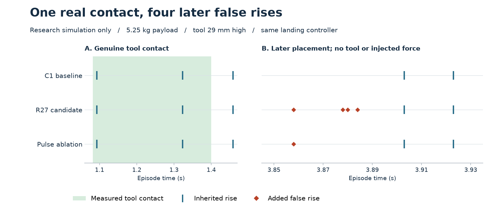

# R27: 착지 제어기를 바꾸지 않고 집기 충격을 더 찾기

**[수업 원본 8 kg 데모](DEMO_SOURCES.md)와 다른 실험이다.** [R26의 착지 제어기](R26_COMBINED_LANDING.md)를 두 조합 모두에서 그대로 쓰고 감지기만 비교했다. 한 조합은 기존 C1, 다른 조합은 C1이 놓친 수평력만 추가 보고한다. 이 점수는 [기본 토크 제어기를 사용한 실험](R27_LOADED_FORCE.md)과 합산하지 않는다.

## 해결한 사례와 새로 드러난 한계

**동일한 수업 평가기를 29회씩 실행:** 집기 중 +Y 방향 15 N 충격을 0 kg과 8 kg에서 추가 검출해 **15→17/24**가 됐다. 제어 점수와 오경보 수는 동일했다. 17은 기본 R10 토크의 18/24를 넘지 않는다. 놓기 제어·궤적을 개선했다는 뜻도 아니다.

| 방식 | 공식 충격 검출 | 교체하지 않은 이유 |
|---|---:|---|
| 기존 C1 | 15/24 | 비교 기준 |
| 집게가 닫힌 동안 수평 이상력 추가 | 17/24 | 실제 공구 접촉은 잡았으나 한참 뒤 3.857초에 오경보가 하나 더 생김 |
| 팔이 하중의 절반 이상을 지지할 때만 추가 | 16/24 | 8 kg 개선은 남았지만 무부하에서는 지지 비율을 정할 수 없어 0 kg 개선을 잃음 |
| **측정 분해능보다 작은 하중을 별도 처리** | **17/24** | 알려진 조건은 통과했으나 새 고하중 공구 조건에서 오경보 4회 증가 |

마지막 방식은 하중이 0.5 N보다 크면 팔이 실제로 절반 이상을 지지해야 하고, 그 이하면 집게가 닫히고 측정된 작업대 반력이 0.5 N 이하여야 한다. C1의 경보는 끄지 않는다. 알려진 정상 6조건과 공구 5조건(각각 두 감지기), 실제 공구 오프셋 25/30/35 mm에서 기존 경보를 유지했다. 0.1·0.35·0.7·1.0 kg에서 기존에 놓친 +Y 네 건을 39–40 ms에 잡았고, 기존 −Y 네 건도 유지했다. 놓기 후 X/Z 네 건을 놓치지 않았다. 수직 집기 충격 하나는 여전히 미검출이다.

### 새 조건에서 별도로 검증한 결과: 미통과

후보 소스를 바꾸지 않고 새 질량·무게중심·물성을 **결과 보기 전에 고정**했다. 18개 물리 입력을 두 감지기로 **36회** 실행했다. 같은 제어에서 물리와 실제 외력은 일치했다. 엄격 검출은 **6→6/8**, 새 검출 이득 0이고, 구간 밖 오경보는 **2→6회**였다. 사선 충격 중복 1건과 둘째 충격 전 경보가 남는 문제는 두 감지기에 이미 똑같이 있었다.

추가 오경보 4회는 모두 **5.25 kg·위로 29 mm 어긋난 공구** 조건에 있었다. 실제 접촉은 1.083–1.399초였고 양쪽 모두 +10 ms에 잡았다. 새 경보는 외력·공구력이 이미 0이던 **3.858, 3.878, 3.880, 3.884초**에 울렸다. 당시 작업대 반력은 24.5–28.3 N이었다. 팔이 지지를 소유한다고 판정한 신호가 꺼졌다 켜지는 동안 추가 경보의 남은 길이가 멈췄다가 다시 소비됐다. **따라서 17/24의 이득은 재현되지만 이 후보는 기본값으로 채택하지 않는다.** [실측 결과·통과/실패 행](../results/r27/landing.json)

### 알림의 재시작만 막으면 어떻게 되나

원인을 확인하기 위해 별도 **46회**에서 센서·제어·힘은 그대로 두고, 팔이 하중을 지지하지 않는 순간 보류 중인 추가 알림을 폐기했다. 네 오경보 중 뒤의 **3회(3.878/3.880/3.884초)가 사라졌다.** 0/8 kg의 실제 +Y 충격은 두 경우 모두 기존과 같은 +38/+43 ms에 잡았다. 그러나 첫 오경보 **3.858초는 남았다**. 즉, 재시작 버그와 처음 하중을 충격으로 오인한 문제는 별개다. 이 검사는 인과관계 확인용이며 위의 공식 17/24 후보를 사후에 바꾸거나 다시 채점한 것이 아니다.



## 공식 결과를 직접 재현하기

수업 원본 키트와 그 MuJoCo 3.17.0 환경을 사용한다. 두 조합은 같은 착지 제어로만 평가한다. 출력 폴더가 이미 있으면 덮어쓰지 않고 종료한다.

```bash
KIT=/path/to/icpbl_sim
OUT=$(mktemp -d)
python -B tools/r27_g4_replay.py describe
python -B tools/r27_g4_replay.py official --kit "$KIT" --out "$OUT/official"
python -B tools/r27_g4_replay.py build-zip --out "$OUT/week09-r27-g4.zip"
```

수업 코드는 배포하지 않는다. 사용자가 가진 키트의 원본 평가기와 원본 의존성을 확인한 뒤 임시 사본에서 실행한다. 새로 푼 ZIP에서 실행한 공식 58회의 **모든 비시간 셀과 과학적 결과가 일치했다**. 벽시계 출력을 포함하는 두 stdout 해시는 달랐고 삭제하거나 일치했다고 처리하지 않았다. [재생 검증 기록](../results/r27/reproducibility.json)
