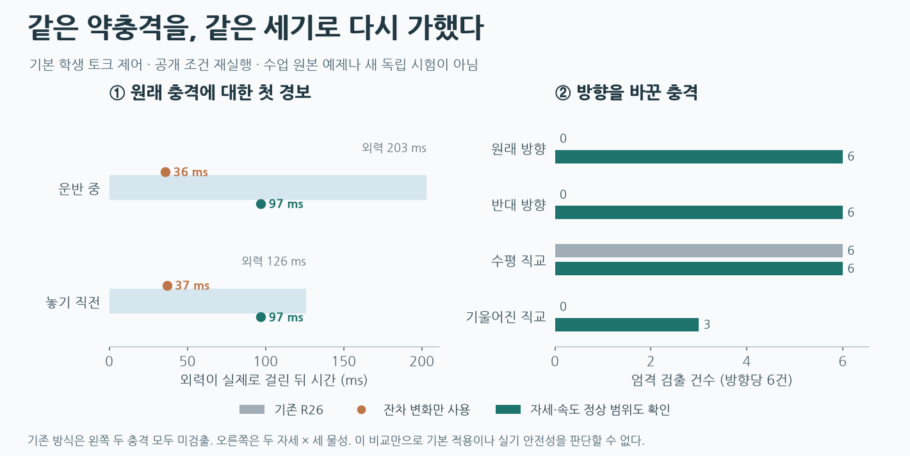

# R27: 박스를 든 토크 팔에서 작은 외력을 감지하기

**수업 원본은 [제공 서보로 실행하는 8 kg 예제](DEMO_SOURCES.md)다.** 여기서는 학생 토크 제어기 `my_torque`를 고정하고 감지기만 교체했다. 비교 기준 **C3**는 이전 R26의 연구 감지기다. 기본 제출 R10도, [다른 착지 제어기로 한 G4 실험](R27_G4_INTEGRATION.md)도 아니다.

## 무엇을 새로 잡았나

이전 R26에서 놓친 **상자 운반(6.23 kg, 6.84 N)**과 **놓기(3.06 kg, 7.74 N)** 조건을 진짜 시뮬레이터에서 다시 가했다. 실제 힘이 작용한 시간은 각각 203, 126 ms다. 각 조건에서 원래 힘·역방향·수평 직교·기울어진 직교 힘을 크기는 같게 바꾸고, 힘을 전혀 주지 않는 짝도 별도로 실행했다. 기본 물성과 두 가지 변경 물성에서 감지기당 **30회: 외력 24회 + 무입력 6회**다. 여기의 24회는 공식 시험 24건이 아니다.

| 감지기 | 24건 중 엄격 검출 | 원래 물성에서 운반 / 놓기 | 넓은 조건에서 확인된 한계 |
|---|---:|---|---|
| 기준 C3 | 6 | 미검출 / 미검출 | R26에서 29/57 |
| 수직 하중을 제외한 수평력 | 6 | 미검출 / 미검출 | 8 ms 변화량이 정상 상한보다 작아 추가 검출 없음 |
| 부호 있는 하중 변화 | 18 | +36 / +37 ms | 무입력 1건 오경보, 이미 잡던 경보가 더 길어짐 |
| 두 힘 추정값이 함께 안정된 하중 | 14 | +97 / +97 ms | R26에서 중복 2건, 구간 밖 새 오경보 3회 |
| **자세·속도까지 확인** | **21** | **+97 / +97 ms** | R26에서 43/57이지만 한 번의 힘을 두 번 보고한 조건이 남음 |



마지막 방식은 두 힘 추정값이 함께 달라지고, 현재 관절 자세·속도와 가까운 두 정상 구역 **모두에서 설명되지 않을 때만** 4 ms 경보를 더한다. 정상 운동 27회로 범위를 만들고 별도 정상 15회로 보정했다. 운동을 모르면 경보를 새로 만들지 않는다. 검출 중에는 외력을 건 시각·방향, 정답, 무입력 짝을 보지 않는다. 무입력 검증 **33조건**에서는 기준 대비 새 오경보가 없었고, 방향 패널 21건은 모두 **실제 힘이 끝나기 전**에 보고했다. 경보 4 ms는 힘의 지속시간 추정치가 아니다.

## 왜 기본값으로 바꾸지 않았나

- **이전 R26의 156회**를 같은 입력으로 다시 돌리자 엄격 개별 검출은 **29→43/57**이었지만, 두 번 가한 힘의 **둘째 엄격 검출은 0→0/9**였다. 단독으로 둘째 힘만 가하면 3→6/9다. 두 개를 모두 가할 때도 성공했다는 뜻은 아니다.
- 놓기 위치에 준 긴 연속 힘 한 건에서 추가 경보가 +97 ms에 울리고 기존 정상력 경보가 +109 ms에 또 울렸다. 두 번 준 조건에서는 첫 힘이 67 ms였는데 첫 경보는 +86 ms였다. 그 결과 둘째 힘 직전 22 ms 중 4 ms에 경보가 남아, 둘째 뒤에 새 경보가 생겨도 엄격 기준을 충족하지 못했다. 같은 비교에서 기준보다 나빠진 물성 행은 3개, 중복이 새로 생긴 슬롯은 2개다.
- 별도의 교차축 스트레스 시험에서도 전체 엄격 검출은 36→47/48로 증가했지만, 기존에 +107 ms에 한 번만 울리던 둘째 힘에서 +96/+107 ms에 두 번 울렸다. 그 시점에서 후속 과거 패널 재실행을 중단했고, 미실행분을 통과로 세지 않았다.
- 별도의 **D4 385조건**에서는 기존 대비 엄격 검출 **146→154**, 구간 밖 오경보 9→9, 중복 2→2였다. 실제 공식 평가기에서는 **연구 C3와 새 방식 모두 24/24**, 표시된 비시간 66셀 동일이다. 이 결과가 연속 충격 실패를 상쇄하지는 않는다.
- 동등한 두 실제 입력·순서를 뒤집은 반복에서 제어+감지 24,000주기씩 측정했다. 에피소드별 벽시계 p99 중 최댓값은 기준 **334 µs**, 새 방식 **382 µs**였다. 공유 CPU의 유한 측정이지 실시간 마감 보장이 아니다. [측정값](../results/r27/timing.json)
- 기존 성능을 지키는 조건 하나라도 실패하면 독립 시험에 넣지 않기로 **외력 실험 전에** 정했다. 이번 네 후보 중 선택한 것은 없다. 다음 독립 시험 **114회는 미실행·미채점**이다. [선정 기록](../results/r27/selection.json) · [후보별 수치와 두 번 울린 원인](../results/r27/development.json)

다음에 구별해야 할 것은 ‘두 경로가 시차를 두고 확인한 같은 하중’와 ‘방향이 다른 실제 둘째 힘’이다. 일정 시간 동안 모든 경보를 막아서는 두 현상을 구별할 수 없다. 두 입력을 따로 준 경우, 함께 준 경우, 긴 연속 입력, 무입력을 같은 물리 조건에서 대조해야 한다.

## 같은 물리 결과 재생

수업에서 받은 키트와 MuJoCo 3.17.0 환경이 필요하다. 아래 명령은 키트를 수정하지 않는다. 명령마다 **아직 존재하지 않는 출력 경로**를 쓴다.

```bash
KIT=/path/to/icpbl_sim
OUT=$(mktemp -d)
python -B tools/r27_force_replay.py compare --kit "$KIT" --arm pose-certified \
  --scope directions --out "$OUT/directions" --jobs 2
# 빠른 재현: 원래 물성의 두 조건과 각각의 무입력을 두 감지기로 실행 (총 8회)
python -B tools/r27_force_replay.py compare --kit "$KIT" --arm signed-change \
  --scope registered --out "$OUT/registered"
# 별도 경로에 소스 ZIP 생성; 수업 원본이나 미개봉 시험은 들어 있지 않음
python -B tools/r27_force_replay.py build-zip --out "$OUT/week09-r27-loaded.zip"
```

`directions`에서는 C3와 선택 후보를 총 60회 실행한다. `result.json`에는 각 입력과 짝의 물리 지문·경보, `receipt.json`에는 실행한 키트와 소스 지문이 남는다. 연구 트리·배포 트리·압축 해제본에서 만든 ZIP은 바이트 단위로 같았다. [재생 지문](../results/r27/reproducibility.json)
