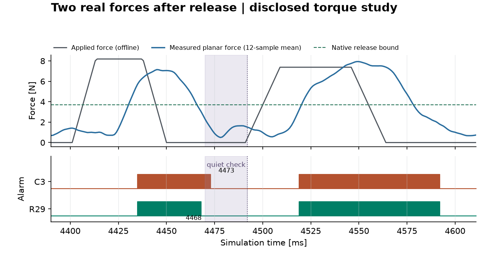

# R29: 상자를 놓은 뒤 두 번의 충격을 구별했나?

**공개된 역방향 충격은 세 물리 조건 모두에서 구별했다. 처음 본 15조건에서는 기존과 같은 9조건만 구별했다.** 상자를 들고 있을 때 약한 힘 하나를 두 번 알리던 문제도 두 사례에서 줄였지만, 다른 충격까지 전부 해결한 것은 아니다. 아래는 학생 토크 제어를 고정한 연구다. [수업 원본 데모](DEMO_SOURCES.md)는 제공 서보·감지기의 `run.py --box 8`이고, 기본 제출 R10은 바꾸지 않았다.

## 1. 두 번째 힘이 약해서가 아니라 첫 경보가 늦게 끝난 사례

상자를 놓은 뒤 6.58 kg 조건에서 힘을 두 번 가했다. 각 물성에서 **힘 없음, 첫째만, 둘째만, 모두, 하나의 긴 힘**을 실제로 따로 실행했다. 감지기에는 정답 힘이나 시각을 주지 않았다. 원래 감지기(C3)는 두 번째 힘에 새 경보를 냈다. 그러나 충격 전 22 ms가 조용해야 두 사건을 구별했다는 평가 기준을 충족하는데, 표준 물성에서는 첫 경보가 그 구간을 3 ms 침범했다.

| 표준 물성, 1 kHz | C3 | 힘의 복귀를 확인하는 방식 |
|---|---:|---:|
| 첫 실제 힘 | 4.402–4.449초 | 동일 |
| 첫 경보 시작 / 종료(종료 시각 제외) | 4.435 / 4.473초 | 4.435 / **4.468초** |
| 둘째 실제 힘 시작 / 둘째 경보 | 4.492 / 4.519초 | 동일 |
| 둘째 시작 전 연속 무경보 | 19 ms | **24 ms** |

감지기는 이미 알린 사건에서만, 손이 열려 있고 다른 감지 경로가 없으며 **기존 12표본 평균과 최근 3개 힘 추정이 모두 기존 복귀 문턱(3.68 N) 안**일 때 경보를 끝낸다. 측정을 잃거나 다른 경로가 살아 있으면 원래 출력을 따른다. 4.468초에 순간 추정은 1.22 N, 평균은 3.02 N이었다. 새 사건을 일정 시간 막는 장치는 쓰지 않았다. 실제 외력은 시험이 끝난 뒤 정답 대조에만 썼다.



표준·구동기 데드존·놓기 면 변경에서 첫 경보를 각각 5/5/6 ms 일찍 끝냈다. 두 번째 경보의 지연은 각각 +27/+26/+25 ms로 바뀌지 않았다. 다른 단계의 두 연속 충격을 포함하면 엄격한 둘째 검출은 기존 **0/9 → 3/9**다.

## 2. 알려진 이득과 새 시험을 분리했다

| 같은 학생 토크 제어, 공개된 R26 조건 156회 비교 | 엄격한 사건 판정 / 57 | 중복 경보 | 연속 충격 둘째 / 9 |
|---|---:|---:|---:|
| C3 (이전 기준) | 29 | 0 | 0 |
| R27 자세별 정상 힘 판정 | 43 | 2 | 0 |
| R29 놓은 뒤 복귀 확인만 | 32 | 0 | 3 |
| R29 상자를 든 상태의 동일 힘 연결만 | 45 | 0 | 0 |
| 두 수정 결합 | **48** | **0** | **3** |
| 두 힘 추정값의 정상 범위를 학습한 별도 시도 | 17 | 12 | 0 |

‘동일 힘 연결’은 먼저 보고한 힘과 두 추정값의 방향·크기가 계속 맞고, 뒤늦게 켜진 원래 경보의 출처까지 확인될 때만 둘을 한 사건으로 본다. 힘이 돌아오거나 다른 출처가 나타나면 원래 경보를 그대로 낸다. 알려진 하나의 긴 충격에서 +97/+109 ms 두 경보 중 +97 ms 경보를 유지했고, 별도 사례에서도 +96/+107 ms 중 +96 ms를 유지했다. **결합 방식은 놓기 직전 교차 충격 세 물성에서 여전히 둘째 전 무경보 기준을 잃었다.** 48/57은 승격 기준 통과가 아니다. 두 관측값의 통계적 정상 범위만 쓴 별도 시도는 엄격 판정과 중복 모두 나빠져 제외했다.

- **새로 고정한 놓은 뒤 15조건:** 서로 다른 방향·세 물성에서 두 감지기를 5종 입력으로 각 75회, 총 150회 실행했다. 각각만 가한 둘째에서는 둘 다 15/15, 둘을 연속 가하면 **둘 다 9/15**였다. 짧은 교차축과 늦은 역방향의 여섯 조건은 둘 다 새 경보는 있었지만 충분히 조용해지지 않았다. 새 이득이나 기존보다 나빠진 조건은 없었다. 이 결과로 문턱을 다시 맞추지 않았다.
- **들고 있는 상태의 동일 힘 연결:** 별도로 고정한 교차축 충격 한 쌍을 정해진 세 감지기의 무충격/첫째만/둘째만/모두, 총 12회로 대조했다. 실제 힘이 겹치지 않았고 둘째를 +43 ms에 한 번 잡았다. 한 입력의 성공을 모든 연속 충격으로 일반화하지 않는다. [확인한 경로와 독립 대조](../results/r29/held-identity.json).
- **공개된 방향·정상 대조:** 결합 방식은 들고 있는 두 자세의 ±방향 등에서 원래의 6/24를 **21/24**로 높인 R27 이득을 유지했다. 별도 무충격 33조건을 두 감지기로 66회 실행했고 새 오경보는 없었다.
- 세 방식 모두 출력이 물리 궤적을 바꾸지 않았는지 검사했다. 첫째만/둘째만/둘 다/긴 힘 대조의 입력 전 구간과 실제 힘도 검증했다. [조건별 수치와 원자료 지문](../results/r29/torque-events.json) · [표준 물성 경보 시계열](../results/r29/detached-mechanism.json).

**더 넓은 토크 대조:** 기본 결합 방식은 공식 토크 29회에서 이전 연구 감지기 C3와 충격 24/24, 오경보 1회, 모든 지연이 같았다. 이 점수는 제출 R10의 18/24가 아니다. 다른 공개 시험 198회(물리 서명 36/36 일치)에서 C3/R27/결합은 각각 57/62/62개(총 75개)였고 중복과 거짓 상승은 모두 0이었다. 결합 방식은 R27과 검출 시각이 같으면서 경보가 켜져 있던 표본은 5,073→4,892로 181개 줄었다. 13개 판정은 여전히 실패했다. [입력 동일성·세 감지기별 결과](../results/r29/broad-history.json).

### 더 빨리 알리는 방식은 왜 제외했나?

상자를 든 채 놓기 직전 교차축 충격에서는 두 힘 추정값이 이미 정상 범위를 벗어났는데도 기존 방식이 힘의 안정화를 기다렸다. 같은 힘이 커지는 도중 두 값 모두 기존 자세별 정상 범위를 벗어난 때 알리자 첫 경보가 세 물성에서 +85~86 ms → **+33~34 ms**가 됐다. 같은 156회에서 엄격한 판정 **51/57**, 연속 충격 둘째는 **6/9**, C3 대비 그 시험의 보호 손실은 0이었다. 목표 30회 평가기의 동결 판정은 실패다. 구동기 데드존 조건에는 원래 연결할 장시간 경보 자체가 없었는데도 평가기는 연결 1회를 요구했다. 이후 결과는 공개 입력에 대한 진단이지 새 독립 합격이 아니다.

**별개의 실제 실패도 있다.** 수평 교차축 힘 하나에 이전 방식은 운반 +35 ms와 놓기 +46 ms에 각각 한 번 울렸지만, 빠른 방식은 각 조건에서 **+29/+35 ms, +32/+46 ms** 두 번 울렸다. 방향 24건 중 네 건이 이 때문에 단일 검출에서 탈락하여 결합 방식의 21/24가 17/24로 떨어졌다. 실제 독립 감지 경로를 임의로 꺼서 점수를 복구하지 않았다. [빠른 방식의 표적과 반례](../results/r29/rising-audit.json).

## 3. 별도 착지 제어: 오경보를 없앴지만 실제 하향 충격까지 없애면 탈락이다

같은 착지 제어에서 R28의 관측 기억 방식을 신규 물리 입력 30개씩 C1·V3·기억 방식으로 총 90회 비교했다. 세 방식 모두 엄격 판정 11/15, 공구 접촉 3/5였다. 기억 방식의 오경보는 3회로 C1과 같고 V3의 7회보다 적었다. 새로 더 찾은 실제 충격은 없다. 24.32 N의 약한 공구 접촉도 세 방식 모두 놓쳤다.

**사전 고정한 판정은 실패 그대로다.** 한 무외력 공구 조건에서 평가기가 (1) 오경보 시각을 물리 지지 정보와 한 묶음으로 비교했고, (2) V3에만 있던 오경보 4개를 없앤 것을 경보 손실로 셌다. 사후 도구는 물리·감지 지표를 분리하고, 누락 허용 대상을 실제로 거짓이라고 분류된 상승으로 제한한다. 두 경보가 하나로 합쳐져도 보존됐다고 하지 않도록 일대일로 대조한다. 구분하지 못하는 새 지표는 통과시키지 않는다. **새 규칙으로 과거 결과를 소급 합격시키지 않는다.** [동결된 원래 결과](../results/r29/g4-prospective-locked.json) · [별도 진단 결과](../results/r29/g4-guard-audit.json).

이전에 남았던 3.903/3.923초 경보는 각각 C1의 느린 경로와 빠른 경로였다. 그 순간 작업대가 상자를 받친 것은 손이 열린 팔의 힘 증거가 아니다. 엔코더·관절 토크로 빈 팔의 연속 힘을 추정한 별도 방식은 두 경보를 없앴고 집기 +Y 충격의 +38/+43 ms도 유지했다. 그러나 **같은 상태의 실제 아래 방향 15 N을 완전히 놓쳤고**, 늦은 아래 방향 충격의 경보도 8→68 ms로 늘었다. 54회 대조 결과 이 방식은 쓰지 않는다. [실패 대조와 근거](../results/r29/g4-release-verdict.json).

## 직접 재생하기

원본 키트를 공개 ZIP에 넣지 않는다. 아래는 원본의 [8 kg 데모](DEMO_SOURCES.md)가 아니라 연구를 재현하는 명령이다. 정식 MuJoCo 3.17.0 환경에서 각 ZIP을 풀어 해당 폴더로 이동하고 실제 키트 경로를 지정한다. 출력은 존재하지 않는 경로여야 한다.

```bash
KIT=/path/to/original/icpbl_sim
OUT=$(mktemp -d)
# 토크 ZIP: 기존 C3 대 놓은 뒤 복귀 확인, 30회
python -B tools/r29_event_replay.py compare --kit "$KIT" --scope known-detached --arm released --out "$OUT/known"
# 같은 ZIP: 결합 방식의 공개 156회 / 별도 사전 고정했던 놓은 뒤 150회
python -B tools/r29_event_replay.py compare --kit "$KIT" --scope known-full --arm composed --out "$OUT/combined"
python -B tools/r29_event_replay.py compare --kit "$KIT" --scope prospective-detached --arm released --out "$OUT/released"
# 같은 ZIP: 방향 대조에서 탈락한 빠른 방식, 공개된 놓기 직전 30회
python -B tools/r29_event_replay.py compare --kit "$KIT" --scope known-place --arm rising-audit --out "$OUT/early"
# 별도 착지 행렬 ZIP: 원래 세 감지기로만 사전 고정한 90회와 원래 FAIL 판정 재생
python -B tools/r29_g4_matrix.py replay --kit "$KIT" --out "$OUT/g4-matrix"
# 별도 착지 경로 ZIP: 채택하지 않은 하향 충격 대조 54회
python -B tools/r29_g4_replay.py release-controls --kit "$KIT" --out "$OUT/g4"
```

세 ZIP은 위 도구에서 `build-zip --out /새/경로.zip`으로 각각 만든다. 물리·경보·판정 값은 매번 원본 키트에서 다시 계산한다. 착지 행렬 도구는 원래 코드의 기계별 절대 경로를 없앴다. 물리 실행·채점 함수 본문은 그대로라서, 새 실행기의 지문(`runner_sha256`)을 제외한 모든 결과가 원래의 **실패 판정까지** 일치하는지 검사한다. 미개봉 시험이나 원본 키트는 어떤 ZIP에도 들어 있지 않다. [각 ZIP과 실행 결과 지문, 원본·R10 검증](../results/r29/handoff.json).
