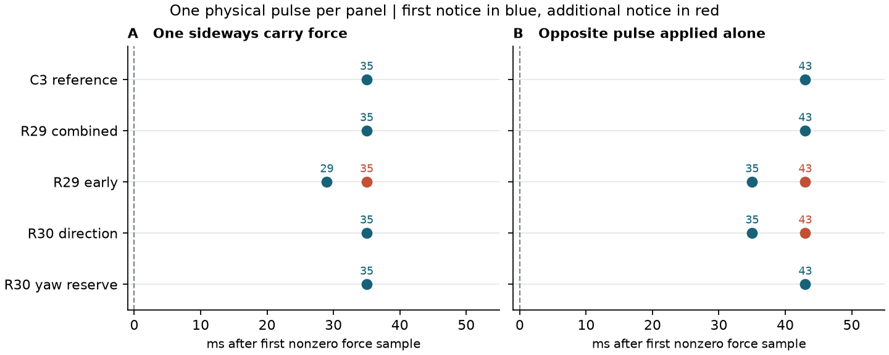
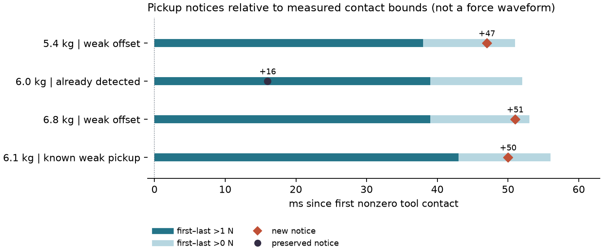

# R30: 실제 충돌 한 번을 경보 두 번으로 세지 않으려면

**원본 데모는 그대로다.** 제공 키트의 기본 서보·감지기로 `run.py --box 8`을 다시 실행했고 교안 내장 결과와 PNG가 바이트 단위로 일치했다(`82cb22df…`). R10 제출도 공식 58회·비시간 132칸이 그대로다(서보 23/24, 토크 18/24). [원본 실행법](DEMO_SOURCES.md)과 아래 연구 재생은 다른 명령이다.

## 한 번의 힘에 두 경보가 뜬 이유

R29의 빠른 방식은 상자를 들고 있을 때 두 센서에서 힘이 충분히 변하면 일찍 알렸다. 한 번만 힘을 준 방향 시험에서 경보가 두 번 난 네 건을 다시 실행했다. **뒤쪽 네 경보는 모두 첫 관절의 회전력(yaw) 경로**에서 나왔다. 시간을 정해 다음 경보를 끄면 진짜 두 번째 충돌도 막을 수 있다. 그래서 기존 회전력 경로는 끄지 않고, 앞쪽의 추가 알림을 언제 낼지를 바꿔 봤다.

1. **방향만 보는 방식:** 두 측정 힘의 변화가 모두 첫 관절 회전으로 잘 보이지 않는 쪽이고, 그 부호도 일치할 때만 먼저 알린다. 방향 시험의 중복 네 건은 사라졌다. 하지만 반대 방향 충격을 **단독으로** 준 대조에서 여전히 **+35, +43 ms**에 두 번 울렸다. 실제로 연속 두 힘을 준 시험의 둘째도 마찬가지였다. 이 방식은 탈락이다.
2. **현재 회전력의 여유까지 보는 방식:** 현재 회전력에 두 센서 각각의 관측 변화량을 투영해 더한다. 현재 값과 양쪽 예상 값이 기존 회전력 경계 안일 때만 먼저 알린다. 외력 정답, 시험 시각, 새 조정계수는 쓰지 않는다. 앞서 실패한 단독 충격에는 **+43 ms 한 번**만 울렸다. 이는 관측한 변화 한 단계에 대한 확인이지 미래 회전력을 보장하지는 않는다.



| 같은 학생 토크 제어, 공개된 시험 | C3 기준 | R29 결합 | R29 조기 | R30 방향만 | R30 회전력 여유 |
|---|---:|---:|---:|---:|---:|
| 힘·무충격·단독·연속을 대조한 엄격 판정 (57구간) | 29 | 48 | 51 | 51 | 51 |
| 그중 둘째 충격 구별 (9구간) | 0 | 3 | 6 | 6 | 6 |
| 힘 방향·물성 대조 (24구간) | 6 | 21 | 17 | 21 | 21 |
| 방향 시험 중 같은 힘에 두 번 울린 구간 | 0 | 0 | 4 | 0 | 0 |
| 이전의 같은·반대·교차 충격 대조 (12구간) | 6 | 12 | — | 10 | 12 |

회전력 여유 방식은 알려진 표준 운반 충격을 정방향 **+97→+31 ms**, 역방향 **+94→+29 ms**에 잡았다(R29 결합 대비). 무충격 33조건에서 새 오경보가 없었고, 이전 물리 시험 198회에서도 R29 결합의 **62/75**를 유지했다. 반대로 놓기 직전의 *둘째만* 준 대조는 탈락했던 R29 조기 방식의 +25~30 ms 대신 R29 결합과 같은 **+73~74 ms**였다. R26에서 남은 6구간은 세 물성 각각의 집기 전환 충격(둘째만, 둘 다의 둘째)이다. [엄격 판정·지연·누락 구간 전체](../results/r30/matched-disclosed.json)

## 왜 제출 감지기를 교체하지 않았나

- **넓은 시험은 실패했다.** D4 385조건에서 두 방식 모두 C3가 잡던 146건을 유지했고 8건을 더 잡았다. 그 8건은 이전 R27도 이미 잡던 조건이다. D4의 검출 여부와 중복 여부는 서로 다른 기준이다. 방향만 본 방식은 **15조건**, 회전력 여유 방식은 **14조건**에서 C3보다 중복이 늘었다. 다른 물리 궤적 때문이 아니다(385/385 힘·충격 전 이력·물리 일치). 따라서 각 방식에 따로 예약한 새 102회·69회 시험에는 아무 후보도 투입하지 않았다. [실패 조건별 기록](../results/r30/broad-history.json)
- **연구용 공식 점수와 제출 점수는 다르다.** 같은 학생 토크 제어에서 공식 평가기는 R10을 **18/24**, R29 결합과 두 R30 연구 방식을 **24/24**로 판정했다. 실제 R10과 R29 결합을 나란히 실행한 별도 공개 충격 대조 30회는 **0/15 대 15/15**였다. 공식 점수가 오른다는 사실은 위 중복과 지연 비용을 상쇄하지 않는다. [생산 기준과 원본 확인](../results/r30/production-baseline.json)
- **주기 비용이 있다.** 네 조건과 역순 반복, 방법당 48,000주기에서 제어+감지 시간의 가장 높은 에피소드 p99는 R10 **317 μs**, R29 결합 **557 μs**, R30 회전력 여유 **552 μs**였다. R30의 관측 최댓값은 **5.30 ms**, 1 ms 이상은 1주기였다. 한 호스트의 유한 측정이다. [최댓값·초과 횟수 포함](../results/r30/timing.json)
- 남은 집기 전환 충격은 손을 닫는 동안 테이블이 21~25 N을 지지할 때 발생했다. 추정기는 손 상태가 바뀌면 관측 창을 비워, 힘이 끝나기 한 표본 전에야 첫 하중 추정이 나왔다. 이때 신호는 보였지만 정상 표본으로만 만든 별도 구분 규칙은 분리해 둔 무충격 16회 중 **7회**에서도 작동해 후보로 만들지 않았다. [적합·반증 기록](../results/r30/grip-transition.json)

## 넓은 시험에서 발견한 두 가지 다른 원인

같은 물성에서 5개 감지기를 **95회** 다시 실행해 14개 실패를 분리했다. **13개**에서는 먼저 추가 알림이 울리고 뒤이어 기존 센서 경로가 울렸다. 모두 첫 관절 회전력만의 문제는 아니다. 예를 들어 266번은 2.729초 추가 경보와 2.740초 회전력 경보였지만, 287번의 두 번째 경보(3.174초)에는 회전력 경로가 없고 여러 다른 경로가 동시에 살아 있었다. **나머지 316번**은 추가 알림 자체가 없었다. 상자를 놓은 상태에서 같은 센서 사건이 1 ms 끊겼다가 다시 출력된, 이전 R29에서 물려받은 문제였다. [실제 힘의 시작·끝과 각 경보의 출처](../results/r30/d4-cause.json)

### 상자를 놓을 때 중복된 한 경보의 후속 수정

316번에서는 C3가 **3.951–3.989초**에 한 번 울렸지만, 이전의 분리 상태 경보는 **3.951–3.963초**, **3.964–3.982초**로 갈라졌다(끝 시각 제외). 방금 끝난 *같은 센서 사건*이 여전히 활성 상태라면 다시 시작하지 못하게 하는 후속 방식을 만들었다. 해당 센서가 내려갔다 다시 켜지거나 다른 경로가 신호를 내면 즉시 원래대로 알린다. 임의로 정한 대기시간은 없다.

같은 1.3 kg·5 N 시험에서 **3.951–3.963초 한 번**으로 바뀌었고 인접한 33조건의 출력은 직접 부모 방식과 같았다. 이는 상자를 들고 있을 때의 조기 알림 방식과 **결합하지 않은 별개 수정**이다. 진짜 두 힘의 간격과 방향을 바꿔 60회 대조한 결과는 두 방식 모두 구간 26/30, 구별되는 둘째 2/6이었다. 부모가 잡던 둘째를 잃지는 않았지만 나머지 네 쌍을 새로 구별한 것도 아니다.

같은 수정 전후 감지기를 **D4 385조건에 각각 실행(770회)**하고 기존 C3와도 대조했다. 수정 전 C3 대비 보호 실패는 316번 하나였고, 수정 후 C3 대비 및 수정 전 대비 모두 **0건**이었다. 수정 전과 점수 또는 경보 활성 표본 수가 달라진 조건은 316번뿐이다. 기존 R26에서 직접 부모와 같은 32/57, 둘째 3/9를 유지했다. 제공 평가기로도 같은 학생 토크 제어에서 두 방식 29회씩·비시간 66칸이 같았다. [사건별 시각·두 충격 대조·D4 전체 판정](../results/r30/detached-lifetime.json). 이 결과가 별도 조기 감지 방식의 다른 13건까지 고친 것은 아니다.

## 별도 착지 제어: 약한 공구 접촉을 놓친 경우

24.32 N의 실제 접촉에서 접근 방향에 반대되는 추정 힘은 12.51 N까지 올랐고, 같은 자세의 오프셋 없는 대조는 0.99 N이었다. 즉 신호 자체는 있다. 즉시 알리면 알려진 누락을 +15 ms에 회복했지만 다른 접촉에 중복을 만들었다. 첫 집기 시도에서만 한 번 알리는 방식도 새 조건에서 기존 경보를 **1.323→1.315초**로 바꿨다. 이미 잡던 한 접촉을 두 방식이 먼저 알렸을 뿐, 새 검출이 아니다.

다음 방식은 처음에는 알리지 않고, 측정된 하중이 내려갈 때까지 기다린 뒤 **첫 집기 동안 기존 경보가 한 번도 없었을 때만** 알린다. 알려진 24.32 N 접촉에서 +50 ms에 한 번 알렸고, 더 약한 알려진 접촉도 +50 ms에 잡았다. 원래 1.323초에 울리던 접촉은 그 시각 그대로다. **이는 접촉 시작 경보가 아니다.** 첫 예제에서 1 N이 넘는 구간은 1.303–1.346초였지만 미세한 접촉력은 1.359초까지 남았다. 1.353초 통지는 **1 N 구간이 끝난 뒤 7 ms, 측정 접촉력이 0이 되기 전 6 ms**였다. 사전에 고정한 첫 14회는 기존 경보와 무충격 침묵을 보존했지만 세 공구 조건을 기존 방식도 이미 잡아, 새로운 누락을 회복했다는 증거는 아니었다. [방식별 실제 경보와 대조](../results/r30/g4-pickup.json)

별도로 질량·무게중심·공구 오프셋을 미리 정한 11개 물리 입력을 두 감지기로 **22회** 비교했다. 무충격 대조 3개는 양쪽 모두 조용했고 실제 공구 접촉 8개는 **4/8→8/8**이었다. 새로 잡은 네 번 중 **두 번**은 새 질량·자세에서의 접촉(5.4 kg/18.5 N, 6.8 kg/22.6 N)이었다. **나머지 두 번**은 알려진 약접촉 뒤에 서로 다른 외부 충격을 가한 대조다. 네 통지는 모두 접촉 시작 후 **47~51 ms**, 1 N 초과 구간 종료 후 **7~12 ms**였고 작은 잔류 접촉력이 0이 되기 **2~6 ms 전**이었다. 뒤에 가한 두 외부 충격의 원래 경보는 그대로였다. [고정한 판정과 행별 접촉력·경보 원자료](../results/r30/g4-qualification.json)



이전에 공개한 착지 입력 30개도 두 방식으로 **60회** 다시 실행했다. 원래의 경보를 하나도 잃지 않았고, 거짓 경보는 **3→3**으로 늘지도 줄지도 않았다. 지지력·물리 궤적은 같았다. 추가 알림 두 번은 같은 약접촉의 외력 없는 경우와 뒤에 외력을 준 경우였다. [이전 물리 행렬 재검증](../results/r30/g4-matrix.json)

제공된 공식 평가기로 같은 착지 제어에서 29회씩 다시 실행했다. 기존 방식과 새 방식은 **17/24**로 같았고, 무충격 오경보 1회 및 충격 실행 중 최대 오경보 2회도 그대로였다. [공식 항목별 대조](../results/r30/g4-official.json). 제출 R10의 토크 18/24와는 다른 제어 실험이다.

## 결과를 직접 재생하려면

MuJoCo 3.17.0과 본인이 받은 원본 키트를 사용한다. 배포물에는 키트·교안 그림·미사용 시험이 없다. 각 출력은 **새 폴더**여야 한다.

```bash
KIT=/path/to/icpbl_sim
OUT=$(mktemp -d)
python -B tools/r30_event_replay.py compare --kit "$KIT" --scope signed-stock --out "$OUT/signed"
python -B tools/r30_event_replay.py compare --kit "$KIT" --scope paired-directions --out "$OUT/opposite"
python -B tools/r30_event_replay.py compare --kit "$KIT" --scope place --out "$OUT/place"
```

별도 착지 제어의 약한 공구 접촉·무접촉·작고 큰 오프셋 네 조건을 네 감지기로 비교하려면 다음을 실행한다. 이 재생 출력의 접촉 구간은 **1 N 초과** 기준이다. 0 N에 도달한 시각과 혼동하지 않는다. 소스와 ZIP 추출본 16회 결과가 바이트 단위로 일치했다. 이전 자료 중 일부는 물리 해시 전체가 아닌 일치 여부만 보관했으므로 과거와의 비교는 저장된 항목으로 제한했다. [착지 재생 영수증](../results/r30/g4-replay.json)

```bash
python -B tools/r30_g4_replay.py replay --kit "$KIT" --out "$OUT/tool"
```

앞의 토크 명령은 같은 제어에서 연구 방식 다섯 개를 각각 실제 실행한다. `result.json`의 `delays_ms`는 확인된 힘 시작 기준 경보 시각이며, `rows`에는 무충격·단독·연속 대조가 있다. 두 번 빌드한 소스 ZIP은 동일했고, 추출본에서 세 명령 **50+60+25=135회**를 다시 실행했다. [재생 영수증·ZIP 해시](../results/r30/replay.json). 실제 로봇 적용이나 안전 인증은 하지 않았다.
