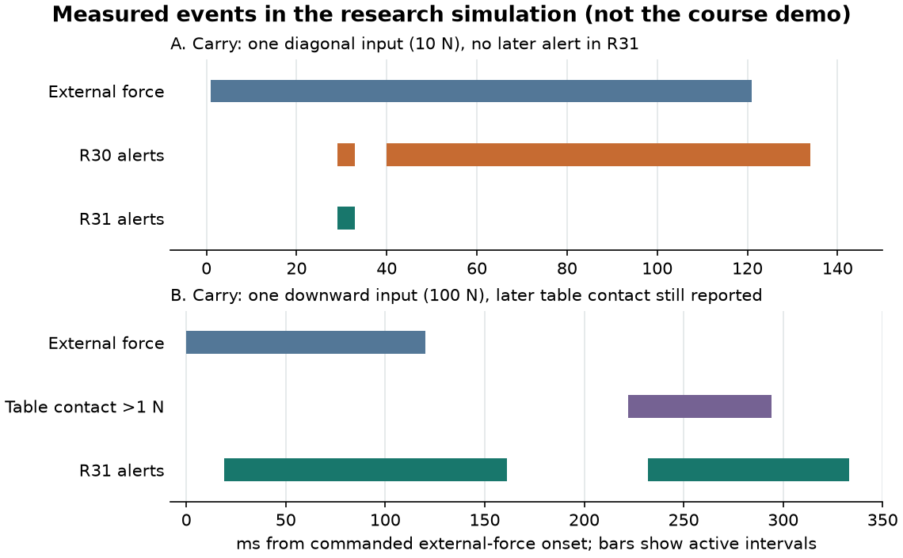

# R31: 같은 힘의 두 번째 경보와 실제 두 번째 충격 구별하기

**수업 원본은 제공 서보·감지기의 `run.py --box 8`이다.** 이번에도 실행 결과 이미지가 교안의 PNG와 바이트 단위로 일치했다. 원본은 RMS 6.14 mm, 최대 14.00 mm, 오경보 7회다. 아래의 경보 그림과 점수는 같은 수업 시뮬레이터에서 학생 토크 제어와 **연구 감지기**를 실행한 결과로, 원본 데모가 아니다. R10 제출 파일도 바꾸지 않았다. [원본 실행법](DEMO_SOURCES.md) · [원본 해시·공식 평가표](../results/r31/official.json)

## 무엇을 고쳤나

상자를 들고 있을 때 빠른 감지기가 힘의 변화를 먼저 알리고, 몇 ms 뒤에 기존 감지기가 같은 힘에 반응하면 두 번째 경보가 뜨곤 했다. **시간을 정해 다음 경보를 끄는 대신**, 첫 알림이 난 순간의 하중 추정값을 기억한다. 두 가지 방법으로 계산한 힘이 같은 방향을 계속 가리키고 기존 경로의 신호도 그 힘으로 설명될 때만 같은 사건으로 센다. 수직·반대 방향의 힘이나 새 측정 구간, 설명할 수 없는 신호는 기존 감지기에 맡긴다. 서로 독립인 하드웨어 센서 두 개를 추가한 것은 아니다. 상자를 놓을 때 한 경보가 1 ms 끊기던 건은 [별도의 이전 수리](R30_EVENT_OWNERSHIP.md)를 함께 썼다.

예를 들어 사선 10 N을 준 266번에서는 이전 방식이 **2.729초, 2.740초**에 울렸다. 새 방식은 **2.729초 한 번** 울렸다. 회전력 경로가 아닌 여러 경로가 뒤따른 287번도 **3.127초, 3.174초 → 3.127초**였다. 298번에서는 해당 때의 중복만 없어졌고 훨씬 뒤인 3.818초의 별도 경보는 남았다. [네 사례의 실제 신호 구간과 짝대조](../results/r31/representative.json)

| 이미 공개한 물리 시험 | 기준 C3 | 이전 R30 | 새 R31 |
|---|---:|---:|---:|
| D4: 외부 충돌 180개 중 구별한 충돌 | 146 | 154 | **154** |
| D4: 한 충돌 구간에서 첫 경보 뒤에 더 울린 횟수 | 2 | 16 | **2** |
| D4: 평가 창 밖 거짓 경보 | 9 | 9 | 9 |
| R26: 단독·연속 충격 구간 57개 중 엄격 통과 | 29 | 51 | **51** |
| R26: 함께 준 두 힘 중 둘째를 구별한 경우 / 9 | 0 | 6 | **6** |

D4 전체는 **385조건**(충돌 180, 무충격 기준 189, 집기 위치 오차 16)이다. 충돌을 감지했는지와 한 충돌에 두 번 울렸는지는 별도로 센다. 이전 R30보다 **운반 13건·놓기 1건**에서 중복이 줄었고, 잡던 154건의 첫 경보 시각은 하나도 바뀌지 않았다. 307번은 첫 경보 시각(+19 ms)이 같고 경보 활성 표본 수만 **162→4**로 줄었다. 놓치던 힘을 새로 잡은 것이 아니며, 지속 경보가 필요하면 오히려 문제다. C3 대비 추가 8건은 R27도 이미 잡았던 조건이다. 조기 알림을 쓰지 않던 R29 결합도 직접 385회 실행했을 때 이미 154/180이었고, 중복은 3건이었다. R31이 이 방식보다 새 종류의 충돌을 더 잡은 것은 아니다. [R29 결합과의 직접 대조](../results/r31/composed-d4.json). 비교한 385건 모두 힘, 물리 궤적, 외력 전 상태가 일치했다. [모든 조건의 실제 점수](../results/r31/d4.json)

다른 과거 시험에서도 방향을 바꾼 단일 충격 **21/24**, 반대·교차 충격 대조 **12/12**, R25의 **62/75**를 유지했다. 과거 무충격 33조건에서 새 오경보는 없었다. 반면 집기 전환 때 짧게 가한 둘째 힘 3쌍은 여전히 엄격 기준을 못 넘었고, 더 일찍 알리지만 방향 시험에서 중복이 나던 R29 방식보다는 ‘둘째만’ 준 놓기 충격 세 건에서 느렸다. [대조군별 누락·지연·거짓 경보](../results/r31/matched-controls.json)

## 남은 두 경보를 지우지 않은 이유

두 조건 모두 **아래 방향 100 N**이었고 새 수평 알림은 한 번도 동작하지 않았다. 244번은 같은 힘이 계속 가해지는 동안 다른 기존 경로가 **1.400초, 1.426초**에 각각 울렸다. 304번은 힘이 끝난 **2.019초** 뒤, 상자와 테이블 사이의 힘이 **2.122초**에 다시 1 N을 넘었고 **2.132초**에 원래 경보가 다시 울렸다. 그때 테이블 힘은 **106.4 N**이었다. 같은 질량·무게중심의 무충격 대조에는 그때 테이블 접촉이 없었다. 외부 입력 한 번을 기준으로 한 점수는 중복이지만, 실제 뒤따른 접촉에 대한 경보를 무조건 지우는 것은 다른 결정이다. 기존 채점은 변경하지 않았다. [12회 물리 재실행: 힘·테이블 접촉·경보 출처](../results/r31/remaining-vertical.json)



## 새 조건에서는 어떻게 됐나

과거 385조건은 개발 중 본 조건이다. 전체를 통과한 것과 처음 보는 충격에서 검증된 것은 다르다. 한 번 잡은 상태에서 다음 경보를 모두 막는 대조 방식은 별도 세 쌍에서 **진짜 둘째 힘 세 개를 모두 숨겼다**. 기존 감지기들은 두 쌍을 엄격하게 구별했다. 세 번째 쌍에도 둘째 상승은 있었지만 그 직전이 조용하지 않아 엄격 통과가 아니다. 이 대조에서는 새 감지기 소스 고정이 기준 결과보다 먼저였다는 증명이 없어 **새 방식은 0회 실행**했다. [대조와 미투입 기록](../results/r31/anti-masking-baseline.json)

첫 신규 단일 충격 시험은 채점기가 새 충격 시각에 맞는 무충격 이력을 저장하지 않아 결과를 내지 못했다. 후보 성능으로 해석하지 않았고 같은 표를 다시 열지 않았다. [무효 기록](../results/r31/single-attempt-invalid.json)

다른 12개 입력을 사용한 새 시험에서는 임의의 충격 시각도 짝대조할 수 있는 채점기를 먼저 검증했다. 합성 자료와 이미 공개된 D4 330번에서 기존 채점과 일치함을 확인한 뒤 입력·소스·통과 규칙을 고정했다. 새 충격 12개 및 각각의 무충격 짝을 3개 방식으로 **72회** 실행했다. 세 방식 모두 **12/12**, 무충격 거짓 경보 0이었다. 이전 R30이 새로 중복을 낸 두 건도 R31은 첫 시각을 그대로 유지하고 한 번만 울렸다.

**이 시험의 최종 판정은 실패다.** 첫 경보가 기존 C3보다 5 ms 넘게 짧아져서는 안 된다는 기준을 다섯 번 위반했다. C3는 각각 67·78·112·106·116 ms 동안 켜졌지만 R31의 첫 경보는 모두 **4 ms**였다. 이전 D4의 최대 유지시간 제한과 이 시험의 최소 유지시간 제한은 반대쪽 위험을 본다. 시작 알림 한 번으로 실제 힘이 얼마나 오래 남았는지 알 수는 없다. [사전 고정 계획·72회 조건별 결과·반증](../results/r31/independent-single.json)

같은 **최소 유지시간** 기준을 이미 공개된 D4 출력에도 사후 적용했다. C3와 함께 잡은 146건 중 첫 경보가 C3보다 5 ms 넘게 짧은 경우는 R30 **40건**, R31 **41건**이었다. R30과 R31이 함께 잡은 154건만 서로 비교하면 새로 더 짧아진 것은 **307번 하나**(162→4 ms)다. 전체 경보 표본 수가 적어진 것을 자동으로 품질 향상으로 보지 않는다. [180개 충돌의 첫 경보 길이와 조건별 차이](../results/r31/primary-width-history.json). 전체 재생 후 `python -B tools/r31_notice_duration.py --report "$OUT/full/result.json" --out "$OUT/widths.json"`으로 확인할 수 있다.

별도로 설계한 **실제 연속 충격 다섯 쌍**도 사전에 고정했다. 다섯 쌍마다 무충격·첫째만·둘째만·두 힘·하나의 긴 힘을 같은 로봇 모델에 가하고 다섯 감지기를 비교했다(**125회**). 이 시험에서는 R30이 낸 중복 **9건이 0건**이 됐고 엄격 통과가 **14/25 → 23/25**로 올랐다(C3와 R29 결합도 23/25). 기준 방식이 실제로 구별하던 세 쌍은 R31도 모두 구별했다. 두 힘을 함께 줬을 때의 둘째 지연은 거의 같은 방향 **24 ms**, 사선 반전 **19 ms**, 혼합 3차원 **26 ms**였다. 나머지 두 쌍도 둘째 뒤에 상승은 있었지만 그 직전이 조용하지 않아 어느 쪽도 별개 충돌로 인정하지 않았다. **이 시험은 통과했지만 위 단일 충격 유지시간 실패를 상쇄하지 않는다.** [전체 대조·쌍별 경보와 실제 힘](../results/r31/independent-pairs.json)

**짧은 알림과 감지 신호를 별도로 볼 수 있다.** [읽기 전용 관측 모듈](../experiments/r31_event_channels/RESULT.md)은 기존 반환값을 그대로 두고 짧은 알림과 기존 채널의 활성 구간을 따로 기록한다. 266번의 알림은 2.729–2.733초, 뒤따르는 신호는 2.740–2.834초였다. 네 사례와 각각의 무충격 짝에서 계측 전후를 비교한 **16회** 모두 물리 배열·잔차·경보 표본이 같았다. 기존 채널의 활성은 **측정된 외력의 지속시간이 아니며**, 이 모듈은 정지 제어나 위 유지시간 실패의 수정이 아니다.

## 제출과 실행 비용

- **제출 기본값 R10:** 제공 평가기에서 58회 재실행, 기존과 비시간 점수 132칸 일치. 서보 **23/24**, 토크 **18/24**. 연구 감지기 R31은 같은 학생 토크 제어와 제공 평가기에서 **24/24**, C3와 비시간 66칸 일치(무충격 오경보 0, 충격 실행 중 최대 거짓 경보 1). 이 공식 점수만으로 기본값을 바꾸지 않았다.
- **별도의 서보 방식:** 0 kg·놓기 +Y 10 N에서 놓친 충격을 **+131 ms**에 찾아 공식 점수가 23/24에서 24/24로 올랐다. 그러나 사전에 고정한 다른 여섯 충격에서는 정확히 한 번씩 잡은 경우가 **5/6 → 3/6**으로 줄었다. +Y 9 N, −Y 10 N, 가벼운 +Y 10 N에서 추가 경보가 생겨 **기각했다.** [공식·새 입력·실패 행](../results/r31/servo.json)
- **시간:** 네 물리 입력을 역순으로도 반복해 방식당 48,000주기를 쟀다. 제어+감지 시간의 가장 높은 에피소드 p99는 R10 **285 µs**, R30 **467 µs**, R31 **507 µs**였다. R31은 최댓값 **6.408 ms**, 1 ms 이상 **1주기**였다. 시뮬레이터·렌더링 시간을 뺀 소프트웨어 측정으로 실시간 보장이나 실기 안전 인증이 아니다. [분포·최댓값·초과 횟수](../results/r31/timing.json)

### 조기 알림을 아예 쓰지 않는 대안

별도 대안은 조기 알림 없이, 들고 있는 상태와 놓은 상태의 기존 감지기를 결합했다. 같은 공식 토크에서 R10 **18/24**, 이 대안 **24/24**였다. 기존 연속 시험은 R29 결합과 같은 **48/57**이다. 하지만 놓기 직전 연속 충격을 준 세 물성에서 둘째 충격 전에 이미 경보가 켜져 있었으므로 채택하지 않았다. D4에서는 후보를 새로 385회 실행해 **154/180**, 중복 **2건**, 오경보 **9건**이었고 C3·R29 결합·R30 분리 수리 대비 보호 기준을 유지했다. 세 방식을 모두 새로 385회씩 실행한 것으로 세지 않았다. [실제 실행 범위·세 대조군 판정·둘째 충격 전 경보](../results/r31/conservative.json)

## 본인의 원본 키트로 재현하기

MuJoCo 3.17.0을 사용한다. 원본 키트는 읽기만 하며 ZIP에 배포하지 않는다. 원본 데모는 위의 별도 명령으로 실행한다. 아래는 같은 학생 토크 제어에 **C3·R30·R31**만 바꾸는 연구 재실행이다. 각 출력은 새로운 디렉터리여야 한다.

```bash
KIT=/path/to/icpbl_sim
OUT=$(mktemp -d)
python -B tools/r31_event_replay.py compare --kit "$KIT" --scope examples --out "$OUT/examples"
python -B tools/r31_event_replay.py compare --kit "$KIT" --scope all-duplicates --jobs 2 --out "$OUT/previous-duplicates"
python -B tools/r31_event_replay.py compare --kit "$KIT" --scope full-d4 --jobs 4 --out "$OUT/full"
```

`result.json`에는 경보 구간(1 ms 표본, 시작 포함·끝 제외), 조건별 짝대조, 실제 힘 검증, 첫 경보 지연과 중복 수가 들어 있다. 행렬 연산으로 한꺼번에 구한 벡터 크기는 일부 사선 입력에서 마지막 비트가 달라질 수 있다. 실제 키트처럼 표본마다 구한 힘 크기와 개별 부호 벡터를 각각 검증한다. 본인이 소스 ZIP을 만들 때는 `python -B tools/r31_event_replay.py build-zip --out "$OUT/r31.zip"`을 사용한다.

ZIP을 두 번 만들었고 바이트가 일치했다. 추출본으로 위 세 명령을 **24+84+1,155=1,263회** 실제 실행했다. 대표 사례는 작업 트리에서 병렬로 실행한 결과와 JSON 바이트가 같았고, 전체 385조건에서는 세 방식의 모든 점수와 과거 평가 창 안의 경보 활성 표본 수가 일치했다. 재생의 `active_samples`는 에피소드 전체이고 이전 D4의 경보 표본 수는 320 ms 평가 창 안이다. [ZIP 해시·범위별 재생 영수증](../results/r31/replay.json)

공개 재생 도구의 실행 파일은 수업 키트의 `run.py`와 다른 이름을 쓴다. 새 단일·연속 시험의 입력, 고정 시점 해시, 판정과 행별 자료는 위 링크에 보존했다. 한 번만 실행하기로 한 시험은 공개 ZIP의 재실행 범위가 아니다.
