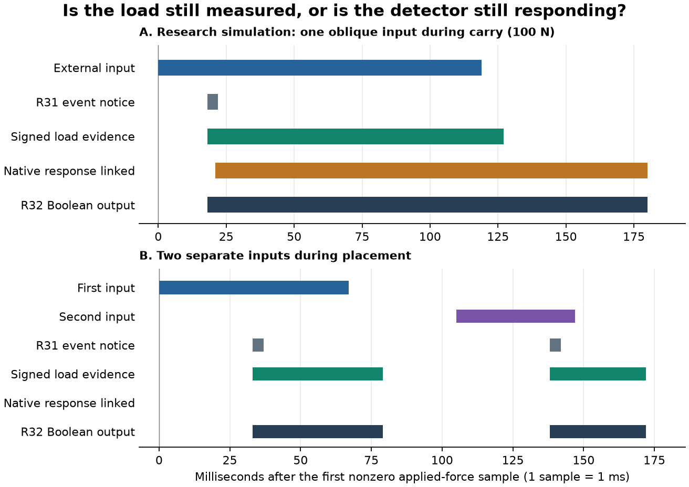

# R32: 새 충격이 시작됐다는 알림과 하중이 계속 측정된다는 신호는 다르다

**이 문서와 아래 그래프는 토크 감지기 연구다. 수업 원본 데모는 [제공 서보·제공 감지기로 실행하는 8 kg 예제](DEMO_SOURCES.md)다.** 이번에도 제공 파일을 수정하지 않고 `run.py --box 8`을 실행했다. 결과는 TCP 오차 RMS 6.14 mm, 최대 14.00 mm, 오경보 7회였고, 생성된 PNG는 교안 내장 그림과 바이트 단위로 같았다. 제출용 세 파일을 그대로 사용한 공식 재실행 58회도 이전과 같다(서보 23/24, 토크 18/24). [원본·제출본·별도 연구의 검증 기록](../results/r32/original-and-release.json)

## 사용자가 고를 수 있는 두 출력

R31은 ‘한 충격을 두 번 알리지 않기’ 위해 새 힘이 시작됐다는 알림을 한 번만 내보냈다. 그래서 **힘이 여전히 작용하는데도 경보가 4 ms 만에 꺼지는** 경우가 생겼다. R32는 단순히 타이머로 경보를 늘리지 않는다.

- **하중 추정(A)**: 상자를 잡은 상태에서 두 힘 추정기가 처음 알린 방향을 계속 지지하는 동안만 경보를 유지한다. 두 추정기 모두 하중이 내려갔거나 방향이 맞지 않으면 끝낸다.
- **경로 인계(B, 코드명 C2)**: 같은 방향의 하중 증거와 원래 감지기의 응답을 분리한다. 알림을 낸 뒤 기존 감지기가 *같은 힘에 반응하기 시작한 것이 확인*되면 그 연속 응답도 표시한다. 기존 감지기 응답은 외력이 사라진 뒤에도 남을 수 있다.
- **사용 방법**: `Detector.update()`의 실제 반환값은 지속 경보이고, `decision.measured_load`와 `decision.linked_native`는 그 근거다. 기존 ‘새 충격’ 인터페이스가 필요한 클라이언트는 같은 모듈의 `NoticeCompatible`을 사용한다. 이는 같은 시뮬레이션 스텝에서 감지기를 한 번만 갱신하고 실제로 R31의 알림을 반환한다. 옆에 기록된 알림을 지속 경보의 상승 횟수로 다시 세지 않는다.



**위 그림 읽기.** 위쪽 100 N 대각 입력(#307)은 실제로 `[3101,3220)` ms에 작용했다. R31 알림은 `[3119,3123)`이고, B에서 두 추정기의 하중 증거는 `[3119,3228)`, 연결된 감지기 응답은 `[3122,3281)`이다. **3281 ms까지 힘이 작용했다는 뜻이 아니다.** 아래 놓기 예제에서는 서로 다른 실제 외력이 `[3395,3462)`, `[3500,3542)`에 작용했다. B의 지속 경보도 `[3428,3474)`, `[3533,3567)`로 분리됐고 둘째 입력 전 필수 무경보 구간을 지켰다. 모든 구간은 1 kHz, 끝 시각을 포함하지 않는다. [세 클라이언트의 실제 구간·힘·잔차 지문](../results/r32/client-compatibility.json)

## 무엇을 개선했고 어디에서 실패했나

원본 키트에 연구용 감지기를 연결해 **180개 단일 충돌, 대응 무충격 189개, 잡기 오차 16개**를 검사했다. A와 B 각각 385회 모두 힘·움직임이 이전 기록과 같았고, 각 입력 전 대응 무충격 궤적을 대조했다. 이미 공개된 입력이다. 다음 표의 ‘겹친 시간’은 **실제 주입 외력이 0이 아닌 전체 21,492개 표본**과 출력이 겹친 수다.

| 실제로 반환한 경보 | 첫 충돌 엄격 검출 /180 | 중복 / 오경보 상승 | 첫 경보가 정확히 4 ms | 외력과 겹친 시간 | 외력이 끝난 뒤 남은 시간¹ |
|---|---:|---:|---:|---:|---:|
| C3 기준 | 146 | 2 / 9 | 0 | 11,684 ms | 4,962 ms |
| R31 | 154 | 2 / 9 | 29 | 10,102 ms | 4,183 ms |
| R32 A | 154 | 2 / 9 | 5 | 12,147 ms | 4,383 ms |
| R32 B | 154 | 2 / 9 | **0** | **12,425 ms** | 4,890 ms |

¹ 충돌별 기존 320 ms 판정 창 안에서만 센 값이다. 외력 뒤 경보를 모두 오경보라고 보지 않는다. 별도 작업대 접촉이나 센서의 후속 응답도 있을 수 있다. [R29·R30을 포함한 전체 비교와 기준별 실패 행](../results/r32/comparison.json) · [4 ms였던 사례와 첫 경보 폭](../results/r32/duration-summary.json)

- **단일 충돌**: R31은 C3보다 첫 경보가 5 ms 넘게 짧은 조건이 41개였다. A에서 35개, B에서 20개가 남았다. B는 상자를 잡고 있던 21개를 복구했지만, **놓은 뒤의 20개는 이 방식으로 바뀌지 않는다.** 반대로 320 ms 창의 총 경보 시간이 C3보다 5 ms 넘게 늘어난 조건은 A 6개, B 17개다.
- **기준 두 개가 충돌하는 경우**: C3의 첫 경보 폭 하한, R31의 첫 알림 지연 상한, R31의 총 경보 시간 상한을 *동시에 같은 불리언*에 적용하면 22개 조건에서 수학적으로 불가능하다. #266 한 건만 보아도 첫 경보가 적어도 **89 ms**여야 하는데, 그 경보가 들어가는 창 전체에서 허용 시간은 **9 ms**다. 기준을 바꿔 통과 처리하지 않았다. [조건별 하한·상한 계산](../results/r32/incompatible-bounds.json)
- **둘째 충격**: 기존 R26 시험에서는 A와 B 모두 R31과 같은 51/57개 슬롯, 함께 준 둘째 충격 6/9개를 구별했다. 별도 교차 방향 시험에서는 A 12/12, B **11/12**였다. B도 둘째를 +96 ms에 알렸지만, 직전 필수 무경보 구간 `[1811,1836)`의 첫 표본에 *두 센서의 하중 추정*이 남았다. 기존 감지기의 잔류 응답 탓이 아니다. 알림 호환 모드를 **실제로 따로 실행**하면 같은 +96 ms에 12/12를 유지한다. 이는 지속 경보의 실패를 지운 것이 아니다. [문제가 된 1 ms와 실제 힘 전체 구간](../results/r32/stress-trace.json) · [서로 다른 반환 모드의 채점](../results/r32/event-guards.json)
- **그 밖의 대조**: 연구 감지기 A·B의 토크 공식 격자는 각각 24/24로 C3의 66개 비시간 셀과 같았다. 방향 대조는 21/24, 정상 33조건의 오경보는 0, 이전 R25 대조는 62/75였다. R26에서 C3 대비 긴 단일 충격의 지속시간 상한을 두 조건에서 넘었고, R31 대비 지속시간 비용 위반은 아홉 조건이다. 기본 제출 토크 18/24와 혼동하지 않는다.
- **서보는 별도 결과다.** 재무장 조건을 두 관측기의 안정된 하중으로 바꾼 후보는 공식 격자에서 23→24/24였지만, 미리 정한 별도 검증에서는 신규 단일 8건 모두 원래 서보도 잡았고 두 충격 4쌍도 양쪽 모두 구별했다. 후보만의 추가 검출은 0건이어서 채택하지 않았다. [결과](../results/r32/servo.json)
- **독립 시험은 열지 않았다.** A가 알려진 폭·지속시간 보호 기준에서 탈락해 미리 잠근 새 조건은 대조군·후보 모두 **0회** 실행했다. B나 다른 후보로 바꿔 재사용하지 않았다. [미등록 영수증](../results/r32/challenge-closed.json)

## 놓은 뒤의 경보도 같은 원리로 바꿀 수 있나

앞의 B는 상자를 놓은 뒤에는 동작하지 않는다. 이때는 **원래 감지기의 신호가 실제로 계속 켜져 있는지**를 따로 검사했다. 이전 방식은 짧은 하중 추정치가 이미 6~7개 표본 연속으로 낮아진 뒤, 긴 추정치가 처음 조용해지는 순간 신호를 끝냈다. 짧은 쪽의 확인 횟수를 3→5로 바꿔도 그 시점에는 이미 두 기준을 넘었으므로 20건 모두 바뀌지 않았다.

새 방식은 원래 종료 결정을 되돌리지 않는다. 직전까지 경보가 켜져 있었고 동일한 단독 감지 경로가 여전히 켜져 있으며, 손이 열려 있고 두 추정값이 계속 낮다는 증거가 있을 때만 **최대 두 표본**을 더 전달한다. 한 표본이라도 근거가 끊기면 그 경로에서는 재시작하지 않는다. #311의 첫 구간은 47→49 ms, #316은 두 번째 추가 표본에서 짧은 추정치의 근거가 사라져 12→13 ms였다. 단순히 모든 경보를 2 ms 늘린 것이 아니다.

이 방식을 B의 **지속 경보에만** 합치고 R31의 알림은 별도로 보존했다. 385조건에서 C3보다 5 ms 넘게 짧은 첫 경보는 **R31 41개 → B 20개 → 결합 1개(#316)**였다. 추가된 45개 표본 중 실제 외력과 겹친 것은 #316의 **1개**뿐이다. 이 수정은 대부분 힘이 끝난 뒤 기존 감지기의 응답을 마무리하는 방식을 고친 것이지, 새 충돌을 찾아낸 것이 아니다. C3 대비 총 경보가 너무 긴 17조건도 그대로 남는다.

**둘째 충격과의 충돌도 확인했다.** 구동기 불감대가 있는 상태에서 첫 충격과 반대 방향으로 다시 밀면, 둘째 외력은 4492 ms에 시작했고 두 방식 모두 4518 ms(+26 ms)에 상승했다. 그런데 새 지속 출력은 첫 충격의 응답을 **4470 ms 한 표본**까지 전달했다. 필수 무경보 구간이 `[4470,4492)`여서 읽기 연장 방식의 둘째 엄격 검출이 6/9→5/9로 줄었다. 둘째를 감지하지 못했다는 뜻은 아니다. 108회로 따로 설계한 **놓기 전용 독립 시험도 열지 않았다**. [사전 조건·미등록 기록](../results/r32/detached-gate.json). 결합 방식의 실제 점수는 R26 50/57(둘째 5/9), 별도 교차 방향 11/12다. 두 계열의 손실을 서로 상쇄해 세지 않았다. [결합·놓기 단독의 행별 변화와 공식 평가](../results/r32/joint-and-readback.json)

실제 소비자에게는 두 값을 따로 제공한다. 아래의 `NoticeClient`는 새 충격을 받는 용도이고, 같은 한 번의 갱신에서 하중 증거·기존 감지기 반응·통합 지속 출력도 꺼낼 수 있다. 입출력 계약을 이 경우와 #266·#316 등에서 원래 R31·지속 출력과 나란히 **27회 실제 실행**했다. 반환한 알림은 모든 표본에서 R31과 같았고, 잔차·적용 외력·움직임도 같았다. 위 4470 ms에서 기존 호환 알림은 **꺼짐**, 옆의 지속 출력은 **켜짐**이었다. [두 인터페이스의 실제 반환 시각](../results/r32/joint-clients.json)

```python
from experiments.r32_alarm_views.client import NoticeClient

detector = NoticeClient()
detector.reset()
# 공개된 원본 시뮬레이터 센서로 매 스텝 단 한 번 호출
residual, notice = detector.update(t, th, thd, tau_motor, tau_spring, grip)
state = detector.decision
# state.event_started: 새 알림 / state.measured_load: 하중 증거
# state.detached_native: 손을 놓은 뒤 원래 신호를 더 전달한 표본
# state.alarm_level: 지속 출력. notice와 서로 다른 용도다.
```

엄격 검출을 놓친 26건 중 19건은 위·아래 수직 입력이었고, 13건은 5 N이었다(서로 겹치는 분류). 첫 경보 폭을 고치는 것만으로 이 충격들을 회복하지는 못했다. [놓친 방향·세기·단계 보기](../results/r32/open-misses.json)

## 재현

아래는 **시뮬레이션 연구용** 명령이다. 수업 원본 그래프나 3D 뷰어는 [원본 전용 명령](DEMO_SOURCES.md)을 사용한다. 수업 키트·교안·메시 파일은 연구 코드에 넣지 않는다. MuJoCo 3.17.0이 설치된 환경과 사용자가 가진 원본 키트, 아직 존재하지 않는 출력 경로를 사용한다.

```bash
KIT=/path/to/original/icpbl_sim
# 4개 감지기를 같은 조건의 실제 키트에서 실행: 단일 충격·대응 정상과 두 충격 대조, 총 52회
python -B tools/r32_level_replay.py compare --kit "$KIT" --scope both --out /tmp/r32-examples
# 키트 없는 독립 실행 ZIP 만들기
python -B tools/r32_level_replay.py build-zip --out /tmp/week09-r32-replay.zip

# 전체 385조건 검증: 먼저 동결된 세 대조군의 전 구간을 생성한 뒤 각 후보를 독립 실행
python -B tools/r31_event_replay.py compare --kit "$KIT" --scope full-d4 --jobs 4 --out /tmp/r31-full
python -B tools/r32_full_census.py --kit "$KIT" --reference /tmp/r31-full/result.json \
  --method load --jobs 4 --out /tmp/r32-load
python -B tools/r32_full_census.py --kit "$KIT" --reference /tmp/r31-full/result.json \
  --method handoff --jobs 4 --out /tmp/r32-handoff
# 놓은 뒤의 변경만 비교하려면 --method readback, 두 변경의 결합은 --method joint (각각 새 출력 경로)
```

예제 ZIP의 SHA-256은 `1c2078c911dbdf879b15a8494d6d2d66646a874c84fd1b0e2b7c3496158ac709`다. 두 번 만든 ZIP이 같았고 저장소 밖에서 풀어 52회(단일 충격 16회, 짝지은 정상 16회, 연속 충격·대조 20회)를 실행했다. [압축·실행 검증](../results/r32/replay.json). 전체 검증 명령은 **저장소 도구**이며 짧은 예제 ZIP에 들어 있는 명령과 다르다. 공개 소스의 깨끗한 키트 복제본에서도 A·B·놓기 연장·결합 각각 385회, 합계 1,540회를 실행했다. A·B의 모든 경보·검출·지속시간 값은 앞선 기록과 같았고, 결합 결과는 별도 실행 파일과 바이트 단위로 같았다. [전체 재실행 영수증](../results/r32/full-reproduction.json). 독립 조건의 일반화, 실제 로봇의 안전 기능, 실시간 성능을 보증하지 않는다.
