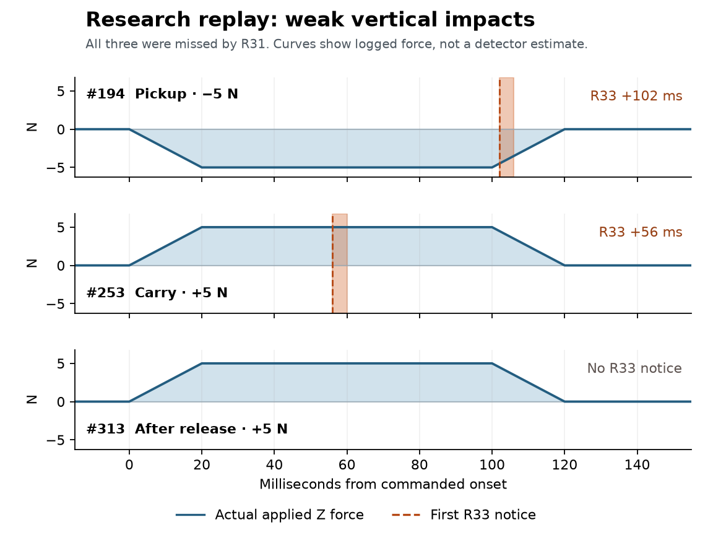

# 약한 수직 충격: 집기·운반에서 놓친 14건을 찾은 방법

**이것은 수업 원본 영상이나 제출 기본 감지기가 아니다.** 원본은 제공 서보와 감지기의 `run.py --box 8`이고, [원본 실행법과 교안 그림 대조](DEMO_SOURCES.md)는 따로 있다. R33은 토크 연구 감지기 R31과 비교한다. 외력을 가하지 않은 같은 상자·동작에서도 경보가 나는지를 함께 확인했다.

**판정: 공개 조건에서 개선됐지만 기본 경보로 채택하지 않았다.** 미리 고정한 독립 시험에서는 외력 중 검출이 12→22/42로 늘었지만 오경보가 0→3회, 기존 엄격 검출 손실이 2건이었다. [사전등록 시험 집계](../results/r33/independent-summary.json)

| 공개 충격 조건 | R31 | R33 | 확인한 변화 |
|---|---:|---:|---|
| 집기 | 50/60 | **57/60** | 수직 ±5·10·15 N 6건과 +XYZ 5 N 1건 |
| 운반 | 53/60 | **60/60** | 수직 7건, 최대 25 N |
| 놓기 | 51/60 | **51/60** | 이번 방식은 놓기 동작을 바꾸지 않는다 |
| 전체 | 154/180 | **168/180** | 중복 2→2, 구분된 오경보 상승 9→9 |

14건의 첫 경보는 외력이 **실제로 작용하던 중**, 입력 시작 후 47–102 ms에 나왔다. 나머지 **371/385개 조건은 경보의 모든 샘플이 R31과 동일**했다. 충격 전후를 넓게 잡아 검출 수를 늘린 결과가 아니다. 외력 없는 189개 기준 동작과 16개 위치 오차 동작을 포함해 385개 모두에서 시간·각도·토크·접촉력 등 9개 물리 기록의 해시를 대조했다. [조건별 회복·잔여 목록](../results/r33/d4.json)



그림: 집기 때의 −5 N은 +102 ms, 운반 때의 +5 N은 +56 ms에 처음 알렸다. 놓은 뒤의 +5 N은 여전히 놓친다. 파란 선은 독립적으로 기록한 외력이며 감지기에 입력하지 않았다. [표본과 대응 무충격 실행](../results/r33/signed-examples.json)

## 어떤 신호를 썼나

- **집기:** 실제 그립 신호가 켜졌을 때 측정한 공구 높이를 기준으로 삼는다. 3 mm 이상 들린 뒤, 역동역학으로 구한 힘과 독립적인 운동량 추정치가 같은 수직 하중을 가리킬 때만 보충 경보를 낸다. 높이별 정상 편차는 공개 충돌과 다른 중량·무게중심 조합의 **무충격 27회만**으로 정했다. 한 번 떠났다가 충격으로 다시 내려온 것을 두 번째 집기로 세지 않는다.
- **운반:** 처음 들어 올리던 속도가 줄고 실제 회전 이동이 시작된 뒤에만 운반 경로를 연다. 두 추정치 모두에서 수직력 변화가 수평력 변화보다 커야 한다. 큰 힘이 아직 증가하는 중이거나 기존 감지기가 같은 힘을 이미 알렸으면 새 알림을 만들지 않는다.
- 새 경로는 실행 시 외력, 과제 시각표, 실제 접촉력, 조건 번호를 읽지 않는다. 역동역학에는 수업 인터페이스가 제공하는 팔·하중 명목 모델을 쓴다. **알림 폭은 힘이 가해진 시간의 추정값이 아니다.** 1 kHz 시뮬레이션의 경보이며 실기 보호 정지 기능이 아니다.

단순히 수직력 임계값을 낮춘 초기안은 집기 6건을 잡는 대신 8개 조건에서 중복을 늘렸다. 운반 초기안도 7건을 잡았지만 비스듬한 충격 10개 조건에서 중복을 늘렸다. 최종안은 이들을 합산하지 않고 새로 385조건을 실행했다. [중간안·정상 대조 결과](../results/r33/development.json)

## 내 키트에서 재현

필수: 본인이 받은 원본 `icpbl_sim` 폴더와 MuJoCo 3.17.0. 아래 실행기는 입력 키트를 수정하지 않고 임시 복사본에서 **각 동작을 R31과 R33으로 별도 실행**한다. 출력 경로는 새 디렉터리여야 한다.

```bash
python -B tools/r33_vertical_replay.py compare --kit /path/to/icpbl_sim --scope smoke --out /tmp/r33-first
python -B tools/r33_vertical_replay.py compare --kit /path/to/icpbl_sim --scope axial19 --out /tmp/r33-axial --jobs 4
python -B tools/r33_vertical_replay.py compare --kit /path/to/icpbl_sim --scope full-d4 --out /tmp/r33-full --jobs 4
```

`smoke`는 세 충격과 무충격 짝의 12회 실행, `axial19`는 놓쳤던 수직 19건과 짝의 76회 실행이다. 후자는 종전 0/19에서 13/19로 늘고 놓기 6건이 남는다. `full-d4`는 385조건 × 2방식이다. 출력 `result.json`에는 경보 구간과 실외력 구간, `receipt.json`에는 입력·결과 해시가 있다. [키트 없는 ZIP 해시 및 실제 재생 영수증](../results/r33/replay.json)

### 남은 한계

공개 조건에서 놓친 12건은 집기 수평 5 N 3건, 놓기 9건(그중 수직 6건)이다. 공개 조건은 개발에 사용했으므로 그 성적으로 처음 보는 충격에서의 성능을 보장할 수 없다. 수업 원본과 R10 제출의 성적은 [별도 검증표](../results/r33/original-and-submission.json)로 분리했다.

### 놓기 방식도 따로 시험했다

별도 후보는 놓은 뒤의 +10 N을 +67 ms, +15 N을 +51 ms에 찾았다. 그러나 +15 N에서는 외력이 끝난 뒤 36 ms에 같은 사건을 다시 알렸다. +5 N에서는 힘 채널과 운동량 채널의 신호가 엇갈렸고 하향 세 건은 이 후보가 작동하는 구간 밖이다. 무충격 짝이 조용했다는 이유로 중복을 무시하지 않았다. **이 2건은 위의 168건에 포함하지 않았고 후보도 결합하지 않았다.** [독립적으로 고정했던 놓기 방식의 검증표](../results/r33/release-study.json)

### 기존 연속 충격에서도 확인했나?

공개된 별도 연속 충격 대조에서 R26의 51/57(둘째 분리 6/9), 교차 방향 12/12, R25의 62/75가 유지됐다. 별도 부호·방향 대조는 24/24, 정상 동작 33개에서는 새 오경보가 없었다. 이 수치들은 385조건에 합산하지 않는다. [물리 기록·대조 방식별 확인표](../results/r33/history.json)

키트 없는 ZIP을 새 폴더에 풀어 전수 모드도 실행했다. **770회 실제 실행**에서 385개 조건 모두 두 감지기의 경보 구간과 대조 판정이 위 전수 결과와 일치했다. 공통 워크스테이션에서 3개 조건을 번갈아 실행한 별도 시간 표본(방식별 6회)의 R33 감지기 p99는 443–572 µs였다. 이는 제어기·구동을 제외한 값이며 실시간 1 ms 마감 보증이 아니다. [측정 조건·에피소드별 시간](../results/r33/timing.json)

## 새 조건에서 달라진 결론

검출기를 고정하고 기존 시험의 보존을 확인한 뒤, 별도로 봉인한 12개 단일 충격과 6개 연속 충격 조건을 한 번만 열었다. 단일 입력은 무충격 짝, 연속 입력은 무충격·첫째만·둘째만·둘 다·긴 힘 한 번과 비교했다. 각 방식 54회, 합계 108회다. 두 방식의 실제 외력, 충격 전 물리 기록, 고정 시간 간격 검사는 통과했다.

| 독립 시험 지표 | R31 | R33 |
|---|---:|---:|
| 구분된 첫 검출(42개 판정 구간) | 16 | 25 |
| 실제 외력 중 첫 검출 | 12 | 22 |
| 오경보 상승 | 0 | 3 |
| 같은 입력에 귀속되는 중복 상승 | 0 | 2 |

단일 충격의 양 방향·여러 작업 구간에서 신규 4건을 찾아 해당 기준은 통과했다. 그러나 둘째 충격을 단독·연속 양쪽에서 외력 중에 새로 구분한 경우는 요구된 최소 2개 대비 1개뿐이었다. 또한 기존에 잡던 엄격 검출 2건을 잃었다. 여기서 ‘잃었다’는 것은 기계가 옛 감지기의 모든 샘플을 지웠다는 뜻이 아니다. 보충 경보가 실제 입력이나 분리 구간보다 먼저 나오면 나중에 기존 경보가 울려도 **새 충격**으로 인정받지 못할 수 있다. 후보 교체·재시험 없이 실패 판정을 유지했다.

**운영 경보와 관측을 분리하는 선택지:** 기본 R10 대신 이 감지기를 연결하라는 뜻이 아니다. 이미 R31을 시험 중이라면 [관측 전용 어댑터](../experiments/r33_observe_only/client.py)는 기존 R31 경보만 반환하고, 미승인 수직 신호는 `observation.pickup_evidence`, `carry_evidence`, `advisory_started`로만 읽을 수 있게 한다. 공개 실제 38회(228,000주기)에서 반환 경보는 별도 실행한 R31과 매 표본 같았고 14개 동작에서 보조 표시가 나왔다. **이 표시는 충돌 확인이나 정지 명령이 아니다.** 소비한 독립 시험에 이 어댑터를 다시 넣지 않았다. [대조 결과](../results/r33/observe-only.json)
