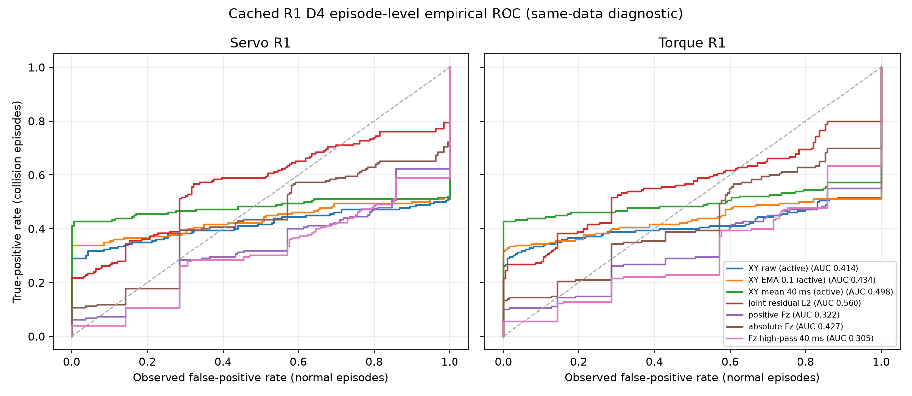

# R4 원인 분석: R1 D4 캐시 재생

## 범위와 자료

이 분석은 새 시뮬레이션 없이 R1 D4 개발 캐시만 다시 읽었다. 공개 인덱스는
[`R3_D4_R1_servo.json`](../results/v2_protocol/R3_D4_R1_servo.json)과
[`R3_D4_R1_torque.json`](../results/v2_protocol/R3_D4_R1_torque.json)이며, 전체 수치와
해시는 [`R4_CAUSE_ANALYSIS.json`](../results/v2_protocol/R4_CAUSE_ANALYSIS.json)에 있다.
서보와 토크 각각 정상 189개, 충돌 180개, 오프셋 16개를 `kind`로 구분했고, 비공개
원시 캐시 385개씩 총 770개의 SHA-256을 공개 인덱스와 대조했다. 불일치는 0개다.
공식 평가와 holdout은 읽지 않았고 모든 사례와 outlier를 유지했다.

허용된 캐시 신호에서 다음 일곱 점수만 유도했다.

1. 고정 R1 정상 모델의 수평 wrench 예측 오차를 active 구간에서만 쓴 원점수
2. 같은 오차의 `alpha=0.1` EMA(active가 꺼지면 0으로 초기화)
3. 같은 오차의 연속 active 구간 내 후행 40 ms 평균
4. gate를 걸지 않은 joint residual L2
5. 추정 wrench의 양의 Fz
6. 추정 wrench의 절댓값 Fz
7. Fz에서 인과 후행 40 ms 평균을 뺀 값의 절댓값

정상 189개 전 시간의 최댓값 바로 위(`nextafter`)를 **진단용 0 관측 오감지
경계**로 삼았다. 이는 protocol 또는 학습에 넘길 운용 임계값이 아니다. 같은 정상
자료의 절대 시각별 최댓값도 비교했지만, 이는 비교 자료를 재사용한 매우 낙관적인
상한이다.

## R1 놓침과 gate

두 방식 모두 충돌 180개 중 69개를 놓쳤다. 공개 `collision_outcome`은
`detect_delay_ms is None`이고 충돌 전 alarm이 없다는 판정과 전부 일치했다. 캐시
`detect` 상승 시각으로 지연을 다시 계산한 결과도 공개 지연과 불일치가 0개였다.

| 항목 | 서보 | 토크 |
|---|---:|---:|
| 놓침 | 69 | 69 |
| 물리 펄스 120 ms 내 learned gate가 계속 꺼진 놓침 | 43 | 46 |
| place 평가창 320 ms 내 learned gate가 계속 꺼진 놓침 | 27 | 29 |
| pick 놓침 중 gate가 120 ms 이후 처음 켜짐 | 16 | 17 |
| pick 펄스 gate 상태(꺼짐/부분/전부 켜짐) | 16/9/0 | 17/8/0 |
| pick 최초 활성 지연 범위 | 61--192 ms | 63--208 ms |

따라서 learned 분기는 상당수 충돌의 물리 펄스 동안 점수를 만들 수 없었다. 다만
R1에는 다른 검출 분기가 OR로 결합되어 있으므로 이것만으로 전체 검출기의 놓침
원인이 확정되지는 않는다. EMA와 4표본 연속 초과가 성립한 시점은 모두 원시
`detect`가 참이었다(위반 0개). 이 검사는 **onset 함의**만 재생한 것이며 8표본
clear latch 파형 전체를 재현한 것은 아니다.

## episode 단위 경험적 ROC와 진단용 headroom

각 정상 episode의 전 주기 점수 최댓값을 음성 표본, 각 충돌 episode의 320 ms
평가창 점수 최댓값을 양성 표본으로 두고 엄격한 `점수 > 경계` 규칙의 경험적 ROC를
계산했다. 방식별 표본은 정상 189개와 충돌 180개다. 아래 곡선과 AUC는 **같은 개발
캐시를 이용한 비독립 진단**이며 후보 선택 임계값이나 일반화 성능이 아니다.

| 점수 | 서보 AUC | 토크 AUC |
|---|---:|---:|
| 수평 원점수 | 0.414 | 0.414 |
| 수평 EMA | 0.433 | 0.434 |
| 수평 40 ms 평균 | 0.481 | 0.498 |
| joint L2 | 0.565 | 0.560 |
| 양의 Fz | 0.324 | 0.322 |
| 절댓값 Fz | 0.425 | 0.427 |
| Fz 고역 성분 | 0.310 | 0.305 |

전체 ROC에서 어느 단일 점수도 강한 episode 분리를 보이지 않았다. 이는 이 개발
캐시의 진단 결과일 뿐 전역적 불가능성의 증명은 아니다.

### 정상 최대 경계의 0 관측 오감지 점

표의 `전체`는 충돌 180개 중 경계를 넘은 수, `추가`는 기존 놓침 69개 중 경계를
넘은 수다. `1/4`는 각각 1표본/4표본 연속 초과다. 정상 자료에서 경계를 정했기
때문에 독립 검증점이 아니라 위 경험적 ROC에 포함되는 동일 자료의 0 관측 오감지
진단점이다.

| 방식 | 점수 | 경계 | 전체 1/4 | 추가 1/4 |
|---|---|---:|---:|---:|
| 서보 | 수평 원점수 | 13.771294 | 52/44 | 1/0 |
| 서보 | 수평 EMA | 7.086429 | 61/59 | 5/4 |
| 서보 | 수평 40 ms 평균 | 5.095053 | 74/70 | **17/13** |
| 서보 | joint L2 | 34.449091 | 39/35 | 0/0 |
| 서보 | 양의 Fz | 36.533715 | 11/11 | 0/0 |
| 서보 | 절댓값 Fz | 36.533715 | 19/18 | 0/0 |
| 서보 | Fz 고역 성분 | 33.209683 | 7/7 | 0/0 |
| 토크 | 수평 원점수 | 14.043865 | 47/41 | 0/0 |
| 토크 | 수평 EMA | 6.645793 | 57/56 | 0/0 |
| 토크 | 수평 40 ms 평균 | 4.428600 | 77/74 | **15/14** |
| 토크 | joint L2 | 32.820333 | 39/37 | 0/0 |
| 토크 | 양의 Fz | 33.459277 | 18/12 | 0/0 |
| 토크 | 절댓값 Fz | 33.459277 | 24/18 | 0/0 |
| 토크 | Fz 고역 성분 | 29.736744 | 10/7 | 1/0 |

일곱 점수의 합집합은 서보에서 추가 놓침 17/13개, 토크에서 16/14개를 포착했다.
반대로 모든 점수가 정상 전역 최댓값 아래인 놓침은 서보 52개, 토크 53개였다.
동일 자료의 시각별 정상 envelope를 쓰면 1표본 기준 두 방식 모두 69개, 4표본
기준 서보 61개와 토크 60개가 초과한다. 이 큰 차이는 절대 시각 정렬 정보를 이미
알고 비교한 낙관적 결과이며, 일반화 또는 전역 분리 가능성을 뜻하지 않는다.

## 40 ms 평균의 추가 포착 층화

전역 정상 최대 경계에서 40 ms 평균이 추가 포착한 놓침은 다음과 같다.

| 방식 | 위상 | 힘 | 물리 펄스 종료 뒤 첫 초과 |
|---|---|---|---:|
| 서보 | pick 10, transport 7, place 0 | 5 N 8, 10 N 7, 15 N 2 | 5 |
| 토크 | pick 7, transport 8, place 0 | 5 N 11, 10 N 3, 15 N 1 | 2 |

두 방식 모두 `+z`와 `-z` 추가 포착은 0개다. 전체 놓침에서 `+z`와 `-z`를 합치면
각 방식에서 pick 6개, transport 7개, place 6개다. 즉 ±z의 pick/place는 12개이고,
`+z`만 보면 pick 3개와 place 3개로 6개다.

## 판정

### 캐시로 확인한 사실

- learned gate가 물리 펄스 전체를 가린 놓침은 서보 43개, 토크 46개다.
- place 놓침은 각각 27개와 29개 모두 평가창 전체에서 learned gate가 꺼져 있었다.
- 후행 40 ms 수평 오차 평균만 전역 정상 최대 경계에서 의미 있는 추가 headroom을
  보였다. 다른 단독 점수의 추가 포착은 서보 최대 5개, 토크 최대 1개였다.
- 40 ms 평균의 추가 포착에도 늦은 첫 초과가 있으며, 모든 놓침을 분리하지 못했다.
- 질량, 위상, 힘, 방향 전 층에 놓침이 남아 단일 질량 또는 단일 힘 문제로 축약되지
  않는다.

### 제한된 추론

- 후행 평균 결과는 짧은 순간값보다 지속된 수평 예측 오차가 다음 후보 축으로 더
  유망하다는 가설을 지지한다. 독립 자료에서 효능과 오감지를 다시 판정해야 한다.
- `+z`와 `-z`를 합친 놓침이 방식마다 pick 6개와 place 6개이고 이들에 40 ms 수평
  평균 headroom이 없다는 관찰은 table-normal 접촉 모호성과 **일관된다**. `+z`만의
  pick/place는 각각 3개다. 캐시만으로 원인을 식별하지 못하며, 수직 충돌이 전역적으로
  분리 불가능하다고 주장하지 않는다.
- learned gate 비활성은 learned 분기의 배제 원인으로 확인되지만, OR 결합된 전체 R1의
  유일한 놓침 원인이라는 추론은 허용되지 않는다.

## 한계와 다음 단계 경계

이 결과는 같은 개발 캐시에서 정상 최댓값과 충돌 headroom을 함께 본 원인 분석이다.
시각별 envelope는 특히 낙관적이며 실제 운용에는 절대 시각 오차와 새로운 정상 변동이
있다. 여기에 적힌 숫자 경계를 protocol 임계값, 학습 label, 후보 튜닝값으로 복사하지
않는다. 다음 후보는 별도 protocol에서 사전 고정한 validation 기준으로 평가해야 하며,
holdout 또는 공식 결과를 보고 다시 설계해서는 안 된다.
